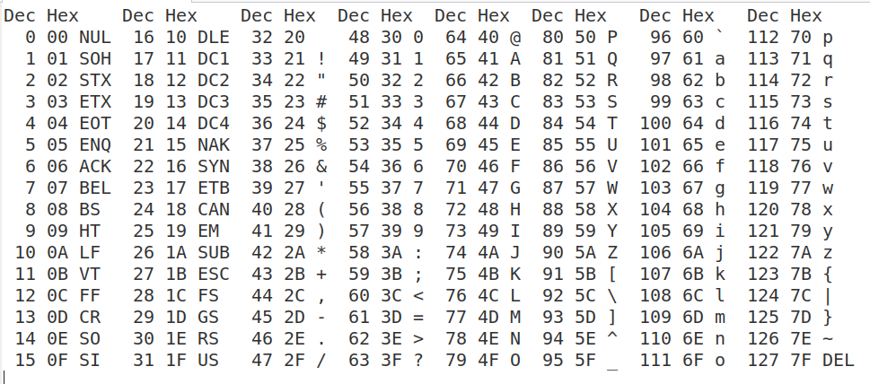
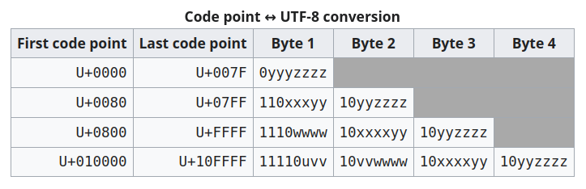
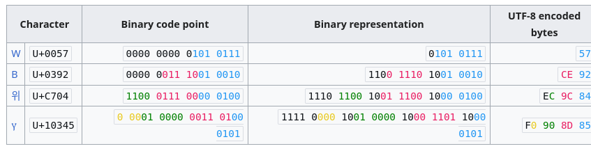
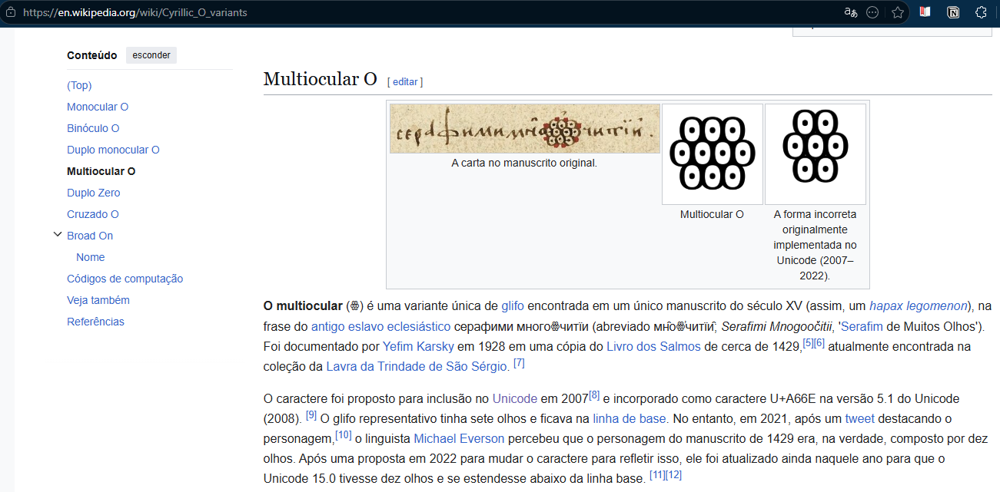

# Compressão de Dados

## Armazenamento de Dados

Desde que começamos a **armazenar dados**, a questão do tamanho dos dados obtidos é algo de vital importância e determina

::: {.incremental}
- quantas fotos podemos manter nos nossos telefones celulares
- quanto tempo vai durar o download de um dado arquivo
- quanto de espaço vai ser necessário reservar nos nossos discos rígidos
- quanto ocuparão nossos livros digitais
:::

. . .

<br>

Tipicamente, quanto **menor o tamanho da representação de um dado objeto, melhor**.

## Compressão de Dados

**Compressão** visa [reduzir o tamanho]{.alert} de um determinado tipo de dado, de forma a ser ainda possível acessar a informação contida neste.

. . .

Tipicamente, há dois tipos de compressão:

::: {.incremental}
- [**com perdas (lossy):**]{.alert} tipicamente no caso de imagens e vídeos, a compressão causa perda de informação, porém esta perda pode não ser crucial frente ao ganho de espaço associado (Ex: JPEG)
- [**sem perdas (lossless):**]{style="color:#3a7a10"} mantém toda a informação do arquivo original (Ex: ZIP)
:::

. . .

<br>

Vamos, nesta aula, considerar o caso de **compressão sem perdas** de **arquivos de texto**.

## Arquivos de Texto

::: {style="font-size:0.9em;"}
Para armazenar texto em computadores, usamos mapeamentos de caracteres para números. Os mais importantes são:

::: {.incremental}
- padrão **ASCII** (*American Standard Code for Information Interchange*): 0 a 127, representa letras minúsculas, maiúsculas e símbolos de controle.
- padrão **UNICODE**: 0 a 1.114.111 (U+10FFFF), representa todos os sistemas de escrita das principais linguagens humanas, além de símbolos matemáticos e de controle.
:::

::: {.fragment}
Para armazenar caracteres **UNICODE**, existem diversas codificações:

- **UTF-8** (1 a 4 bytes, tamanho variável, compatível com ASCII)
- **UTF-16** (2 ou 4 bytes, tamanho variável)
- **UCS-2** (2 bytes, tamanho fixo, limitado)
- **UTF-32** (4 bytes, tamanho fixo)

UTF significa *Unicode Transformation Format*.
:::
:::

## ASCII

{width=100% fig-align="center"}

## UNICODE

Todos os símbolos UNICODE: [symbl.cc/pt/unicode-table](https://symbl.cc/pt/unicode-table/)

. . .

Angzarr (U+237C ⍼) -- *Why Nobody Knows What This One Unicode Character Means*:

```{=html}
<iframe src="https://www.youtube.com/embed/cCoed5Oo_J4" title="Why Nobody Knows What This One Unicode Character Means" style="display:block; margin:0.4em auto 0; width:80%; aspect-ratio:16/9; border:1px solid #dde3e7; border-radius:8px;" allow="fullscreen" allowfullscreen></iframe>
<div style="text-align:center; margin-top:0.35em; font-size:0.6em;"><a href="https://www.youtube.com/watch?v=cCoed5Oo_J4" target="_blank" data-preview-link="false">youtube.com/watch?v=cCoed5Oo_J4</a></div>
```

## UTF-8

{width=70% fig-align="center"}

. . .

::: {style="font-size:0.85em;"}
**U+uvwxyz** seria a palavra representada, onde u, v, w, x, y e z representam bits individuais (agrupados em 4 por caractere hexadecimal).
:::

. . .

::: {style="font-size:0.85em;"}
**Exemplos:**
:::

{width=85% fig-align="center"}

## Many-Eyed Seraphim

{width=75% fig-align="center"}

## Many-Eyed Seraphim

**U+A66E** [ꙮ]{style="font-size:1.4em;"} (*Cyrillic Letter Multiocular O*)

. . .

{width=90% fig-align="center"}

::: {style="text-align:center; font-size:0.7em;"}
[en.wikipedia.org/wiki/Many-eyed_Seraphim](https://en.wikipedia.org/wiki/Many-eyed_Seraphim){target="_blank" data-preview-link="false"}
:::

# Codificações Prefix-Free Ótimas

## Codificações de Texto

Por simplicidade, vamos começar considerando alfabetos menores e suas possíveis codificações. Considere $\Sigma = \{A, B, C, D\}$.

:::: {.columns}
::: {.column width="50%"}
Uma possibilidade de codificação seria:

::: {style="font-size:0.8em;"}
| **Símbolo** | **Codificação** |
|:-:|:-:|
| $A$ | `00` |
| $B$ | `01` |
| $C$ | `10` |
| $D$ | `11` |
:::
:::
::: {.column .fragment width="50%"}
Poderíamos querer reduzir o espaço utilizado tentando uma codificação **de tamanho variável**:

::: {style="font-size:0.8em;"}
| **Símbolo** | **Codificação** |
|:-:|:-:|
| $A$ | `0` |
| $B$ | `01` |
| $C$ | `10` |
| $D$ | `1` |
:::
:::
::::

::: {.fragment}
[**Pergunta:**]{.label-qstn} Algum problema com a codificação de tamanho variável apresentada? Qual seria a decodificação da string $10001$?
:::

::: {.fragment style="font-size:0.85em;"}
**Ambígua!** $10001$ pode ser lida como $CAB$, $CAAD$, $DAAB$ ou $DAAAD$: o código de $A$ é prefixo do de $B$, e o de $D$ é prefixo do de $C$.
:::

## Codificações Prefix-Free

> [**Definição:**]{.label-def} Uma codificação de texto é **prefix-free** (livre de prefixo) quando, para quaisquer dois símbolos distintos $a$ e $b$, a codificação de $a$ não é prefixo da codificação de $b$ (e vice-versa).

. . .

<br>

Se uma codificação é livre de prefixo, [não há ambiguidade na decodificação]{.alert}.

. . .

<br>

:::: {.columns style="display: flex; align-items: center;"}
::: {.column width="50%"}
[**Exemplo:**]{.label-exmp}

::: {style="font-size:0.8em;"}
| **Símbolo** | **Codificação** |
|:-:|:-:|
| $A$ | `0` |
| $B$ | `10` |
| $C$ | `110` |
| $D$ | `111` |
:::
:::
::: {.column .fragment width="50%"}
Basta ler os bits até completar um código:

$$
\underbrace{110}_{C}\;\underbrace{0}_{A}\;\underbrace{111}_{D}\;\underbrace{10}_{B}
$$
:::
::::

## Eficiência de uma Codificação Prefix-Free

Quando símbolos ocorrem com frequências distintas, um código prefix-free pode ser mais ou menos eficiente: **quanto menos bits para representar um caractere em média, melhor**.

. . .

:::: {.columns}
::: {.column width="35%"}
Assuma a seguinte tabela de frequências:

::: {style="font-size:0.75em;"}
| **Símbolo** | **Frequência** |
|:-:|:-:|
| $A$ | 60% |
| $B$ | 25% |
| $C$ | 10% |
| $D$ | 5% |
:::
:::
::: {.column .fragment width="65%"}
Podemos então comparar os dois códigos (fixo e variável):

::: {style="font-size:0.75em;"}
| **Símbolo** | **Tamanho fixo** | **Prefix-free (variável)** |
|:-:|:-:|:-:|
| $A$ | `00` | `0` |
| $B$ | `01` | `10` |
| $C$ | `10` | `110` |
| $D$ | `11` | `111` |
:::
:::
::::

::: {.fragment}
[**Pergunta:**]{.label-qstn} Qual a **média do número de bits** necessário para codificar cada caractere em cada um dos códigos?
:::

::: {.incremental style="font-size:0.85em;"}
- **Fixo:** $2$ bits por caractere.
- **Variável:** $0{,}60 \cdot 1 + 0{,}25 \cdot 2 + 0{,}10 \cdot 3 + 0{,}05 \cdot 3 = 1{,}55$ bits por caractere.
:::

## Problema do Código Prefix-Free Ótimo

**Entrada:** Uma tabela de frequências não-negativas $p_a$ para cada símbolo $a$ de um alfabeto $\Sigma$ de tamanho $\geq 2$.

. . .

<br>

**Saída:** Um código binário *prefix-free* com o [menor]{.alert} tamanho médio de codificação (por caractere):

$$
\sum_{a \in \Sigma} p_a \times (\text{número de bits para codificar } a).
$$

. . .

<br>

Vamos discutir agora como **representar** tais códigos, e como construir um código ótimo segundo uma **estratégia gulosa** proposta por **Huffman**.

## Códigos como Árvores

:::: {.columns style="display: flex; align-items: center;"}
::: {.column width="40%"}
::: {style="font-size:0.75em;"}
| **Símbolo** | **Codificação** |
|:-:|:-:|
| $A$ | `00` |
| $B$ | `01` |
| $C$ | `10` |
| $D$ | `11` |
:::
:::
::: {.column .fragment width="60%"}
```{=html}
<svg viewBox="0 0 360 172" style="display:block; margin:0 auto; width:19em; max-width:100%; height:auto;" xmlns="http://www.w3.org/2000/svg" role="img" aria-label="Árvore do código de tamanho fixo: A=00, B=01, C=10, D=11; todos os símbolos nas folhas">
<line x1="180.0" y1="22.0" x2="105.0" y2="84.0" stroke="#555555" stroke-width="2.5"/>
<text x="134.2" y="43.0" font-size="18" text-anchor="middle" dominant-baseline="central" fill="#2e75b6" font-family="KaTeX_Main, 'Times New Roman', serif" font-weight="bold">0</text>
<line x1="180.0" y1="22.0" x2="255.0" y2="84.0" stroke="#555555" stroke-width="2.5"/>
<text x="225.8" y="43.0" font-size="18" text-anchor="middle" dominant-baseline="central" fill="#2e75b6" font-family="KaTeX_Main, 'Times New Roman', serif" font-weight="bold">1</text>
<line x1="105.0" y1="84.0" x2="142.5" y2="146.0" stroke="#555555" stroke-width="2.5"/>
<text x="134.9" y="108.3" font-size="18" text-anchor="middle" dominant-baseline="central" fill="#2e75b6" font-family="KaTeX_Main, 'Times New Roman', serif" font-weight="bold">1</text>
<line x1="105.0" y1="84.0" x2="67.5" y2="146.0" stroke="#555555" stroke-width="2.5"/>
<text x="75.1" y="108.3" font-size="18" text-anchor="middle" dominant-baseline="central" fill="#2e75b6" font-family="KaTeX_Main, 'Times New Roman', serif" font-weight="bold">0</text>
<line x1="255.0" y1="84.0" x2="217.5" y2="146.0" stroke="#555555" stroke-width="2.5"/>
<text x="225.1" y="108.3" font-size="18" text-anchor="middle" dominant-baseline="central" fill="#2e75b6" font-family="KaTeX_Main, 'Times New Roman', serif" font-weight="bold">0</text>
<line x1="255.0" y1="84.0" x2="292.5" y2="146.0" stroke="#555555" stroke-width="2.5"/>
<text x="284.9" y="108.3" font-size="18" text-anchor="middle" dominant-baseline="central" fill="#2e75b6" font-family="KaTeX_Main, 'Times New Roman', serif" font-weight="bold">1</text>
<circle cx="180.0" cy="22.0" r="8" fill="#ffffff" stroke="#23373b" stroke-width="2"/>
<circle cx="105.0" cy="84.0" r="8" fill="#ffffff" stroke="#23373b" stroke-width="2"/>
<circle cx="255.0" cy="84.0" r="8" fill="#ffffff" stroke="#23373b" stroke-width="2"/>
<circle cx="142.5" cy="146.0" r="16" fill="#23373b" stroke="#152224" stroke-width="2"/>
<text x="142.5" y="146.0" font-size="16" text-anchor="middle" dominant-baseline="central" fill="#ffffff" font-family="KaTeX_Math, 'Times New Roman', serif" font-style="italic" font-weight="bold">B</text>
<circle cx="67.5" cy="146.0" r="16" fill="#23373b" stroke="#152224" stroke-width="2"/>
<text x="67.5" y="146.0" font-size="16" text-anchor="middle" dominant-baseline="central" fill="#ffffff" font-family="KaTeX_Math, 'Times New Roman', serif" font-style="italic" font-weight="bold">A</text>
<circle cx="217.5" cy="146.0" r="16" fill="#23373b" stroke="#152224" stroke-width="2"/>
<text x="217.5" y="146.0" font-size="16" text-anchor="middle" dominant-baseline="central" fill="#ffffff" font-family="KaTeX_Math, 'Times New Roman', serif" font-style="italic" font-weight="bold">C</text>
<circle cx="292.5" cy="146.0" r="16" fill="#23373b" stroke="#152224" stroke-width="2"/>
<text x="292.5" y="146.0" font-size="16" text-anchor="middle" dominant-baseline="central" fill="#ffffff" font-family="KaTeX_Math, 'Times New Roman', serif" font-style="italic" font-weight="bold">D</text>
</svg>
```
:::
::::

. . .

:::: {.columns style="display: flex; align-items: center;"}
::: {.column width="40%"}
::: {style="font-size:0.75em;"}
| **Símbolo** | **Codificação** |
|:-:|:-:|
| $A$ | `0` |
| $B$ | `01` |
| $C$ | `10` |
| $D$ | `1` |
:::
:::
::: {.column .fragment width="60%"}
```{=html}
<svg viewBox="0 0 360 172" style="display:block; margin:0 auto; width:19em; max-width:100%; height:auto;" xmlns="http://www.w3.org/2000/svg" role="img" aria-label="Árvore do código de tamanho variável A=0, B=01, C=10, D=1: A e D ocupam nodos internos">
<line x1="180.0" y1="22.0" x2="105.0" y2="84.0" stroke="#555555" stroke-width="2.5"/>
<text x="134.2" y="43.0" font-size="18" text-anchor="middle" dominant-baseline="central" fill="#2e75b6" font-family="KaTeX_Main, 'Times New Roman', serif" font-weight="bold">0</text>
<line x1="180.0" y1="22.0" x2="255.0" y2="84.0" stroke="#555555" stroke-width="2.5"/>
<text x="225.8" y="43.0" font-size="18" text-anchor="middle" dominant-baseline="central" fill="#2e75b6" font-family="KaTeX_Main, 'Times New Roman', serif" font-weight="bold">1</text>
<line x1="105.0" y1="84.0" x2="142.5" y2="146.0" stroke="#555555" stroke-width="2.5"/>
<text x="134.9" y="108.3" font-size="18" text-anchor="middle" dominant-baseline="central" fill="#2e75b6" font-family="KaTeX_Main, 'Times New Roman', serif" font-weight="bold">1</text>
<line x1="255.0" y1="84.0" x2="217.5" y2="146.0" stroke="#555555" stroke-width="2.5"/>
<text x="225.1" y="108.3" font-size="18" text-anchor="middle" dominant-baseline="central" fill="#2e75b6" font-family="KaTeX_Main, 'Times New Roman', serif" font-weight="bold">0</text>
<circle cx="180.0" cy="22.0" r="8" fill="#ffffff" stroke="#23373b" stroke-width="2"/>
<circle cx="105.0" cy="84.0" r="16" fill="#23373b" stroke="#152224" stroke-width="2"/>
<text x="105.0" y="84.0" font-size="16" text-anchor="middle" dominant-baseline="central" fill="#ffffff" font-family="KaTeX_Math, 'Times New Roman', serif" font-style="italic" font-weight="bold">A</text>
<circle cx="255.0" cy="84.0" r="16" fill="#23373b" stroke="#152224" stroke-width="2"/>
<text x="255.0" y="84.0" font-size="16" text-anchor="middle" dominant-baseline="central" fill="#ffffff" font-family="KaTeX_Math, 'Times New Roman', serif" font-style="italic" font-weight="bold">D</text>
<circle cx="142.5" cy="146.0" r="16" fill="#23373b" stroke="#152224" stroke-width="2"/>
<text x="142.5" y="146.0" font-size="16" text-anchor="middle" dominant-baseline="central" fill="#ffffff" font-family="KaTeX_Math, 'Times New Roman', serif" font-style="italic" font-weight="bold">B</text>
<circle cx="217.5" cy="146.0" r="16" fill="#23373b" stroke="#152224" stroke-width="2"/>
<text x="217.5" y="146.0" font-size="16" text-anchor="middle" dominant-baseline="central" fill="#ffffff" font-family="KaTeX_Math, 'Times New Roman', serif" font-style="italic" font-weight="bold">C</text>
</svg>
```
:::
::::

## Códigos como Árvores

:::: {.columns style="display: flex; align-items: center;"}
::: {.column width="40%"}
::: {style="font-size:0.75em;"}
| **Símbolo** | **Codificação** |
|:-:|:-:|
| $A$ | `0` |
| $B$ | `10` |
| $C$ | `110` |
| $D$ | `111` |
:::
:::
::: {.column .fragment width="60%"}
```{=html}
<svg viewBox="0 0 400 234" style="display:block; margin:0 auto; width:22em; max-width:100%; height:auto;" xmlns="http://www.w3.org/2000/svg" role="img" aria-label="Árvore do código prefix-free A=0, B=10, C=110, D=111: todos os símbolos nas folhas">
<line x1="200.0" y1="22.0" x2="115.0" y2="84.0" stroke="#555555" stroke-width="2.5"/>
<text x="149.8" y="42.5" font-size="18" text-anchor="middle" dominant-baseline="central" fill="#2e75b6" font-family="KaTeX_Main, 'Times New Roman', serif" font-weight="bold">0</text>
<line x1="200.0" y1="22.0" x2="285.0" y2="84.0" stroke="#555555" stroke-width="2.5"/>
<text x="250.2" y="42.5" font-size="18" text-anchor="middle" dominant-baseline="central" fill="#2e75b6" font-family="KaTeX_Main, 'Times New Roman', serif" font-weight="bold">1</text>
<line x1="285.0" y1="84.0" x2="242.5" y2="146.0" stroke="#555555" stroke-width="2.5"/>
<text x="253.0" y="107.6" font-size="18" text-anchor="middle" dominant-baseline="central" fill="#2e75b6" font-family="KaTeX_Main, 'Times New Roman', serif" font-weight="bold">0</text>
<line x1="285.0" y1="84.0" x2="327.5" y2="146.0" stroke="#555555" stroke-width="2.5"/>
<text x="317.0" y="107.6" font-size="18" text-anchor="middle" dominant-baseline="central" fill="#2e75b6" font-family="KaTeX_Main, 'Times New Roman', serif" font-weight="bold">1</text>
<line x1="327.5" y1="146.0" x2="306.2" y2="208.0" stroke="#555555" stroke-width="2.5"/>
<text x="304.6" y="172.8" font-size="18" text-anchor="middle" dominant-baseline="central" fill="#2e75b6" font-family="KaTeX_Main, 'Times New Roman', serif" font-weight="bold">0</text>
<line x1="327.5" y1="146.0" x2="348.8" y2="208.0" stroke="#555555" stroke-width="2.5"/>
<text x="350.4" y="172.8" font-size="18" text-anchor="middle" dominant-baseline="central" fill="#2e75b6" font-family="KaTeX_Main, 'Times New Roman', serif" font-weight="bold">1</text>
<circle cx="200.0" cy="22.0" r="8" fill="#ffffff" stroke="#23373b" stroke-width="2"/>
<circle cx="115.0" cy="84.0" r="16" fill="#23373b" stroke="#152224" stroke-width="2"/>
<text x="115.0" y="84.0" font-size="16" text-anchor="middle" dominant-baseline="central" fill="#ffffff" font-family="KaTeX_Math, 'Times New Roman', serif" font-style="italic" font-weight="bold">A</text>
<circle cx="285.0" cy="84.0" r="8" fill="#ffffff" stroke="#23373b" stroke-width="2"/>
<circle cx="242.5" cy="146.0" r="16" fill="#23373b" stroke="#152224" stroke-width="2"/>
<text x="242.5" y="146.0" font-size="16" text-anchor="middle" dominant-baseline="central" fill="#ffffff" font-family="KaTeX_Math, 'Times New Roman', serif" font-style="italic" font-weight="bold">B</text>
<circle cx="327.5" cy="146.0" r="8" fill="#ffffff" stroke="#23373b" stroke-width="2"/>
<circle cx="306.2" cy="208.0" r="16" fill="#23373b" stroke="#152224" stroke-width="2"/>
<text x="306.2" y="208.0" font-size="16" text-anchor="middle" dominant-baseline="central" fill="#ffffff" font-family="KaTeX_Math, 'Times New Roman', serif" font-style="italic" font-weight="bold">C</text>
<circle cx="348.8" cy="208.0" r="16" fill="#23373b" stroke="#152224" stroke-width="2"/>
<text x="348.8" y="208.0" font-size="16" text-anchor="middle" dominant-baseline="central" fill="#ffffff" font-family="KaTeX_Math, 'Times New Roman', serif" font-style="italic" font-weight="bold">D</text>
</svg>
```
:::
::::

::: {.fragment}
<br>

[**Pergunta:**]{.label-qstn} Como **confirmar** que um código é *prefix-free* a partir da árvore correspondente?
:::

::: {.fragment style="font-size:0.85em;"}
Basta verificar que **todos os símbolos estão em folhas**. Um símbolo em um nodo interno é prefixo de todos os símbolos da sua subárvore (no slide anterior: $A = 0$ é prefixo de $B = 01$).
:::

## Códigos como Árvores: Propriedades

> [**Proposição:**]{.label-thm} Toda **árvore binária** com **cada símbolo do alfabeto ocorrendo em no máximo um nodo** corresponde a [exatamente uma codificação binária do alfabeto]{.alert}.

<br>

::: {.incremental}
- Nesta representação como árvore, a **profundidade do nodo** onde se encontra um determinado símbolo corresponde ao **número de bits** necessários para representá-lo.
- Árvores onde os símbolos ocorrem exclusivamente **nas folhas** correspondem a códigos **prefix-free**.
:::

## Problema do Código Prefix-Free Ótimo (Árvores)

> [**Definição:**]{.label-def} Seja **$\Sigma$-árvore** uma árvore contendo cada símbolo de $\Sigma$ em exatamente uma de suas folhas.

. . .

<br>

**Entrada:** Uma tabela de frequências não-negativas $p_a$ para cada símbolo $a$ de um alfabeto $\Sigma$ de tamanho $\geq 2$.

. . .

<br>

**Saída:** Uma $\Sigma$-árvore com o [menor]{.alert} tamanho médio de codificação (por caractere):

$$
\sum_{a \in \Sigma} p_a \times (\text{profundidade de } a \text{ na árvore}).
$$

# Codificação de Huffman

## Algoritmo de Huffman

**Algoritmo de Huffman** (1951): Constrói uma $\Sigma$-árvore ótima a partir da tabela de frequências de símbolos.

. . .

<br>

Construção é **bottom-up** e **gulosa**.

. . .

<br>

**Ideia fundamental:** Os caracteres que aparecem menos devem ser agrupados primeiro (pois vão ocorrer como os códigos de maior tamanho na árvore final).

. . .

<br>

[**Curiosidade:**]{.label-rmk} Esse foi um problema de sala de aula proposto pelo professor de David A. Huffman (Robert M. Fano), que tinha uma proposta top-down sub-ótima para o mesmo problema.

::: {style="font-size:0.6em; margin-top:0.6em;"}
[D. A. Huffman. *A Method for the Construction of Minimum-Redundancy Codes*. Proceedings of the IRE, 1952.](https://doi.org/10.1109/JRPROC.1952.273898){target="_blank" data-preview-link="false"}
:::

## Algoritmo de Huffman: Aplicações

::: {.incremental}
- Compressão de arquivos em formatos como ZIP, GZIP e PNG.
- Codificação eficiente de dados em sistemas de transmissão digital.
- Compressão de áudio e imagem em formatos multimídia, como MP3 e JPEG.
- Otimização da largura de banda em redes de comunicação.
- Aplicação em telecomunicações para minimizar redundâncias em mensagens.
- Emprego em compiladores e técnicas de representação compacta de símbolos.
:::

## Visualização do Algoritmo de Huffman

```{=html}
<iframe id="huffman-viz" src="https://lucasalegre.github.io/huffman-visualizer/?exemplo=aula22-2" title="Visualização do algoritmo de Huffman" style="display:block; width:100%; height:595px; border:1px solid #dde3e7; border-radius:8px;" allow="fullscreen" allowfullscreen></iframe>
<div style="display:flex; justify-content:space-between; align-items:center; margin-top:0.35em; font-size:0.6em;">
  <span><a href="https://lucasalegre.github.io/huffman-visualizer/?exemplo=aula22-2" target="_blank" data-preview-link="false">lucasalegre.github.io/huffman-visualizer</a> &nbsp;·&nbsp; <a href="https://see-algorithms.com/other/HuffmanCoding" target="_blank" data-preview-link="false">see-algorithms.com/other/HuffmanCoding</a></span>
  <button type="button" onclick="const f = document.getElementById('huffman-viz'); (f.requestFullscreen || f.webkitRequestFullscreen).call(f);" style="font: inherit; padding: 0.25em 0.8em; border: 1px solid #2e75b6; border-radius: 6px; background: #2e75b6; color: #fff; cursor: pointer;">⛶ Tela cheia</button>
</div>
```


## Algoritmo de Huffman: Pseudocódigo

**Entrada:** alfabeto $\Sigma$ e tabela $p_a$ para cada símbolo $a \in \Sigma$.

**Saída:** $\Sigma$-árvore ótima.

. . .

```pseudocode
#| html-line-number: true
#| html-no-end: true

\begin{algorithmic}
\Procedure{Huffman}{$\Sigma, p$}
  \For{$a \in \Sigma$}
    \State $T_a \gets$ árvore contendo um nodo rotulado $a$
    \State $P(T_a) \gets p_a$
  \EndFor
  \State $F \gets \{T_a\}_{a \in \Sigma}$
  \While{$F$ contém 2 ou mais árvores}
    \State $T_1 \gets$ árvore de menor $P$
    \State $T_2 \gets$ árvore de segundo menor $P$
    \State $F \gets F \setminus \{T_1, T_2\}$
    \State $T_3 \gets$ composição de $T_1$ e $T_2$ \Comment{$T_1$ e $T_2$ viram filhos de uma nova raiz}
    \State $P(T_3) \gets P(T_1) + P(T_2)$
    \State $F \gets F \cup \{T_3\}$
  \EndWhile
  \State \textbf{Retorne} a única árvore em $F$
\EndProcedure
\end{algorithmic}
```


## Exemplo de Execução

```{=html}
<p style="font-size:0.65em; margin:0 0 0.3em;"><strong>Frequências:</strong> <span class="math inline">A</span>: 60%, <span class="math inline">B</span>: 25%, <span class="math inline">C</span>: 10%, <span class="math inline">D</span>: 5%.</p>
<div style="display:flex; gap:0.8em; align-items:flex-start;">
<div style="flex:0 0 50%;">
<div class="r-stack" style="width:100%;">
<div style="width:100%;">
<svg viewBox="0 0 360 262" style="display:block; margin:0 auto; width:100%; max-width:100%; height:auto;" xmlns="http://www.w3.org/2000/svg" role="img" aria-label="Huffman, passo 0: floresta F; a árvore recém-composta aparece em laranja">
<rect x="0" y="0" width="360" height="262" fill="#ffffff"/>
<circle cx="45.0" cy="212.0" r="16" fill="#23373b" stroke="#152224" stroke-width="2"/>
<text x="45.0" y="212.0" font-size="16" text-anchor="middle" dominant-baseline="central" fill="#ffffff" font-family="KaTeX_Math, 'Times New Roman', serif" font-style="italic" font-weight="bold">A</text>
<text x="45.0" y="241.0" font-size="15" text-anchor="middle" dominant-baseline="central" fill="#6b777d" font-family="KaTeX_Main, 'Times New Roman', serif">60</text>
<circle cx="135.0" cy="212.0" r="16" fill="#23373b" stroke="#152224" stroke-width="2"/>
<text x="135.0" y="212.0" font-size="16" text-anchor="middle" dominant-baseline="central" fill="#ffffff" font-family="KaTeX_Math, 'Times New Roman', serif" font-style="italic" font-weight="bold">B</text>
<text x="135.0" y="241.0" font-size="15" text-anchor="middle" dominant-baseline="central" fill="#6b777d" font-family="KaTeX_Main, 'Times New Roman', serif">25</text>
<circle cx="225.0" cy="212.0" r="16" fill="#23373b" stroke="#152224" stroke-width="2"/>
<text x="225.0" y="212.0" font-size="16" text-anchor="middle" dominant-baseline="central" fill="#ffffff" font-family="KaTeX_Math, 'Times New Roman', serif" font-style="italic" font-weight="bold">C</text>
<text x="225.0" y="241.0" font-size="15" text-anchor="middle" dominant-baseline="central" fill="#6b777d" font-family="KaTeX_Main, 'Times New Roman', serif">10</text>
<circle cx="315.0" cy="212.0" r="16" fill="#23373b" stroke="#152224" stroke-width="2"/>
<text x="315.0" y="212.0" font-size="16" text-anchor="middle" dominant-baseline="central" fill="#ffffff" font-family="KaTeX_Math, 'Times New Roman', serif" font-style="italic" font-weight="bold">D</text>
<text x="315.0" y="241.0" font-size="15" text-anchor="middle" dominant-baseline="central" fill="#6b777d" font-family="KaTeX_Main, 'Times New Roman', serif">5</text>
</svg>
</div>
<div class="fragment" data-fragment-index="1" style="width:100%;">
<svg viewBox="0 0 360 262" style="display:block; margin:0 auto; width:100%; max-width:100%; height:auto;" xmlns="http://www.w3.org/2000/svg" role="img" aria-label="Huffman, passo 1: floresta F; a árvore recém-composta aparece em laranja">
<rect x="0" y="0" width="360" height="262" fill="#ffffff"/>
<circle cx="57.0" cy="212.0" r="16" fill="#23373b" stroke="#152224" stroke-width="2"/>
<text x="57.0" y="212.0" font-size="16" text-anchor="middle" dominant-baseline="central" fill="#ffffff" font-family="KaTeX_Math, 'Times New Roman', serif" font-style="italic" font-weight="bold">A</text>
<text x="57.0" y="241.0" font-size="15" text-anchor="middle" dominant-baseline="central" fill="#6b777d" font-family="KaTeX_Main, 'Times New Roman', serif">60</text>
<circle cx="147.0" cy="212.0" r="16" fill="#23373b" stroke="#152224" stroke-width="2"/>
<text x="147.0" y="212.0" font-size="16" text-anchor="middle" dominant-baseline="central" fill="#ffffff" font-family="KaTeX_Math, 'Times New Roman', serif" font-style="italic" font-weight="bold">B</text>
<text x="147.0" y="241.0" font-size="15" text-anchor="middle" dominant-baseline="central" fill="#6b777d" font-family="KaTeX_Main, 'Times New Roman', serif">25</text>
<line x1="270.0" y1="150.0" x2="237.0" y2="212.0" stroke="#eb811b" stroke-width="3.5"/>
<line x1="270.0" y1="150.0" x2="303.0" y2="212.0" stroke="#eb811b" stroke-width="3.5"/>
<circle cx="270.0" cy="150.0" r="16" fill="#eb811b" stroke="#b35c00" stroke-width="2"/>
<text x="270.0" y="150.0" font-size="14" text-anchor="middle" dominant-baseline="central" fill="#ffffff" font-family="KaTeX_Main, 'Times New Roman', serif" font-weight="bold">15</text>
<circle cx="237.0" cy="212.0" r="16" fill="#23373b" stroke="#152224" stroke-width="2"/>
<text x="237.0" y="212.0" font-size="16" text-anchor="middle" dominant-baseline="central" fill="#ffffff" font-family="KaTeX_Math, 'Times New Roman', serif" font-style="italic" font-weight="bold">C</text>
<text x="237.0" y="241.0" font-size="15" text-anchor="middle" dominant-baseline="central" fill="#6b777d" font-family="KaTeX_Main, 'Times New Roman', serif">10</text>
<circle cx="303.0" cy="212.0" r="16" fill="#23373b" stroke="#152224" stroke-width="2"/>
<text x="303.0" y="212.0" font-size="16" text-anchor="middle" dominant-baseline="central" fill="#ffffff" font-family="KaTeX_Math, 'Times New Roman', serif" font-style="italic" font-weight="bold">D</text>
<text x="303.0" y="241.0" font-size="15" text-anchor="middle" dominant-baseline="central" fill="#6b777d" font-family="KaTeX_Main, 'Times New Roman', serif">5</text>
</svg>
</div>
<div class="fragment" data-fragment-index="2" style="width:100%;">
<svg viewBox="0 0 360 262" style="display:block; margin:0 auto; width:100%; max-width:100%; height:auto;" xmlns="http://www.w3.org/2000/svg" role="img" aria-label="Huffman, passo 2: floresta F; a árvore recém-composta aparece em laranja">
<rect x="0" y="0" width="360" height="262" fill="#ffffff"/>
<circle cx="69.0" cy="212.0" r="16" fill="#23373b" stroke="#152224" stroke-width="2"/>
<text x="69.0" y="212.0" font-size="16" text-anchor="middle" dominant-baseline="central" fill="#ffffff" font-family="KaTeX_Math, 'Times New Roman', serif" font-style="italic" font-weight="bold">A</text>
<text x="69.0" y="241.0" font-size="15" text-anchor="middle" dominant-baseline="central" fill="#6b777d" font-family="KaTeX_Main, 'Times New Roman', serif">60</text>
<line x1="208.5" y1="88.0" x2="159.0" y2="150.0" stroke="#eb811b" stroke-width="3.5"/>
<line x1="208.5" y1="88.0" x2="258.0" y2="150.0" stroke="#eb811b" stroke-width="3.5"/>
<line x1="258.0" y1="150.0" x2="225.0" y2="212.0" stroke="#555555" stroke-width="2.5"/>
<line x1="258.0" y1="150.0" x2="291.0" y2="212.0" stroke="#555555" stroke-width="2.5"/>
<circle cx="208.5" cy="88.0" r="16" fill="#eb811b" stroke="#b35c00" stroke-width="2"/>
<text x="208.5" y="88.0" font-size="14" text-anchor="middle" dominant-baseline="central" fill="#ffffff" font-family="KaTeX_Main, 'Times New Roman', serif" font-weight="bold">40</text>
<circle cx="159.0" cy="150.0" r="16" fill="#23373b" stroke="#152224" stroke-width="2"/>
<text x="159.0" y="150.0" font-size="16" text-anchor="middle" dominant-baseline="central" fill="#ffffff" font-family="KaTeX_Math, 'Times New Roman', serif" font-style="italic" font-weight="bold">B</text>
<text x="159.0" y="179.0" font-size="15" text-anchor="middle" dominant-baseline="central" fill="#6b777d" font-family="KaTeX_Main, 'Times New Roman', serif">25</text>
<circle cx="258.0" cy="150.0" r="16" fill="#ffffff" stroke="#23373b" stroke-width="2"/>
<text x="258.0" y="150.0" font-size="14" text-anchor="middle" dominant-baseline="central" fill="#23373b" font-family="KaTeX_Main, 'Times New Roman', serif">15</text>
<circle cx="225.0" cy="212.0" r="16" fill="#23373b" stroke="#152224" stroke-width="2"/>
<text x="225.0" y="212.0" font-size="16" text-anchor="middle" dominant-baseline="central" fill="#ffffff" font-family="KaTeX_Math, 'Times New Roman', serif" font-style="italic" font-weight="bold">C</text>
<text x="225.0" y="241.0" font-size="15" text-anchor="middle" dominant-baseline="central" fill="#6b777d" font-family="KaTeX_Main, 'Times New Roman', serif">10</text>
<circle cx="291.0" cy="212.0" r="16" fill="#23373b" stroke="#152224" stroke-width="2"/>
<text x="291.0" y="212.0" font-size="16" text-anchor="middle" dominant-baseline="central" fill="#ffffff" font-family="KaTeX_Math, 'Times New Roman', serif" font-style="italic" font-weight="bold">D</text>
<text x="291.0" y="241.0" font-size="15" text-anchor="middle" dominant-baseline="central" fill="#6b777d" font-family="KaTeX_Main, 'Times New Roman', serif">5</text>
</svg>
</div>
<div class="fragment" data-fragment-index="3" style="width:100%;">
<svg viewBox="0 0 360 262" style="display:block; margin:0 auto; width:100%; max-width:100%; height:auto;" xmlns="http://www.w3.org/2000/svg" role="img" aria-label="Huffman, passo 3: floresta F; a árvore recém-composta aparece em laranja">
<rect x="0" y="0" width="360" height="262" fill="#ffffff"/>
<line x1="138.8" y1="26.0" x2="81.0" y2="88.0" stroke="#eb811b" stroke-width="3.5"/>
<line x1="138.8" y1="26.0" x2="196.5" y2="88.0" stroke="#eb811b" stroke-width="3.5"/>
<line x1="196.5" y1="88.0" x2="147.0" y2="150.0" stroke="#555555" stroke-width="2.5"/>
<line x1="196.5" y1="88.0" x2="246.0" y2="150.0" stroke="#555555" stroke-width="2.5"/>
<line x1="246.0" y1="150.0" x2="213.0" y2="212.0" stroke="#555555" stroke-width="2.5"/>
<line x1="246.0" y1="150.0" x2="279.0" y2="212.0" stroke="#555555" stroke-width="2.5"/>
<circle cx="138.8" cy="26.0" r="16" fill="#eb811b" stroke="#b35c00" stroke-width="2"/>
<text x="138.8" y="26.0" font-size="14" text-anchor="middle" dominant-baseline="central" fill="#ffffff" font-family="KaTeX_Main, 'Times New Roman', serif" font-weight="bold">100</text>
<circle cx="81.0" cy="88.0" r="16" fill="#23373b" stroke="#152224" stroke-width="2"/>
<text x="81.0" y="88.0" font-size="16" text-anchor="middle" dominant-baseline="central" fill="#ffffff" font-family="KaTeX_Math, 'Times New Roman', serif" font-style="italic" font-weight="bold">A</text>
<text x="81.0" y="117.0" font-size="15" text-anchor="middle" dominant-baseline="central" fill="#6b777d" font-family="KaTeX_Main, 'Times New Roman', serif">60</text>
<circle cx="196.5" cy="88.0" r="16" fill="#ffffff" stroke="#23373b" stroke-width="2"/>
<text x="196.5" y="88.0" font-size="14" text-anchor="middle" dominant-baseline="central" fill="#23373b" font-family="KaTeX_Main, 'Times New Roman', serif">40</text>
<circle cx="147.0" cy="150.0" r="16" fill="#23373b" stroke="#152224" stroke-width="2"/>
<text x="147.0" y="150.0" font-size="16" text-anchor="middle" dominant-baseline="central" fill="#ffffff" font-family="KaTeX_Math, 'Times New Roman', serif" font-style="italic" font-weight="bold">B</text>
<text x="147.0" y="179.0" font-size="15" text-anchor="middle" dominant-baseline="central" fill="#6b777d" font-family="KaTeX_Main, 'Times New Roman', serif">25</text>
<circle cx="246.0" cy="150.0" r="16" fill="#ffffff" stroke="#23373b" stroke-width="2"/>
<text x="246.0" y="150.0" font-size="14" text-anchor="middle" dominant-baseline="central" fill="#23373b" font-family="KaTeX_Main, 'Times New Roman', serif">15</text>
<circle cx="213.0" cy="212.0" r="16" fill="#23373b" stroke="#152224" stroke-width="2"/>
<text x="213.0" y="212.0" font-size="16" text-anchor="middle" dominant-baseline="central" fill="#ffffff" font-family="KaTeX_Math, 'Times New Roman', serif" font-style="italic" font-weight="bold">C</text>
<text x="213.0" y="241.0" font-size="15" text-anchor="middle" dominant-baseline="central" fill="#6b777d" font-family="KaTeX_Main, 'Times New Roman', serif">10</text>
<circle cx="279.0" cy="212.0" r="16" fill="#23373b" stroke="#152224" stroke-width="2"/>
<text x="279.0" y="212.0" font-size="16" text-anchor="middle" dominant-baseline="central" fill="#ffffff" font-family="KaTeX_Math, 'Times New Roman', serif" font-style="italic" font-weight="bold">D</text>
<text x="279.0" y="241.0" font-size="15" text-anchor="middle" dominant-baseline="central" fill="#6b777d" font-family="KaTeX_Main, 'Times New Roman', serif">5</text>
</svg>
</div>
<div class="fragment" data-fragment-index="4" style="width:100%;">
<svg viewBox="0 0 360 262" style="display:block; margin:0 auto; width:100%; max-width:100%; height:auto;" xmlns="http://www.w3.org/2000/svg" role="img" aria-label="Árvore final com os rótulos 0 (esquerda) e 1 (direita) nas arestas e o código de cada símbolo abaixo da folha">
<rect x="0" y="0" width="360" height="262" fill="#ffffff"/>
<line x1="138.8" y1="26.0" x2="81.0" y2="88.0" stroke="#555555" stroke-width="2.5"/>
<text x="101.1" y="48.8" font-size="15" text-anchor="middle" dominant-baseline="central" fill="#2e75b6" font-family="KaTeX_Main, 'Times New Roman', serif" font-weight="bold">0</text>
<line x1="138.8" y1="26.0" x2="196.5" y2="88.0" stroke="#555555" stroke-width="2.5"/>
<text x="176.4" y="48.8" font-size="15" text-anchor="middle" dominant-baseline="central" fill="#2e75b6" font-family="KaTeX_Main, 'Times New Roman', serif" font-weight="bold">1</text>
<line x1="196.5" y1="88.0" x2="147.0" y2="150.0" stroke="#555555" stroke-width="2.5"/>
<text x="162.4" y="111.5" font-size="15" text-anchor="middle" dominant-baseline="central" fill="#2e75b6" font-family="KaTeX_Main, 'Times New Roman', serif" font-weight="bold">0</text>
<line x1="196.5" y1="88.0" x2="246.0" y2="150.0" stroke="#555555" stroke-width="2.5"/>
<text x="230.6" y="111.5" font-size="15" text-anchor="middle" dominant-baseline="central" fill="#2e75b6" font-family="KaTeX_Main, 'Times New Roman', serif" font-weight="bold">1</text>
<line x1="246.0" y1="150.0" x2="213.0" y2="212.0" stroke="#555555" stroke-width="2.5"/>
<text x="218.9" y="175.4" font-size="15" text-anchor="middle" dominant-baseline="central" fill="#2e75b6" font-family="KaTeX_Main, 'Times New Roman', serif" font-weight="bold">0</text>
<line x1="246.0" y1="150.0" x2="279.0" y2="212.0" stroke="#555555" stroke-width="2.5"/>
<text x="273.1" y="175.4" font-size="15" text-anchor="middle" dominant-baseline="central" fill="#2e75b6" font-family="KaTeX_Main, 'Times New Roman', serif" font-weight="bold">1</text>
<circle cx="138.8" cy="26.0" r="16" fill="#ffffff" stroke="#23373b" stroke-width="2"/>
<text x="138.8" y="26.0" font-size="14" text-anchor="middle" dominant-baseline="central" fill="#23373b" font-family="KaTeX_Main, 'Times New Roman', serif">100</text>
<circle cx="81.0" cy="88.0" r="16" fill="#23373b" stroke="#152224" stroke-width="2"/>
<text x="81.0" y="88.0" font-size="16" text-anchor="middle" dominant-baseline="central" fill="#ffffff" font-family="KaTeX_Math, 'Times New Roman', serif" font-style="italic" font-weight="bold">A</text>
<text x="81.0" y="118.0" font-size="15" text-anchor="middle" dominant-baseline="central" fill="#2e75b6" font-family="KaTeX_Typewriter, 'Courier New', monospace" font-weight="bold">0</text>
<circle cx="196.5" cy="88.0" r="16" fill="#ffffff" stroke="#23373b" stroke-width="2"/>
<text x="196.5" y="88.0" font-size="14" text-anchor="middle" dominant-baseline="central" fill="#23373b" font-family="KaTeX_Main, 'Times New Roman', serif">40</text>
<circle cx="147.0" cy="150.0" r="16" fill="#23373b" stroke="#152224" stroke-width="2"/>
<text x="147.0" y="150.0" font-size="16" text-anchor="middle" dominant-baseline="central" fill="#ffffff" font-family="KaTeX_Math, 'Times New Roman', serif" font-style="italic" font-weight="bold">B</text>
<text x="147.0" y="180.0" font-size="15" text-anchor="middle" dominant-baseline="central" fill="#2e75b6" font-family="KaTeX_Typewriter, 'Courier New', monospace" font-weight="bold">10</text>
<circle cx="246.0" cy="150.0" r="16" fill="#ffffff" stroke="#23373b" stroke-width="2"/>
<text x="246.0" y="150.0" font-size="14" text-anchor="middle" dominant-baseline="central" fill="#23373b" font-family="KaTeX_Main, 'Times New Roman', serif">15</text>
<circle cx="213.0" cy="212.0" r="16" fill="#23373b" stroke="#152224" stroke-width="2"/>
<text x="213.0" y="212.0" font-size="16" text-anchor="middle" dominant-baseline="central" fill="#ffffff" font-family="KaTeX_Math, 'Times New Roman', serif" font-style="italic" font-weight="bold">C</text>
<text x="213.0" y="242.0" font-size="15" text-anchor="middle" dominant-baseline="central" fill="#2e75b6" font-family="KaTeX_Typewriter, 'Courier New', monospace" font-weight="bold">110</text>
<circle cx="279.0" cy="212.0" r="16" fill="#23373b" stroke="#152224" stroke-width="2"/>
<text x="279.0" y="212.0" font-size="16" text-anchor="middle" dominant-baseline="central" fill="#ffffff" font-family="KaTeX_Math, 'Times New Roman', serif" font-style="italic" font-weight="bold">D</text>
<text x="279.0" y="242.0" font-size="15" text-anchor="middle" dominant-baseline="central" fill="#2e75b6" font-family="KaTeX_Typewriter, 'Courier New', monospace" font-weight="bold">111</text>
</svg>
</div>
</div>
<div style="font-size:0.55em; margin-top:0.4em; line-height:1.5;"><span style="display:inline-block; width:0.9em; height:0.9em; border-radius:50%; background:#23373b; vertical-align:middle;"></span> símbolo (peso abaixo) &nbsp; <span style="display:inline-block; width:0.9em; height:0.9em; border-radius:50%; border:2px solid #23373b; box-sizing:border-box; vertical-align:middle;"></span> <span class="math inline">P(T)</span> &nbsp; <span style="display:inline-block; width:0.9em; height:0.9em; border-radius:50%; background:#eb811b; vertical-align:middle;"></span> <span class="math inline">T_3</span> recém-composta</div>
</div>
<div style="flex:1;">
<table style="width:100%; border-collapse:collapse; font-size:0.7em;"><thead><tr><th style="border-bottom:2px solid #23373b; padding:0.2em 0.45em; text-align:left;">#</th><th style="border-bottom:2px solid #23373b; padding:0.2em 0.45em; text-align:left;"><span class="math inline">T_1</span></th><th style="border-bottom:2px solid #23373b; padding:0.2em 0.45em; text-align:left;"><span class="math inline">T_2</span></th><th style="border-bottom:2px solid #23373b; padding:0.2em 0.45em; text-align:left;"><span class="math inline">P(T_3)</span></th><th style="border-bottom:2px solid #23373b; padding:0.2em 0.45em; text-align:left;"><span class="math inline">F</span> (pesos)</th></tr></thead><tbody>
<tr class="fragment" data-fragment-index="1"><td style="border-bottom:1px solid #dde3e7; padding:0.2em 0.45em; text-align:left;">1</td><td style="border-bottom:1px solid #dde3e7; padding:0.2em 0.45em; text-align:left;"><span class="math inline">D\,(5)</span></td><td style="border-bottom:1px solid #dde3e7; padding:0.2em 0.45em; text-align:left;"><span class="math inline">C\,(10)</span></td><td style="border-bottom:1px solid #dde3e7; padding:0.2em 0.45em; text-align:left;"><span style="color:#b35c00; font-weight:600;">15</span></td><td style="border-bottom:1px solid #dde3e7; padding:0.2em 0.45em; text-align:left;"><span class="math inline">15,\ 25,\ 60</span></td></tr>
<tr class="fragment" data-fragment-index="2"><td style="border-bottom:1px solid #dde3e7; padding:0.2em 0.45em; text-align:left;">2</td><td style="border-bottom:1px solid #dde3e7; padding:0.2em 0.45em; text-align:left;"><span class="math inline">\{C,D\}\,(15)</span></td><td style="border-bottom:1px solid #dde3e7; padding:0.2em 0.45em; text-align:left;"><span class="math inline">B\,(25)</span></td><td style="border-bottom:1px solid #dde3e7; padding:0.2em 0.45em; text-align:left;"><span style="color:#b35c00; font-weight:600;">40</span></td><td style="border-bottom:1px solid #dde3e7; padding:0.2em 0.45em; text-align:left;"><span class="math inline">40,\ 60</span></td></tr>
<tr class="fragment" data-fragment-index="3"><td style="border-bottom:1px solid #dde3e7; padding:0.2em 0.45em; text-align:left;">3</td><td style="border-bottom:1px solid #dde3e7; padding:0.2em 0.45em; text-align:left;"><span class="math inline">\{B,C,D\}\,(40)</span></td><td style="border-bottom:1px solid #dde3e7; padding:0.2em 0.45em; text-align:left;"><span class="math inline">A\,(60)</span></td><td style="border-bottom:1px solid #dde3e7; padding:0.2em 0.45em; text-align:left;"><span style="color:#b35c00; font-weight:600;">100</span></td><td style="border-bottom:1px solid #dde3e7; padding:0.2em 0.45em; text-align:left;"><span class="math inline">100</span></td></tr>
</tbody></table>
<div class="fragment" data-fragment-index="4" style="font-size:0.7em; margin-top:0.5em;"><strong>Fim:</strong> código obtido <span style="white-space:nowrap;"><span class="math inline">A=0</span></span>, <span style="white-space:nowrap;"><span class="math inline">B=10</span></span>, <span style="white-space:nowrap;"><span class="math inline">C=110</span></span>, <span style="white-space:nowrap;"><span class="math inline">D=111</span></span>: exatamente o código <em>prefix-free</em> visto antes, com <span class="math inline">1{,}55</span> bits por caractere em média.</div>
</div>
</div>
```

## Outro Exemplo de Execução

```{=html}
<p style="font-size:0.65em; margin:0 0 0.3em;"><strong>Pesos:</strong> <span class="math inline">A</span>: 3, <span class="math inline">B</span>: 2, <span class="math inline">C</span>: 6, <span class="math inline">D</span>: 8, <span class="math inline">E</span>: 2, <span class="math inline">F</span>: 6.</p>
<div style="display:flex; gap:0.8em; align-items:flex-start;">
<div style="flex:0 0 46%;">
<div class="r-stack" style="width:100%;">
<div style="width:100%;">
<svg viewBox="0 0 500 300" style="display:block; margin:0 auto; width:100%; max-width:100%; height:auto;" xmlns="http://www.w3.org/2000/svg" role="img" aria-label="Huffman, passo 0: floresta F; a árvore recém-composta aparece em laranja">
<rect x="0" y="0" width="500" height="300" fill="#ffffff"/>
<circle cx="55.0" cy="250.0" r="16" fill="#23373b" stroke="#152224" stroke-width="2"/>
<text x="55.0" y="250.0" font-size="16" text-anchor="middle" dominant-baseline="central" fill="#ffffff" font-family="KaTeX_Math, 'Times New Roman', serif" font-style="italic" font-weight="bold">A</text>
<text x="55.0" y="279.0" font-size="15" text-anchor="middle" dominant-baseline="central" fill="#6b777d" font-family="KaTeX_Main, 'Times New Roman', serif">3</text>
<circle cx="133.0" cy="250.0" r="16" fill="#23373b" stroke="#152224" stroke-width="2"/>
<text x="133.0" y="250.0" font-size="16" text-anchor="middle" dominant-baseline="central" fill="#ffffff" font-family="KaTeX_Math, 'Times New Roman', serif" font-style="italic" font-weight="bold">B</text>
<text x="133.0" y="279.0" font-size="15" text-anchor="middle" dominant-baseline="central" fill="#6b777d" font-family="KaTeX_Main, 'Times New Roman', serif">2</text>
<circle cx="211.0" cy="250.0" r="16" fill="#23373b" stroke="#152224" stroke-width="2"/>
<text x="211.0" y="250.0" font-size="16" text-anchor="middle" dominant-baseline="central" fill="#ffffff" font-family="KaTeX_Math, 'Times New Roman', serif" font-style="italic" font-weight="bold">C</text>
<text x="211.0" y="279.0" font-size="15" text-anchor="middle" dominant-baseline="central" fill="#6b777d" font-family="KaTeX_Main, 'Times New Roman', serif">6</text>
<circle cx="289.0" cy="250.0" r="16" fill="#23373b" stroke="#152224" stroke-width="2"/>
<text x="289.0" y="250.0" font-size="16" text-anchor="middle" dominant-baseline="central" fill="#ffffff" font-family="KaTeX_Math, 'Times New Roman', serif" font-style="italic" font-weight="bold">D</text>
<text x="289.0" y="279.0" font-size="15" text-anchor="middle" dominant-baseline="central" fill="#6b777d" font-family="KaTeX_Main, 'Times New Roman', serif">8</text>
<circle cx="367.0" cy="250.0" r="16" fill="#23373b" stroke="#152224" stroke-width="2"/>
<text x="367.0" y="250.0" font-size="16" text-anchor="middle" dominant-baseline="central" fill="#ffffff" font-family="KaTeX_Math, 'Times New Roman', serif" font-style="italic" font-weight="bold">E</text>
<text x="367.0" y="279.0" font-size="15" text-anchor="middle" dominant-baseline="central" fill="#6b777d" font-family="KaTeX_Main, 'Times New Roman', serif">2</text>
<circle cx="445.0" cy="250.0" r="16" fill="#23373b" stroke="#152224" stroke-width="2"/>
<text x="445.0" y="250.0" font-size="16" text-anchor="middle" dominant-baseline="central" fill="#ffffff" font-family="KaTeX_Math, 'Times New Roman', serif" font-style="italic" font-weight="bold">F</text>
<text x="445.0" y="279.0" font-size="15" text-anchor="middle" dominant-baseline="central" fill="#6b777d" font-family="KaTeX_Main, 'Times New Roman', serif">6</text>
</svg>
</div>
<div class="fragment" data-fragment-index="1" style="width:100%;">
<svg viewBox="0 0 500 300" style="display:block; margin:0 auto; width:100%; max-width:100%; height:auto;" xmlns="http://www.w3.org/2000/svg" role="img" aria-label="Huffman, passo 1: floresta F; a árvore recém-composta aparece em laranja">
<rect x="0" y="0" width="500" height="300" fill="#ffffff"/>
<circle cx="66.0" cy="250.0" r="16" fill="#23373b" stroke="#152224" stroke-width="2"/>
<text x="66.0" y="250.0" font-size="16" text-anchor="middle" dominant-baseline="central" fill="#ffffff" font-family="KaTeX_Math, 'Times New Roman', serif" font-style="italic" font-weight="bold">A</text>
<text x="66.0" y="279.0" font-size="15" text-anchor="middle" dominant-baseline="central" fill="#6b777d" font-family="KaTeX_Main, 'Times New Roman', serif">3</text>
<line x1="172.0" y1="194.0" x2="144.0" y2="250.0" stroke="#eb811b" stroke-width="3.5"/>
<line x1="172.0" y1="194.0" x2="200.0" y2="250.0" stroke="#eb811b" stroke-width="3.5"/>
<circle cx="172.0" cy="194.0" r="16" fill="#eb811b" stroke="#b35c00" stroke-width="2"/>
<text x="172.0" y="194.0" font-size="14" text-anchor="middle" dominant-baseline="central" fill="#ffffff" font-family="KaTeX_Main, 'Times New Roman', serif" font-weight="bold">4</text>
<circle cx="144.0" cy="250.0" r="16" fill="#23373b" stroke="#152224" stroke-width="2"/>
<text x="144.0" y="250.0" font-size="16" text-anchor="middle" dominant-baseline="central" fill="#ffffff" font-family="KaTeX_Math, 'Times New Roman', serif" font-style="italic" font-weight="bold">B</text>
<text x="144.0" y="279.0" font-size="15" text-anchor="middle" dominant-baseline="central" fill="#6b777d" font-family="KaTeX_Main, 'Times New Roman', serif">2</text>
<circle cx="200.0" cy="250.0" r="16" fill="#23373b" stroke="#152224" stroke-width="2"/>
<text x="200.0" y="250.0" font-size="16" text-anchor="middle" dominant-baseline="central" fill="#ffffff" font-family="KaTeX_Math, 'Times New Roman', serif" font-style="italic" font-weight="bold">E</text>
<text x="200.0" y="279.0" font-size="15" text-anchor="middle" dominant-baseline="central" fill="#6b777d" font-family="KaTeX_Main, 'Times New Roman', serif">2</text>
<circle cx="278.0" cy="250.0" r="16" fill="#23373b" stroke="#152224" stroke-width="2"/>
<text x="278.0" y="250.0" font-size="16" text-anchor="middle" dominant-baseline="central" fill="#ffffff" font-family="KaTeX_Math, 'Times New Roman', serif" font-style="italic" font-weight="bold">C</text>
<text x="278.0" y="279.0" font-size="15" text-anchor="middle" dominant-baseline="central" fill="#6b777d" font-family="KaTeX_Main, 'Times New Roman', serif">6</text>
<circle cx="356.0" cy="250.0" r="16" fill="#23373b" stroke="#152224" stroke-width="2"/>
<text x="356.0" y="250.0" font-size="16" text-anchor="middle" dominant-baseline="central" fill="#ffffff" font-family="KaTeX_Math, 'Times New Roman', serif" font-style="italic" font-weight="bold">D</text>
<text x="356.0" y="279.0" font-size="15" text-anchor="middle" dominant-baseline="central" fill="#6b777d" font-family="KaTeX_Main, 'Times New Roman', serif">8</text>
<circle cx="434.0" cy="250.0" r="16" fill="#23373b" stroke="#152224" stroke-width="2"/>
<text x="434.0" y="250.0" font-size="16" text-anchor="middle" dominant-baseline="central" fill="#ffffff" font-family="KaTeX_Math, 'Times New Roman', serif" font-style="italic" font-weight="bold">F</text>
<text x="434.0" y="279.0" font-size="15" text-anchor="middle" dominant-baseline="central" fill="#6b777d" font-family="KaTeX_Main, 'Times New Roman', serif">6</text>
</svg>
</div>
<div class="fragment" data-fragment-index="2" style="width:100%;">
<svg viewBox="0 0 500 300" style="display:block; margin:0 auto; width:100%; max-width:100%; height:auto;" xmlns="http://www.w3.org/2000/svg" role="img" aria-label="Huffman, passo 2: floresta F; a árvore recém-composta aparece em laranja">
<rect x="0" y="0" width="500" height="300" fill="#ffffff"/>
<line x1="119.0" y1="138.0" x2="77.0" y2="194.0" stroke="#eb811b" stroke-width="3.5"/>
<line x1="119.0" y1="138.0" x2="161.0" y2="194.0" stroke="#eb811b" stroke-width="3.5"/>
<line x1="161.0" y1="194.0" x2="133.0" y2="250.0" stroke="#555555" stroke-width="2.5"/>
<line x1="161.0" y1="194.0" x2="189.0" y2="250.0" stroke="#555555" stroke-width="2.5"/>
<circle cx="119.0" cy="138.0" r="16" fill="#eb811b" stroke="#b35c00" stroke-width="2"/>
<text x="119.0" y="138.0" font-size="14" text-anchor="middle" dominant-baseline="central" fill="#ffffff" font-family="KaTeX_Main, 'Times New Roman', serif" font-weight="bold">7</text>
<circle cx="77.0" cy="194.0" r="16" fill="#23373b" stroke="#152224" stroke-width="2"/>
<text x="77.0" y="194.0" font-size="16" text-anchor="middle" dominant-baseline="central" fill="#ffffff" font-family="KaTeX_Math, 'Times New Roman', serif" font-style="italic" font-weight="bold">A</text>
<text x="77.0" y="223.0" font-size="15" text-anchor="middle" dominant-baseline="central" fill="#6b777d" font-family="KaTeX_Main, 'Times New Roman', serif">3</text>
<circle cx="161.0" cy="194.0" r="16" fill="#ffffff" stroke="#23373b" stroke-width="2"/>
<text x="161.0" y="194.0" font-size="14" text-anchor="middle" dominant-baseline="central" fill="#23373b" font-family="KaTeX_Main, 'Times New Roman', serif">4</text>
<circle cx="133.0" cy="250.0" r="16" fill="#23373b" stroke="#152224" stroke-width="2"/>
<text x="133.0" y="250.0" font-size="16" text-anchor="middle" dominant-baseline="central" fill="#ffffff" font-family="KaTeX_Math, 'Times New Roman', serif" font-style="italic" font-weight="bold">B</text>
<text x="133.0" y="279.0" font-size="15" text-anchor="middle" dominant-baseline="central" fill="#6b777d" font-family="KaTeX_Main, 'Times New Roman', serif">2</text>
<circle cx="189.0" cy="250.0" r="16" fill="#23373b" stroke="#152224" stroke-width="2"/>
<text x="189.0" y="250.0" font-size="16" text-anchor="middle" dominant-baseline="central" fill="#ffffff" font-family="KaTeX_Math, 'Times New Roman', serif" font-style="italic" font-weight="bold">E</text>
<text x="189.0" y="279.0" font-size="15" text-anchor="middle" dominant-baseline="central" fill="#6b777d" font-family="KaTeX_Main, 'Times New Roman', serif">2</text>
<circle cx="267.0" cy="250.0" r="16" fill="#23373b" stroke="#152224" stroke-width="2"/>
<text x="267.0" y="250.0" font-size="16" text-anchor="middle" dominant-baseline="central" fill="#ffffff" font-family="KaTeX_Math, 'Times New Roman', serif" font-style="italic" font-weight="bold">C</text>
<text x="267.0" y="279.0" font-size="15" text-anchor="middle" dominant-baseline="central" fill="#6b777d" font-family="KaTeX_Main, 'Times New Roman', serif">6</text>
<circle cx="345.0" cy="250.0" r="16" fill="#23373b" stroke="#152224" stroke-width="2"/>
<text x="345.0" y="250.0" font-size="16" text-anchor="middle" dominant-baseline="central" fill="#ffffff" font-family="KaTeX_Math, 'Times New Roman', serif" font-style="italic" font-weight="bold">D</text>
<text x="345.0" y="279.0" font-size="15" text-anchor="middle" dominant-baseline="central" fill="#6b777d" font-family="KaTeX_Main, 'Times New Roman', serif">8</text>
<circle cx="423.0" cy="250.0" r="16" fill="#23373b" stroke="#152224" stroke-width="2"/>
<text x="423.0" y="250.0" font-size="16" text-anchor="middle" dominant-baseline="central" fill="#ffffff" font-family="KaTeX_Math, 'Times New Roman', serif" font-style="italic" font-weight="bold">F</text>
<text x="423.0" y="279.0" font-size="15" text-anchor="middle" dominant-baseline="central" fill="#6b777d" font-family="KaTeX_Main, 'Times New Roman', serif">6</text>
</svg>
</div>
<div class="fragment" data-fragment-index="3" style="width:100%;">
<svg viewBox="0 0 500 300" style="display:block; margin:0 auto; width:100%; max-width:100%; height:auto;" xmlns="http://www.w3.org/2000/svg" role="img" aria-label="Huffman, passo 3: floresta F; a árvore recém-composta aparece em laranja">
<rect x="0" y="0" width="500" height="300" fill="#ffffff"/>
<line x1="130.0" y1="138.0" x2="88.0" y2="194.0" stroke="#555555" stroke-width="2.5"/>
<line x1="130.0" y1="138.0" x2="172.0" y2="194.0" stroke="#555555" stroke-width="2.5"/>
<line x1="172.0" y1="194.0" x2="144.0" y2="250.0" stroke="#555555" stroke-width="2.5"/>
<line x1="172.0" y1="194.0" x2="200.0" y2="250.0" stroke="#555555" stroke-width="2.5"/>
<circle cx="130.0" cy="138.0" r="16" fill="#ffffff" stroke="#23373b" stroke-width="2"/>
<text x="130.0" y="138.0" font-size="14" text-anchor="middle" dominant-baseline="central" fill="#23373b" font-family="KaTeX_Main, 'Times New Roman', serif">7</text>
<circle cx="88.0" cy="194.0" r="16" fill="#23373b" stroke="#152224" stroke-width="2"/>
<text x="88.0" y="194.0" font-size="16" text-anchor="middle" dominant-baseline="central" fill="#ffffff" font-family="KaTeX_Math, 'Times New Roman', serif" font-style="italic" font-weight="bold">A</text>
<text x="88.0" y="223.0" font-size="15" text-anchor="middle" dominant-baseline="central" fill="#6b777d" font-family="KaTeX_Main, 'Times New Roman', serif">3</text>
<circle cx="172.0" cy="194.0" r="16" fill="#ffffff" stroke="#23373b" stroke-width="2"/>
<text x="172.0" y="194.0" font-size="14" text-anchor="middle" dominant-baseline="central" fill="#23373b" font-family="KaTeX_Main, 'Times New Roman', serif">4</text>
<circle cx="144.0" cy="250.0" r="16" fill="#23373b" stroke="#152224" stroke-width="2"/>
<text x="144.0" y="250.0" font-size="16" text-anchor="middle" dominant-baseline="central" fill="#ffffff" font-family="KaTeX_Math, 'Times New Roman', serif" font-style="italic" font-weight="bold">B</text>
<text x="144.0" y="279.0" font-size="15" text-anchor="middle" dominant-baseline="central" fill="#6b777d" font-family="KaTeX_Main, 'Times New Roman', serif">2</text>
<circle cx="200.0" cy="250.0" r="16" fill="#23373b" stroke="#152224" stroke-width="2"/>
<text x="200.0" y="250.0" font-size="16" text-anchor="middle" dominant-baseline="central" fill="#ffffff" font-family="KaTeX_Math, 'Times New Roman', serif" font-style="italic" font-weight="bold">E</text>
<text x="200.0" y="279.0" font-size="15" text-anchor="middle" dominant-baseline="central" fill="#6b777d" font-family="KaTeX_Main, 'Times New Roman', serif">2</text>
<line x1="306.0" y1="194.0" x2="278.0" y2="250.0" stroke="#eb811b" stroke-width="3.5"/>
<line x1="306.0" y1="194.0" x2="334.0" y2="250.0" stroke="#eb811b" stroke-width="3.5"/>
<circle cx="306.0" cy="194.0" r="16" fill="#eb811b" stroke="#b35c00" stroke-width="2"/>
<text x="306.0" y="194.0" font-size="14" text-anchor="middle" dominant-baseline="central" fill="#ffffff" font-family="KaTeX_Main, 'Times New Roman', serif" font-weight="bold">12</text>
<circle cx="278.0" cy="250.0" r="16" fill="#23373b" stroke="#152224" stroke-width="2"/>
<text x="278.0" y="250.0" font-size="16" text-anchor="middle" dominant-baseline="central" fill="#ffffff" font-family="KaTeX_Math, 'Times New Roman', serif" font-style="italic" font-weight="bold">C</text>
<text x="278.0" y="279.0" font-size="15" text-anchor="middle" dominant-baseline="central" fill="#6b777d" font-family="KaTeX_Main, 'Times New Roman', serif">6</text>
<circle cx="334.0" cy="250.0" r="16" fill="#23373b" stroke="#152224" stroke-width="2"/>
<text x="334.0" y="250.0" font-size="16" text-anchor="middle" dominant-baseline="central" fill="#ffffff" font-family="KaTeX_Math, 'Times New Roman', serif" font-style="italic" font-weight="bold">F</text>
<text x="334.0" y="279.0" font-size="15" text-anchor="middle" dominant-baseline="central" fill="#6b777d" font-family="KaTeX_Main, 'Times New Roman', serif">6</text>
<circle cx="412.0" cy="250.0" r="16" fill="#23373b" stroke="#152224" stroke-width="2"/>
<text x="412.0" y="250.0" font-size="16" text-anchor="middle" dominant-baseline="central" fill="#ffffff" font-family="KaTeX_Math, 'Times New Roman', serif" font-style="italic" font-weight="bold">D</text>
<text x="412.0" y="279.0" font-size="15" text-anchor="middle" dominant-baseline="central" fill="#6b777d" font-family="KaTeX_Main, 'Times New Roman', serif">8</text>
</svg>
</div>
<div class="fragment" data-fragment-index="4" style="width:100%;">
<svg viewBox="0 0 500 300" style="display:block; margin:0 auto; width:100%; max-width:100%; height:auto;" xmlns="http://www.w3.org/2000/svg" role="img" aria-label="Huffman, passo 4: floresta F; a árvore recém-composta aparece em laranja">
<rect x="0" y="0" width="500" height="300" fill="#ffffff"/>
<line x1="204.0" y1="82.0" x2="141.0" y2="138.0" stroke="#eb811b" stroke-width="3.5"/>
<line x1="204.0" y1="82.0" x2="267.0" y2="138.0" stroke="#eb811b" stroke-width="3.5"/>
<line x1="141.0" y1="138.0" x2="99.0" y2="194.0" stroke="#555555" stroke-width="2.5"/>
<line x1="141.0" y1="138.0" x2="183.0" y2="194.0" stroke="#555555" stroke-width="2.5"/>
<line x1="183.0" y1="194.0" x2="155.0" y2="250.0" stroke="#555555" stroke-width="2.5"/>
<line x1="183.0" y1="194.0" x2="211.0" y2="250.0" stroke="#555555" stroke-width="2.5"/>
<circle cx="204.0" cy="82.0" r="16" fill="#eb811b" stroke="#b35c00" stroke-width="2"/>
<text x="204.0" y="82.0" font-size="14" text-anchor="middle" dominant-baseline="central" fill="#ffffff" font-family="KaTeX_Main, 'Times New Roman', serif" font-weight="bold">15</text>
<circle cx="141.0" cy="138.0" r="16" fill="#ffffff" stroke="#23373b" stroke-width="2"/>
<text x="141.0" y="138.0" font-size="14" text-anchor="middle" dominant-baseline="central" fill="#23373b" font-family="KaTeX_Main, 'Times New Roman', serif">7</text>
<circle cx="99.0" cy="194.0" r="16" fill="#23373b" stroke="#152224" stroke-width="2"/>
<text x="99.0" y="194.0" font-size="16" text-anchor="middle" dominant-baseline="central" fill="#ffffff" font-family="KaTeX_Math, 'Times New Roman', serif" font-style="italic" font-weight="bold">A</text>
<text x="99.0" y="223.0" font-size="15" text-anchor="middle" dominant-baseline="central" fill="#6b777d" font-family="KaTeX_Main, 'Times New Roman', serif">3</text>
<circle cx="183.0" cy="194.0" r="16" fill="#ffffff" stroke="#23373b" stroke-width="2"/>
<text x="183.0" y="194.0" font-size="14" text-anchor="middle" dominant-baseline="central" fill="#23373b" font-family="KaTeX_Main, 'Times New Roman', serif">4</text>
<circle cx="155.0" cy="250.0" r="16" fill="#23373b" stroke="#152224" stroke-width="2"/>
<text x="155.0" y="250.0" font-size="16" text-anchor="middle" dominant-baseline="central" fill="#ffffff" font-family="KaTeX_Math, 'Times New Roman', serif" font-style="italic" font-weight="bold">B</text>
<text x="155.0" y="279.0" font-size="15" text-anchor="middle" dominant-baseline="central" fill="#6b777d" font-family="KaTeX_Main, 'Times New Roman', serif">2</text>
<circle cx="211.0" cy="250.0" r="16" fill="#23373b" stroke="#152224" stroke-width="2"/>
<text x="211.0" y="250.0" font-size="16" text-anchor="middle" dominant-baseline="central" fill="#ffffff" font-family="KaTeX_Math, 'Times New Roman', serif" font-style="italic" font-weight="bold">E</text>
<text x="211.0" y="279.0" font-size="15" text-anchor="middle" dominant-baseline="central" fill="#6b777d" font-family="KaTeX_Main, 'Times New Roman', serif">2</text>
<circle cx="267.0" cy="138.0" r="16" fill="#23373b" stroke="#152224" stroke-width="2"/>
<text x="267.0" y="138.0" font-size="16" text-anchor="middle" dominant-baseline="central" fill="#ffffff" font-family="KaTeX_Math, 'Times New Roman', serif" font-style="italic" font-weight="bold">D</text>
<text x="267.0" y="167.0" font-size="15" text-anchor="middle" dominant-baseline="central" fill="#6b777d" font-family="KaTeX_Main, 'Times New Roman', serif">8</text>
<line x1="373.0" y1="194.0" x2="345.0" y2="250.0" stroke="#555555" stroke-width="2.5"/>
<line x1="373.0" y1="194.0" x2="401.0" y2="250.0" stroke="#555555" stroke-width="2.5"/>
<circle cx="373.0" cy="194.0" r="16" fill="#ffffff" stroke="#23373b" stroke-width="2"/>
<text x="373.0" y="194.0" font-size="14" text-anchor="middle" dominant-baseline="central" fill="#23373b" font-family="KaTeX_Main, 'Times New Roman', serif">12</text>
<circle cx="345.0" cy="250.0" r="16" fill="#23373b" stroke="#152224" stroke-width="2"/>
<text x="345.0" y="250.0" font-size="16" text-anchor="middle" dominant-baseline="central" fill="#ffffff" font-family="KaTeX_Math, 'Times New Roman', serif" font-style="italic" font-weight="bold">C</text>
<text x="345.0" y="279.0" font-size="15" text-anchor="middle" dominant-baseline="central" fill="#6b777d" font-family="KaTeX_Main, 'Times New Roman', serif">6</text>
<circle cx="401.0" cy="250.0" r="16" fill="#23373b" stroke="#152224" stroke-width="2"/>
<text x="401.0" y="250.0" font-size="16" text-anchor="middle" dominant-baseline="central" fill="#ffffff" font-family="KaTeX_Math, 'Times New Roman', serif" font-style="italic" font-weight="bold">F</text>
<text x="401.0" y="279.0" font-size="15" text-anchor="middle" dominant-baseline="central" fill="#6b777d" font-family="KaTeX_Main, 'Times New Roman', serif">6</text>
</svg>
</div>
<div class="fragment" data-fragment-index="5" style="width:100%;">
<svg viewBox="0 0 500 300" style="display:block; margin:0 auto; width:100%; max-width:100%; height:auto;" xmlns="http://www.w3.org/2000/svg" role="img" aria-label="Huffman, passo 5: floresta F; a árvore recém-composta aparece em laranja">
<rect x="0" y="0" width="500" height="300" fill="#ffffff"/>
<line x1="288.5" y1="26.0" x2="215.0" y2="82.0" stroke="#eb811b" stroke-width="3.5"/>
<line x1="288.5" y1="26.0" x2="362.0" y2="82.0" stroke="#eb811b" stroke-width="3.5"/>
<line x1="215.0" y1="82.0" x2="152.0" y2="138.0" stroke="#555555" stroke-width="2.5"/>
<line x1="215.0" y1="82.0" x2="278.0" y2="138.0" stroke="#555555" stroke-width="2.5"/>
<line x1="152.0" y1="138.0" x2="110.0" y2="194.0" stroke="#555555" stroke-width="2.5"/>
<line x1="152.0" y1="138.0" x2="194.0" y2="194.0" stroke="#555555" stroke-width="2.5"/>
<line x1="194.0" y1="194.0" x2="166.0" y2="250.0" stroke="#555555" stroke-width="2.5"/>
<line x1="194.0" y1="194.0" x2="222.0" y2="250.0" stroke="#555555" stroke-width="2.5"/>
<line x1="362.0" y1="82.0" x2="334.0" y2="138.0" stroke="#555555" stroke-width="2.5"/>
<line x1="362.0" y1="82.0" x2="390.0" y2="138.0" stroke="#555555" stroke-width="2.5"/>
<circle cx="288.5" cy="26.0" r="16" fill="#eb811b" stroke="#b35c00" stroke-width="2"/>
<text x="288.5" y="26.0" font-size="14" text-anchor="middle" dominant-baseline="central" fill="#ffffff" font-family="KaTeX_Main, 'Times New Roman', serif" font-weight="bold">27</text>
<circle cx="215.0" cy="82.0" r="16" fill="#ffffff" stroke="#23373b" stroke-width="2"/>
<text x="215.0" y="82.0" font-size="14" text-anchor="middle" dominant-baseline="central" fill="#23373b" font-family="KaTeX_Main, 'Times New Roman', serif">15</text>
<circle cx="152.0" cy="138.0" r="16" fill="#ffffff" stroke="#23373b" stroke-width="2"/>
<text x="152.0" y="138.0" font-size="14" text-anchor="middle" dominant-baseline="central" fill="#23373b" font-family="KaTeX_Main, 'Times New Roman', serif">7</text>
<circle cx="110.0" cy="194.0" r="16" fill="#23373b" stroke="#152224" stroke-width="2"/>
<text x="110.0" y="194.0" font-size="16" text-anchor="middle" dominant-baseline="central" fill="#ffffff" font-family="KaTeX_Math, 'Times New Roman', serif" font-style="italic" font-weight="bold">A</text>
<text x="110.0" y="223.0" font-size="15" text-anchor="middle" dominant-baseline="central" fill="#6b777d" font-family="KaTeX_Main, 'Times New Roman', serif">3</text>
<circle cx="194.0" cy="194.0" r="16" fill="#ffffff" stroke="#23373b" stroke-width="2"/>
<text x="194.0" y="194.0" font-size="14" text-anchor="middle" dominant-baseline="central" fill="#23373b" font-family="KaTeX_Main, 'Times New Roman', serif">4</text>
<circle cx="166.0" cy="250.0" r="16" fill="#23373b" stroke="#152224" stroke-width="2"/>
<text x="166.0" y="250.0" font-size="16" text-anchor="middle" dominant-baseline="central" fill="#ffffff" font-family="KaTeX_Math, 'Times New Roman', serif" font-style="italic" font-weight="bold">B</text>
<text x="166.0" y="279.0" font-size="15" text-anchor="middle" dominant-baseline="central" fill="#6b777d" font-family="KaTeX_Main, 'Times New Roman', serif">2</text>
<circle cx="222.0" cy="250.0" r="16" fill="#23373b" stroke="#152224" stroke-width="2"/>
<text x="222.0" y="250.0" font-size="16" text-anchor="middle" dominant-baseline="central" fill="#ffffff" font-family="KaTeX_Math, 'Times New Roman', serif" font-style="italic" font-weight="bold">E</text>
<text x="222.0" y="279.0" font-size="15" text-anchor="middle" dominant-baseline="central" fill="#6b777d" font-family="KaTeX_Main, 'Times New Roman', serif">2</text>
<circle cx="278.0" cy="138.0" r="16" fill="#23373b" stroke="#152224" stroke-width="2"/>
<text x="278.0" y="138.0" font-size="16" text-anchor="middle" dominant-baseline="central" fill="#ffffff" font-family="KaTeX_Math, 'Times New Roman', serif" font-style="italic" font-weight="bold">D</text>
<text x="278.0" y="167.0" font-size="15" text-anchor="middle" dominant-baseline="central" fill="#6b777d" font-family="KaTeX_Main, 'Times New Roman', serif">8</text>
<circle cx="362.0" cy="82.0" r="16" fill="#ffffff" stroke="#23373b" stroke-width="2"/>
<text x="362.0" y="82.0" font-size="14" text-anchor="middle" dominant-baseline="central" fill="#23373b" font-family="KaTeX_Main, 'Times New Roman', serif">12</text>
<circle cx="334.0" cy="138.0" r="16" fill="#23373b" stroke="#152224" stroke-width="2"/>
<text x="334.0" y="138.0" font-size="16" text-anchor="middle" dominant-baseline="central" fill="#ffffff" font-family="KaTeX_Math, 'Times New Roman', serif" font-style="italic" font-weight="bold">C</text>
<text x="334.0" y="167.0" font-size="15" text-anchor="middle" dominant-baseline="central" fill="#6b777d" font-family="KaTeX_Main, 'Times New Roman', serif">6</text>
<circle cx="390.0" cy="138.0" r="16" fill="#23373b" stroke="#152224" stroke-width="2"/>
<text x="390.0" y="138.0" font-size="16" text-anchor="middle" dominant-baseline="central" fill="#ffffff" font-family="KaTeX_Math, 'Times New Roman', serif" font-style="italic" font-weight="bold">F</text>
<text x="390.0" y="167.0" font-size="15" text-anchor="middle" dominant-baseline="central" fill="#6b777d" font-family="KaTeX_Main, 'Times New Roman', serif">6</text>
</svg>
</div>
</div>
<div style="font-size:0.55em; margin-top:0.4em; line-height:1.5;"><span style="display:inline-block; width:0.9em; height:0.9em; border-radius:50%; background:#23373b; vertical-align:middle;"></span> símbolo (peso abaixo) &nbsp; <span style="display:inline-block; width:0.9em; height:0.9em; border-radius:50%; border:2px solid #23373b; box-sizing:border-box; vertical-align:middle;"></span> <span class="math inline">P(T)</span> &nbsp; <span style="display:inline-block; width:0.9em; height:0.9em; border-radius:50%; background:#eb811b; vertical-align:middle;"></span> <span class="math inline">T_3</span> recém-composta</div>
</div>
<div style="flex:1;">
<table style="width:100%; border-collapse:collapse; font-size:0.6em;"><thead><tr><th style="border-bottom:2px solid #23373b; padding:0.2em 0.45em; text-align:left;">#</th><th style="border-bottom:2px solid #23373b; padding:0.2em 0.45em; text-align:left;"><span class="math inline">T_1</span></th><th style="border-bottom:2px solid #23373b; padding:0.2em 0.45em; text-align:left;"><span class="math inline">T_2</span></th><th style="border-bottom:2px solid #23373b; padding:0.2em 0.45em; text-align:left;"><span class="math inline">P(T_3)</span></th><th style="border-bottom:2px solid #23373b; padding:0.2em 0.45em; text-align:left;"><span class="math inline">F</span> (pesos)</th></tr></thead><tbody>
<tr class="fragment" data-fragment-index="1"><td style="border-bottom:1px solid #dde3e7; padding:0.2em 0.45em; text-align:left;">1</td><td style="border-bottom:1px solid #dde3e7; padding:0.2em 0.45em; text-align:left;"><span class="math inline">B\,(2)</span></td><td style="border-bottom:1px solid #dde3e7; padding:0.2em 0.45em; text-align:left;"><span class="math inline">E\,(2)</span></td><td style="border-bottom:1px solid #dde3e7; padding:0.2em 0.45em; text-align:left;"><span style="color:#b35c00; font-weight:600;">4</span></td><td style="border-bottom:1px solid #dde3e7; padding:0.2em 0.45em; text-align:left;"><span class="math inline">3,\ 4,\ 6,\ 6,\ 8</span></td></tr>
<tr class="fragment" data-fragment-index="2"><td style="border-bottom:1px solid #dde3e7; padding:0.2em 0.45em; text-align:left;">2</td><td style="border-bottom:1px solid #dde3e7; padding:0.2em 0.45em; text-align:left;"><span class="math inline">A\,(3)</span></td><td style="border-bottom:1px solid #dde3e7; padding:0.2em 0.45em; text-align:left;"><span class="math inline">\{B,E\}\,(4)</span></td><td style="border-bottom:1px solid #dde3e7; padding:0.2em 0.45em; text-align:left;"><span style="color:#b35c00; font-weight:600;">7</span></td><td style="border-bottom:1px solid #dde3e7; padding:0.2em 0.45em; text-align:left;"><span class="math inline">6,\ 6,\ 7,\ 8</span></td></tr>
<tr class="fragment" data-fragment-index="3"><td style="border-bottom:1px solid #dde3e7; padding:0.2em 0.45em; text-align:left;">3</td><td style="border-bottom:1px solid #dde3e7; padding:0.2em 0.45em; text-align:left;"><span class="math inline">C\,(6)</span></td><td style="border-bottom:1px solid #dde3e7; padding:0.2em 0.45em; text-align:left;"><span class="math inline">F\,(6)</span></td><td style="border-bottom:1px solid #dde3e7; padding:0.2em 0.45em; text-align:left;"><span style="color:#b35c00; font-weight:600;">12</span></td><td style="border-bottom:1px solid #dde3e7; padding:0.2em 0.45em; text-align:left;"><span class="math inline">7,\ 8,\ 12</span></td></tr>
<tr class="fragment" data-fragment-index="4"><td style="border-bottom:1px solid #dde3e7; padding:0.2em 0.45em; text-align:left;">4</td><td style="border-bottom:1px solid #dde3e7; padding:0.2em 0.45em; text-align:left;"><span class="math inline">\{A,B,E\}\,(7)</span></td><td style="border-bottom:1px solid #dde3e7; padding:0.2em 0.45em; text-align:left;"><span class="math inline">D\,(8)</span></td><td style="border-bottom:1px solid #dde3e7; padding:0.2em 0.45em; text-align:left;"><span style="color:#b35c00; font-weight:600;">15</span></td><td style="border-bottom:1px solid #dde3e7; padding:0.2em 0.45em; text-align:left;"><span class="math inline">12,\ 15</span></td></tr>
<tr class="fragment" data-fragment-index="5"><td style="border-bottom:1px solid #dde3e7; padding:0.2em 0.45em; text-align:left;">5</td><td style="border-bottom:1px solid #dde3e7; padding:0.2em 0.45em; text-align:left;"><span class="math inline">\{C,F\}\,(12)</span></td><td style="border-bottom:1px solid #dde3e7; padding:0.2em 0.45em; text-align:left;"><span class="math inline">\{A,B,E,D\}\,(15)</span></td><td style="border-bottom:1px solid #dde3e7; padding:0.2em 0.45em; text-align:left;"><span style="color:#b35c00; font-weight:600;">27</span></td><td style="border-bottom:1px solid #dde3e7; padding:0.2em 0.45em; text-align:left;"><span class="math inline">27</span></td></tr>
</tbody></table>
<div class="fragment" data-fragment-index="5" style="font-size:0.6em; margin-top:0.5em;"><strong>Fim:</strong> <span class="math inline">F</span> contém uma única árvore, de peso <span class="math inline">27</span> (a soma de todos os pesos).</div>
</div>
</div>
```

## Outro Exemplo de Execução: Código Ótimo

O que nos gera o seguinte código ótimo:

:::: {.columns style="display: flex; align-items: center;"}
::: {.column width="38%"}
::: {style="font-size:0.75em;"}
| **Símbolo** | **Peso** | **Codificação** |
|:-:|:-:|:-:|
| $A$ | 3 | `000` |
| $B$ | 2 | `0010` |
| $C$ | 6 | `10` |
| $D$ | 8 | `01` |
| $E$ | 2 | `0011` |
| $F$ | 6 | `11` |
:::
:::
::: {.column .fragment width="62%"}
```{=html}
<svg viewBox="0 0 420 300" style="display:block; margin:0 auto; width:100%; max-width:100%; height:auto;" xmlns="http://www.w3.org/2000/svg" role="img" aria-label="Árvore final do segundo exemplo com rótulos 0/1 nas arestas: A=000, B=0010, E=0011, D=01, C=10, F=11">
<line x1="255.4" y1="26.0" x2="168.8" y2="82.0" stroke="#555555" stroke-width="2.5"/>
<text x="205.5" y="43.9" font-size="15" text-anchor="middle" dominant-baseline="central" fill="#2e75b6" font-family="KaTeX_Main, 'Times New Roman', serif" font-weight="bold">0</text>
<line x1="255.4" y1="26.0" x2="342.0" y2="82.0" stroke="#555555" stroke-width="2.5"/>
<text x="305.2" y="43.9" font-size="15" text-anchor="middle" dominant-baseline="central" fill="#2e75b6" font-family="KaTeX_Main, 'Times New Roman', serif" font-weight="bold">1</text>
<line x1="168.8" y1="82.0" x2="94.5" y2="138.0" stroke="#555555" stroke-width="2.5"/>
<text x="124.4" y="100.4" font-size="15" text-anchor="middle" dominant-baseline="central" fill="#2e75b6" font-family="KaTeX_Main, 'Times New Roman', serif" font-weight="bold">0</text>
<line x1="168.8" y1="82.0" x2="243.0" y2="138.0" stroke="#555555" stroke-width="2.5"/>
<text x="213.1" y="100.4" font-size="15" text-anchor="middle" dominant-baseline="central" fill="#2e75b6" font-family="KaTeX_Main, 'Times New Roman', serif" font-weight="bold">1</text>
<line x1="94.5" y1="138.0" x2="45.0" y2="194.0" stroke="#555555" stroke-width="2.5"/>
<text x="60.8" y="158.1" font-size="15" text-anchor="middle" dominant-baseline="central" fill="#2e75b6" font-family="KaTeX_Main, 'Times New Roman', serif" font-weight="bold">0</text>
<line x1="94.5" y1="138.0" x2="144.0" y2="194.0" stroke="#555555" stroke-width="2.5"/>
<text x="128.2" y="158.1" font-size="15" text-anchor="middle" dominant-baseline="central" fill="#2e75b6" font-family="KaTeX_Main, 'Times New Roman', serif" font-weight="bold">1</text>
<line x1="144.0" y1="194.0" x2="111.0" y2="250.0" stroke="#555555" stroke-width="2.5"/>
<text x="117.2" y="215.9" font-size="15" text-anchor="middle" dominant-baseline="central" fill="#2e75b6" font-family="KaTeX_Main, 'Times New Roman', serif" font-weight="bold">0</text>
<line x1="144.0" y1="194.0" x2="177.0" y2="250.0" stroke="#555555" stroke-width="2.5"/>
<text x="170.8" y="215.9" font-size="15" text-anchor="middle" dominant-baseline="central" fill="#2e75b6" font-family="KaTeX_Main, 'Times New Roman', serif" font-weight="bold">1</text>
<line x1="342.0" y1="82.0" x2="309.0" y2="138.0" stroke="#555555" stroke-width="2.5"/>
<text x="315.2" y="103.9" font-size="15" text-anchor="middle" dominant-baseline="central" fill="#2e75b6" font-family="KaTeX_Main, 'Times New Roman', serif" font-weight="bold">0</text>
<line x1="342.0" y1="82.0" x2="375.0" y2="138.0" stroke="#555555" stroke-width="2.5"/>
<text x="368.8" y="103.9" font-size="15" text-anchor="middle" dominant-baseline="central" fill="#2e75b6" font-family="KaTeX_Main, 'Times New Roman', serif" font-weight="bold">1</text>
<circle cx="255.4" cy="26.0" r="16" fill="#ffffff" stroke="#23373b" stroke-width="2"/>
<text x="255.4" y="26.0" font-size="14" text-anchor="middle" dominant-baseline="central" fill="#23373b" font-family="KaTeX_Main, 'Times New Roman', serif">27</text>
<circle cx="168.8" cy="82.0" r="16" fill="#ffffff" stroke="#23373b" stroke-width="2"/>
<text x="168.8" y="82.0" font-size="14" text-anchor="middle" dominant-baseline="central" fill="#23373b" font-family="KaTeX_Main, 'Times New Roman', serif">15</text>
<circle cx="94.5" cy="138.0" r="16" fill="#ffffff" stroke="#23373b" stroke-width="2"/>
<text x="94.5" y="138.0" font-size="14" text-anchor="middle" dominant-baseline="central" fill="#23373b" font-family="KaTeX_Main, 'Times New Roman', serif">7</text>
<circle cx="45.0" cy="194.0" r="16" fill="#23373b" stroke="#152224" stroke-width="2"/>
<text x="45.0" y="194.0" font-size="16" text-anchor="middle" dominant-baseline="central" fill="#ffffff" font-family="KaTeX_Math, 'Times New Roman', serif" font-style="italic" font-weight="bold">A</text>
<text x="45.0" y="224.0" font-size="15" text-anchor="middle" dominant-baseline="central" fill="#2e75b6" font-family="KaTeX_Typewriter, 'Courier New', monospace" font-weight="bold">000</text>
<circle cx="144.0" cy="194.0" r="16" fill="#ffffff" stroke="#23373b" stroke-width="2"/>
<text x="144.0" y="194.0" font-size="14" text-anchor="middle" dominant-baseline="central" fill="#23373b" font-family="KaTeX_Main, 'Times New Roman', serif">4</text>
<circle cx="111.0" cy="250.0" r="16" fill="#23373b" stroke="#152224" stroke-width="2"/>
<text x="111.0" y="250.0" font-size="16" text-anchor="middle" dominant-baseline="central" fill="#ffffff" font-family="KaTeX_Math, 'Times New Roman', serif" font-style="italic" font-weight="bold">B</text>
<text x="111.0" y="280.0" font-size="15" text-anchor="middle" dominant-baseline="central" fill="#2e75b6" font-family="KaTeX_Typewriter, 'Courier New', monospace" font-weight="bold">0010</text>
<circle cx="177.0" cy="250.0" r="16" fill="#23373b" stroke="#152224" stroke-width="2"/>
<text x="177.0" y="250.0" font-size="16" text-anchor="middle" dominant-baseline="central" fill="#ffffff" font-family="KaTeX_Math, 'Times New Roman', serif" font-style="italic" font-weight="bold">E</text>
<text x="177.0" y="280.0" font-size="15" text-anchor="middle" dominant-baseline="central" fill="#2e75b6" font-family="KaTeX_Typewriter, 'Courier New', monospace" font-weight="bold">0011</text>
<circle cx="243.0" cy="138.0" r="16" fill="#23373b" stroke="#152224" stroke-width="2"/>
<text x="243.0" y="138.0" font-size="16" text-anchor="middle" dominant-baseline="central" fill="#ffffff" font-family="KaTeX_Math, 'Times New Roman', serif" font-style="italic" font-weight="bold">D</text>
<text x="243.0" y="168.0" font-size="15" text-anchor="middle" dominant-baseline="central" fill="#2e75b6" font-family="KaTeX_Typewriter, 'Courier New', monospace" font-weight="bold">01</text>
<circle cx="342.0" cy="82.0" r="16" fill="#ffffff" stroke="#23373b" stroke-width="2"/>
<text x="342.0" y="82.0" font-size="14" text-anchor="middle" dominant-baseline="central" fill="#23373b" font-family="KaTeX_Main, 'Times New Roman', serif">12</text>
<circle cx="309.0" cy="138.0" r="16" fill="#23373b" stroke="#152224" stroke-width="2"/>
<text x="309.0" y="138.0" font-size="16" text-anchor="middle" dominant-baseline="central" fill="#ffffff" font-family="KaTeX_Math, 'Times New Roman', serif" font-style="italic" font-weight="bold">C</text>
<text x="309.0" y="168.0" font-size="15" text-anchor="middle" dominant-baseline="central" fill="#2e75b6" font-family="KaTeX_Typewriter, 'Courier New', monospace" font-weight="bold">10</text>
<circle cx="375.0" cy="138.0" r="16" fill="#23373b" stroke="#152224" stroke-width="2"/>
<text x="375.0" y="138.0" font-size="16" text-anchor="middle" dominant-baseline="central" fill="#ffffff" font-family="KaTeX_Math, 'Times New Roman', serif" font-style="italic" font-weight="bold">F</text>
<text x="375.0" y="168.0" font-size="15" text-anchor="middle" dominant-baseline="central" fill="#2e75b6" font-family="KaTeX_Typewriter, 'Courier New', monospace" font-weight="bold">11</text>
</svg>
```
:::
::::

::: {.fragment style="font-size:0.85em;"}
Média de bits por símbolo: $\;\dfrac{3\cdot 3 + 2\cdot 4 + 6\cdot 2 + 8\cdot 2 + 2\cdot 4 + 6\cdot 2}{27} = \dfrac{65}{27} \approx 2{,}41$.

Um código de tamanho fixo precisaria de $3$ bits por símbolo.
:::

# Implementação do Algoritmo de Huffman em Python

## Implementação em Python

```pyodide
import heapq

class Node:
    """Nodo da árvore: folha (símbolo) ou nodo interno (só peso)."""
    def __init__(self, symbol=None, peso=0, left=None, right=None):
        self.symbol = symbol
        self.peso = peso
        self.left = left
        self.right = right

    def __lt__(self, other):              # comparação usada pelo heap
        return self.peso < other.peso

def huffman(p: dict) -> Node:
    """Algoritmo de Huffman O(n log n) com heap."""
    F = [Node(a, p_a) for a, p_a in p.items()]  # árvores unitárias
    heapq.heapify(F)
    while len(F) >= 2:
        T1 = heapq.heappop(F)             # árvore de menor P
        T2 = heapq.heappop(F)             # árvore de segundo menor P
        T3 = Node(peso=T1.peso + T2.peso, left=T1, right=T2)
        heapq.heappush(F, T3)
    return F[0]

def codigos(T: Node, prefixo: str = '', C: dict = None) -> dict:
    """Percorre a árvore: esquerda = 0, direita = 1."""
    if C is None:
        C = {}
    if T.symbol is not None:
        C[T.symbol] = prefixo
    else:
        codigos(T.left, prefixo + '0', C)
        codigos(T.right, prefixo + '1', C)
    return C

p = {'A': 3, 'B': 2, 'C': 6, 'D': 8, 'E': 2, 'F': 6}
C = codigos(huffman(p))  # empates podem gerar outro código, de mesmo ABL
for a in sorted(C):
    print(a, p[a], C[a])

abl = sum(p[a] * len(C[a]) for a in p) / sum(p.values())
print(f'ABL = {abl:.2f} bits por símbolo')

texto = 'FACADE'
print(texto, '->', ''.join(C[a] for a in texto))
```

Ver também: [huffman.ipynb](https://github.com/BrunoGrisci/projeto-e-analise-de-algoritmos/blob/main/paa1/huffman.ipynb){data-preview-link="false"}

# Análise do Algoritmo de Huffman

## Análise de Custo do Algoritmo de Huffman

:::: {.columns}
::: {.column width="52%"}
::: {style="font-size:0.75em;"}
**Entrada:** alfabeto $\Sigma$ e tabela $p_a$ para cada símbolo $a \in \Sigma$.

**Saída:** $\Sigma$-árvore ótima.
:::

::: {.pc-sm}
```pseudocode
#| html-line-number: true
#| html-no-end: true

\begin{algorithmic}
\Procedure{Huffman}{$\Sigma, p$}
  \For{$a \in \Sigma$}
    \State $T_a \gets$ árvore contendo um nodo rotulado $a$
    \State $P(T_a) \gets p_a$
  \EndFor
  \State $F \gets \{T_a\}_{a \in \Sigma}$
  \While{$F$ contém 2 ou mais árvores}
    \State $T_1 \gets$ árvore de menor $P$
    \State $T_2 \gets$ árvore de segundo menor $P$
    \State $F \gets F \setminus \{T_1, T_2\}$
    \State $T_3 \gets$ composição de $T_1$ e $T_2$
    \State $P(T_3) \gets P(T_1) + P(T_2)$
    \State $F \gets F \cup \{T_3\}$
  \EndWhile
  \State \textbf{Retorne} a única árvore em $F$
\EndProcedure
\end{algorithmic}
```
:::
:::
::: {.column width="48%"}
::: {style="font-size:0.75em;"}
::: {.fragment}
Seja $|\Sigma| = n$. Temos então que o algoritmo de **Huffman**, se implementado ingenuamente, possui [tempo de execução]{.alert} $O(n^2)$.
:::

::: {.incremental}
- Iniciamos com $n$ árvores unitárias, e a cada passo unimos duas delas em uma. Serão ao todo $n-1$ **unificações** (passos no laço principal).
- Determinar as **duas árvores de menor ocorrência** ($P$) custa $O(n)$ se utilizarmos **vetores ou listas** para $F$.
:::

::: {.fragment}
> Contudo, ao usarmos uma **heap** para $F$, reduzimos para $O(\log n)$ o custo de extração das duas menores árvores, e o algoritmo fica com [custo total]{.alert} $O(n \log n)$.
:::
:::
:::
::::

::: {.fragment style="font-size:0.7em;"}
| **Estrutura para $F$** | **Linhas 6–7** | **Linha 11** | **Total ($n-1$ iterações)** |
|:--|:-:|:-:|:-:|
| vetor / lista | $O(n)$ | $O(1)$ | $O(n^2)$ |
| heap | $O(\log n)$ | $O(\log n)$ | $O(n \log n)$ |
:::

## Correção do Algoritmo de Huffman

Para garantir que a árvore gerada é **prefix-free**, basta utilizar indução:

::: {.incremental}
- Árvores **unitárias** iniciais são **prefix-free**.
- A operação de **composição (merge)** gera árvores **prefix-free**.
:::

. . .

Garantir [otimalidade]{.alert} é um pouco mais complexo: serão somente rascunhados os principais elementos da demonstração.

. . .

Assuma que $a$ e $b$ são, em algum momento, os símbolos com menores pesos:

::: {.incremental}
- **Ideia 1:** Provar que a saída do algoritmo de Huffman é ótima para toda $\Sigma$-árvore onde $a$ e $b$ são irmãos (não necessariamente ótima global).
- **Ideia 2:** Provar que uma dada solução ótima $T$ pode ser convertida em uma outra solução ótima $T'$ onde $a$ e $b$ são irmãos (**Argumento da Troca**).
:::

## Correção: Lema Auxiliar

::: {style="font-size:0.85em;"}
- Seja $T$ a $\Sigma$-árvore gerada por Huffman para $S$, onde $\textcolor{#d9690b}{y^*}$ e $\textcolor{#d9690b}{z^*}$ são os dois símbolos de menor frequência e $\textcolor{#3a7a10}{\omega}$ é a meta-letra com $f_{\textcolor{#3a7a10}{\omega}} = f_{\textcolor{#d9690b}{y^*}} + f_{\textcolor{#d9690b}{z^*}}$.
- Seja $\textcolor{#2e75b6}{T'}$ a $S'$-árvore obtida de $T$ removendo as folhas $\textcolor{#d9690b}{y^*}$ e $\textcolor{#d9690b}{z^*}$ e renomeando o pai deles para $\textcolor{#3a7a10}{\omega}$.

::: {.fragment}
[**Notação:**]{.label-notn} $\text{prof}_T(a)$ denota a **profundidade** (número de bits) do símbolo $a$ na árvore $T$.
:::

::: {.fragment}
[**Notação:**]{.label-notn} $\text{ABL}(T) = \sum_{a \in \Sigma} f_a \cdot \text{prof}_T(a)$ é o **número médio de bits por letra** (*Average Bits per Letter*) do código representado por $T$.
:::
:::

::: {.fragment}
```{=html}
<div style="width:78%; margin:0 auto;">
<svg viewBox="0 0 800 300" style="display:block; margin:0 auto; width:100%; max-width:100%; height:auto;" xmlns="http://www.w3.org/2000/svg" role="img" aria-label="À esquerda, a árvore T de Huffman do segundo exemplo com as folhas y*=B e z*=E em laranja; à direita, T' obtida removendo B e E e renomeando o pai deles para a meta-letra ω, em verde">
<line x1="224.9" y1="28.0" x2="148.8" y2="80.0" stroke="#555555" stroke-width="2.5"/>
<line x1="224.9" y1="28.0" x2="301.0" y2="80.0" stroke="#555555" stroke-width="2.5"/>
<line x1="148.8" y1="80.0" x2="83.5" y2="132.0" stroke="#555555" stroke-width="2.5"/>
<line x1="148.8" y1="80.0" x2="214.0" y2="132.0" stroke="#555555" stroke-width="2.5"/>
<line x1="83.5" y1="132.0" x2="40.0" y2="184.0" stroke="#555555" stroke-width="2.5"/>
<line x1="83.5" y1="132.0" x2="127.0" y2="184.0" stroke="#555555" stroke-width="2.5"/>
<line x1="127.0" y1="184.0" x2="98.0" y2="236.0" stroke="#555555" stroke-width="2.5"/>
<line x1="127.0" y1="184.0" x2="156.0" y2="236.0" stroke="#555555" stroke-width="2.5"/>
<line x1="301.0" y1="80.0" x2="272.0" y2="132.0" stroke="#555555" stroke-width="2.5"/>
<line x1="301.0" y1="80.0" x2="330.0" y2="132.0" stroke="#555555" stroke-width="2.5"/>
<circle cx="224.9" cy="28.0" r="16" fill="#ffffff" stroke="#23373b" stroke-width="2"/>
<text x="224.9" y="28.0" font-size="14" text-anchor="middle" dominant-baseline="central" fill="#23373b" font-family="KaTeX_Main, 'Times New Roman', serif">27</text>
<circle cx="148.8" cy="80.0" r="16" fill="#ffffff" stroke="#23373b" stroke-width="2"/>
<text x="148.8" y="80.0" font-size="14" text-anchor="middle" dominant-baseline="central" fill="#23373b" font-family="KaTeX_Main, 'Times New Roman', serif">15</text>
<circle cx="83.5" cy="132.0" r="16" fill="#ffffff" stroke="#23373b" stroke-width="2"/>
<text x="83.5" y="132.0" font-size="14" text-anchor="middle" dominant-baseline="central" fill="#23373b" font-family="KaTeX_Main, 'Times New Roman', serif">7</text>
<circle cx="40.0" cy="184.0" r="16" fill="#23373b" stroke="#152224" stroke-width="2"/>
<text x="40.0" y="184.0" font-size="16" text-anchor="middle" dominant-baseline="central" fill="#ffffff" font-family="KaTeX_Math, 'Times New Roman', serif" font-style="italic" font-weight="bold">A</text>
<text x="40.0" y="213.0" font-size="15" text-anchor="middle" dominant-baseline="central" fill="#6b777d" font-family="KaTeX_Main, 'Times New Roman', serif">3</text>
<circle cx="127.0" cy="184.0" r="16" fill="#ffffff" stroke="#23373b" stroke-width="2"/>
<text x="127.0" y="184.0" font-size="14" text-anchor="middle" dominant-baseline="central" fill="#23373b" font-family="KaTeX_Main, 'Times New Roman', serif">4</text>
<circle cx="98.0" cy="236.0" r="16" fill="#eb811b" stroke="#b35c00" stroke-width="2"/>
<text x="98.0" y="236.0" font-size="16" text-anchor="middle" dominant-baseline="central" fill="#ffffff" font-family="KaTeX_Math, 'Times New Roman', serif" font-style="italic" font-weight="bold">B</text>
<text x="98.0" y="265.0" font-size="15" text-anchor="middle" dominant-baseline="central" fill="#6b777d" font-family="KaTeX_Main, 'Times New Roman', serif">2</text>
<circle cx="156.0" cy="236.0" r="16" fill="#eb811b" stroke="#b35c00" stroke-width="2"/>
<text x="156.0" y="236.0" font-size="16" text-anchor="middle" dominant-baseline="central" fill="#ffffff" font-family="KaTeX_Math, 'Times New Roman', serif" font-style="italic" font-weight="bold">E</text>
<text x="156.0" y="265.0" font-size="15" text-anchor="middle" dominant-baseline="central" fill="#6b777d" font-family="KaTeX_Main, 'Times New Roman', serif">2</text>
<circle cx="214.0" cy="132.0" r="16" fill="#23373b" stroke="#152224" stroke-width="2"/>
<text x="214.0" y="132.0" font-size="16" text-anchor="middle" dominant-baseline="central" fill="#ffffff" font-family="KaTeX_Math, 'Times New Roman', serif" font-style="italic" font-weight="bold">D</text>
<text x="214.0" y="161.0" font-size="15" text-anchor="middle" dominant-baseline="central" fill="#6b777d" font-family="KaTeX_Main, 'Times New Roman', serif">8</text>
<circle cx="301.0" cy="80.0" r="16" fill="#ffffff" stroke="#23373b" stroke-width="2"/>
<text x="301.0" y="80.0" font-size="14" text-anchor="middle" dominant-baseline="central" fill="#23373b" font-family="KaTeX_Main, 'Times New Roman', serif">12</text>
<circle cx="272.0" cy="132.0" r="16" fill="#23373b" stroke="#152224" stroke-width="2"/>
<text x="272.0" y="132.0" font-size="16" text-anchor="middle" dominant-baseline="central" fill="#ffffff" font-family="KaTeX_Math, 'Times New Roman', serif" font-style="italic" font-weight="bold">C</text>
<text x="272.0" y="161.0" font-size="15" text-anchor="middle" dominant-baseline="central" fill="#6b777d" font-family="KaTeX_Main, 'Times New Roman', serif">6</text>
<circle cx="330.0" cy="132.0" r="16" fill="#23373b" stroke="#152224" stroke-width="2"/>
<text x="330.0" y="132.0" font-size="16" text-anchor="middle" dominant-baseline="central" fill="#ffffff" font-family="KaTeX_Math, 'Times New Roman', serif" font-style="italic" font-weight="bold">F</text>
<text x="330.0" y="161.0" font-size="15" text-anchor="middle" dominant-baseline="central" fill="#6b777d" font-family="KaTeX_Main, 'Times New Roman', serif">6</text>
<line x1="622.0" y1="28.0" x2="550.0" y2="80.0" stroke="#555555" stroke-width="2.5"/>
<line x1="622.0" y1="28.0" x2="694.0" y2="80.0" stroke="#555555" stroke-width="2.5"/>
<line x1="550.0" y1="80.0" x2="502.0" y2="132.0" stroke="#555555" stroke-width="2.5"/>
<line x1="550.0" y1="80.0" x2="598.0" y2="132.0" stroke="#555555" stroke-width="2.5"/>
<line x1="502.0" y1="132.0" x2="470.0" y2="184.0" stroke="#555555" stroke-width="2.5"/>
<line x1="502.0" y1="132.0" x2="534.0" y2="184.0" stroke="#555555" stroke-width="2.5"/>
<line x1="694.0" y1="80.0" x2="662.0" y2="132.0" stroke="#555555" stroke-width="2.5"/>
<line x1="694.0" y1="80.0" x2="726.0" y2="132.0" stroke="#555555" stroke-width="2.5"/>
<circle cx="622.0" cy="28.0" r="16" fill="#ffffff" stroke="#23373b" stroke-width="2"/>
<text x="622.0" y="28.0" font-size="14" text-anchor="middle" dominant-baseline="central" fill="#23373b" font-family="KaTeX_Main, 'Times New Roman', serif">27</text>
<circle cx="550.0" cy="80.0" r="16" fill="#ffffff" stroke="#23373b" stroke-width="2"/>
<text x="550.0" y="80.0" font-size="14" text-anchor="middle" dominant-baseline="central" fill="#23373b" font-family="KaTeX_Main, 'Times New Roman', serif">15</text>
<circle cx="502.0" cy="132.0" r="16" fill="#ffffff" stroke="#23373b" stroke-width="2"/>
<text x="502.0" y="132.0" font-size="14" text-anchor="middle" dominant-baseline="central" fill="#23373b" font-family="KaTeX_Main, 'Times New Roman', serif">7</text>
<circle cx="470.0" cy="184.0" r="16" fill="#23373b" stroke="#152224" stroke-width="2"/>
<text x="470.0" y="184.0" font-size="16" text-anchor="middle" dominant-baseline="central" fill="#ffffff" font-family="KaTeX_Math, 'Times New Roman', serif" font-style="italic" font-weight="bold">A</text>
<text x="470.0" y="213.0" font-size="15" text-anchor="middle" dominant-baseline="central" fill="#6b777d" font-family="KaTeX_Main, 'Times New Roman', serif">3</text>
<circle cx="534.0" cy="184.0" r="16" fill="#3a7a10" stroke="#2b5c0c" stroke-width="2"/>
<text x="534.0" y="184.0" font-size="16" text-anchor="middle" dominant-baseline="central" fill="#ffffff" font-family="KaTeX_Math, 'Times New Roman', serif" font-style="italic" font-weight="bold">ω</text>
<text x="534.0" y="213.0" font-size="15" text-anchor="middle" dominant-baseline="central" fill="#6b777d" font-family="KaTeX_Main, 'Times New Roman', serif">4</text>
<circle cx="598.0" cy="132.0" r="16" fill="#23373b" stroke="#152224" stroke-width="2"/>
<text x="598.0" y="132.0" font-size="16" text-anchor="middle" dominant-baseline="central" fill="#ffffff" font-family="KaTeX_Math, 'Times New Roman', serif" font-style="italic" font-weight="bold">D</text>
<text x="598.0" y="161.0" font-size="15" text-anchor="middle" dominant-baseline="central" fill="#6b777d" font-family="KaTeX_Main, 'Times New Roman', serif">8</text>
<circle cx="694.0" cy="80.0" r="16" fill="#ffffff" stroke="#23373b" stroke-width="2"/>
<text x="694.0" y="80.0" font-size="14" text-anchor="middle" dominant-baseline="central" fill="#23373b" font-family="KaTeX_Main, 'Times New Roman', serif">12</text>
<circle cx="662.0" cy="132.0" r="16" fill="#23373b" stroke="#152224" stroke-width="2"/>
<text x="662.0" y="132.0" font-size="16" text-anchor="middle" dominant-baseline="central" fill="#ffffff" font-family="KaTeX_Math, 'Times New Roman', serif" font-style="italic" font-weight="bold">C</text>
<text x="662.0" y="161.0" font-size="15" text-anchor="middle" dominant-baseline="central" fill="#6b777d" font-family="KaTeX_Main, 'Times New Roman', serif">6</text>
<circle cx="726.0" cy="132.0" r="16" fill="#23373b" stroke="#152224" stroke-width="2"/>
<text x="726.0" y="132.0" font-size="16" text-anchor="middle" dominant-baseline="central" fill="#ffffff" font-family="KaTeX_Math, 'Times New Roman', serif" font-style="italic" font-weight="bold">F</text>
<text x="726.0" y="161.0" font-size="15" text-anchor="middle" dominant-baseline="central" fill="#6b777d" font-family="KaTeX_Main, 'Times New Roman', serif">6</text>
<text x="400.0" y="150.0" font-size="34" text-anchor="middle" dominant-baseline="central" fill="#6b777d" font-family="KaTeX_Main, 'Times New Roman', serif">⟹</text>
<text x="185.0" y="290.0" font-size="22" text-anchor="middle" dominant-baseline="central" fill="#23373b" font-family="KaTeX_Math, 'Times New Roman', serif" font-style="italic">T</text>
<text x="598.0" y="290.0" font-size="22" text-anchor="middle" dominant-baseline="central" fill="#2e75b6" font-family="KaTeX_Math, 'Times New Roman', serif" font-style="italic">T<tspan font-family="KaTeX_Main, 'Times New Roman', serif" font-style="normal" font-size="18" dy="-7">′</tspan></text>
</svg>
</div>
```

::: {style="font-size:0.7em; text-align:center;"}
[**Exemplo:**]{.label-exmp} $\textcolor{#d9690b}{y^*} = B$, $\textcolor{#d9690b}{z^*} = E$, $f_{\textcolor{#3a7a10}{\omega}} = \frac{4}{27}$, $\;\text{ABL}(T) = \frac{65}{27}$ e $\text{ABL}(\textcolor{#2e75b6}{T'}) = \frac{61}{27}$.
:::
:::

## Correção: Lema Auxiliar

::: {style="font-size:0.85em;"}
- $T$: árvore gerada por **Huffman** para $S$; $\textcolor{#d9690b}{y^*}$ e $\textcolor{#d9690b}{z^*}$: os **dois símbolos de menor frequência**.
- $\textcolor{#2e75b6}{T'}$: obtida de $T$ **removendo** as folhas $\textcolor{#d9690b}{y^*}$ e $\textcolor{#d9690b}{z^*}$ e **renomeando** o pai deles para $\textcolor{#3a7a10}{\omega}$, com $f_{\textcolor{#3a7a10}{\omega}} = f_{\textcolor{#d9690b}{y^*}} + f_{\textcolor{#d9690b}{z^*}}$.

::: {.fragment}
> [**Lema:**]{.label-lem} $\text{ABL}(\textcolor{#2e75b6}{T'}) = \text{ABL}(T) - f_{\textcolor{#3a7a10}{\omega}}$.
:::

::: {.fragment}
Comparando as profundidades em $T$ e $\textcolor{#2e75b6}{T'}$:
:::

::: {.incremental}
- **(1)** Os demais símbolos **não mudam de profundidade**: $\text{prof}_T(x) = \text{prof}_{\textcolor{#2e75b6}{T'}}(x)$, para todo $x \neq \textcolor{#d9690b}{y^*}, \textcolor{#d9690b}{z^*}$.
- **(2)** $\textcolor{#d9690b}{y^*}$ e $\textcolor{#d9690b}{z^*}$ ficam **um nível abaixo** de $\textcolor{#3a7a10}{\omega}$: $\text{prof}_T(\textcolor{#d9690b}{y^*}) = \text{prof}_T(\textcolor{#d9690b}{z^*}) = 1 + \text{prof}_{\textcolor{#2e75b6}{T'}}(\textcolor{#3a7a10}{\omega})$.
- **Intuição:** $T$ gasta **1 bit a mais** em cada ocorrência de $\textcolor{#d9690b}{y^*}$ ou $\textcolor{#d9690b}{z^*}$, um custo extra por letra de $f_{\textcolor{#d9690b}{y^*}} + f_{\textcolor{#d9690b}{z^*}} = f_{\textcolor{#3a7a10}{\omega}}$.
:::
:::

## Correção: Lema Auxiliar (Cont.)

::: {style="font-size:0.85em;"}
[**Demonstração:**]{.label-prf} Vamos mostrar que $\text{ABL}(T) = \text{ABL}(\textcolor{#2e75b6}{T'}) + f_{\textcolor{#3a7a10}{\omega}}$.

::: {.incremental}
- Pela **definição** de ABL, separando $\textcolor{#d9690b}{y^*}$ e $\textcolor{#d9690b}{z^*}$ dos demais símbolos:
  $$\text{ABL}(T) = f_{\textcolor{#d9690b}{y^*}} \cdot \text{prof}_T(\textcolor{#d9690b}{y^*}) + f_{\textcolor{#d9690b}{z^*}} \cdot \text{prof}_T(\textcolor{#d9690b}{z^*}) + \sum_{x \neq \textcolor{#d9690b}{y^*}, \textcolor{#d9690b}{z^*}} f_x \cdot \text{prof}_T(x)$$
- Aplicando **(2)** às duas primeiras parcelas e **(1)** ao somatório:
  $$\text{ABL}(T) = (f_{\textcolor{#d9690b}{y^*}} + f_{\textcolor{#d9690b}{z^*}}) \cdot (1 + \text{prof}_{\textcolor{#2e75b6}{T'}}(\textcolor{#3a7a10}{\omega})) + \sum_{x \neq \textcolor{#d9690b}{y^*}, \textcolor{#d9690b}{z^*}} f_x \cdot \text{prof}_{\textcolor{#2e75b6}{T'}}(x)$$
- Como $f_{\textcolor{#d9690b}{y^*}} + f_{\textcolor{#d9690b}{z^*}} = f_{\textcolor{#3a7a10}{\omega}}$, **distribuindo**:
  $$\text{ABL}(T) = f_{\textcolor{#3a7a10}{\omega}} + f_{\textcolor{#3a7a10}{\omega}} \cdot \text{prof}_{\textcolor{#2e75b6}{T'}}(\textcolor{#3a7a10}{\omega}) + \sum_{x \neq \textcolor{#d9690b}{y^*}, \textcolor{#d9690b}{z^*}} f_x \cdot \text{prof}_{\textcolor{#2e75b6}{T'}}(x)$$
- O termo de $\textcolor{#3a7a10}{\omega}$ **entra no somatório**, que passa a percorrer exatamente $S'$:
  $$\text{ABL}(T) = f_{\textcolor{#3a7a10}{\omega}} + \underbrace{\sum_{x \in S'} f_x \cdot \text{prof}_{\textcolor{#2e75b6}{T'}}(x)}_{\text{ABL}(\textcolor{#2e75b6}{T'})}$$
- Logo, $\text{ABL}(\textcolor{#2e75b6}{T'}) = \text{ABL}(T) - f_{\textcolor{#3a7a10}{\omega}}$. $\blacksquare$
:::
:::

## Correção: Otimalidade do Algoritmo de Huffman

> [**Teorema:**]{.label-thm} O código de Huffman atinge o **menor número médio de bits por letra** dentre todos os códigos *prefix-free*.

::: {.fragment}
[**Demonstração:**]{.label-prf} Por indução no tamanho do alfabeto $|S|$.
:::

::: {.incremental}
- **Base:** Para $|S| = 2$, o código usa 1 bit por letra -- trivialmente ótimo.
- **H.I.:** O algoritmo é ótimo para todo alfabeto de tamanho $k - 1$.
- **Passo** ($|S| = k$): Seja $T$ a árvore gerada por Huffman. Suponha, por contradição, que $T$ [não]{.alert} é ótima.
  - Logo existe $Z$ com $\text{ABL}(Z) < \text{ABL}(T)$.
  - Pelo Lema (4.31, ver livro), podemos assumir que $y^*$ e $z^*$ são irmãos em $Z$. Removendo-os e rotulando o pai como $\omega$ obtemos uma $S'$-árvore $Z'$.
  - Pelo lema auxiliar aplicado a $Z$ e $Z'$: $\;\text{ABL}(Z') = \text{ABL}(Z) - f_\omega < \text{ABL}(T) - f_\omega = \text{ABL}(T')$.
  - Isso contradiz a **hipótese de indução**, que garante que $T'$ (a árvore que Huffman gera para $S'$) é ótima para $S'$. $\blacksquare$
:::

## Conclusão

::: {.incremental}
- Codificações são necessárias para podermos armazenar digitalmente textos.
- **Códigos de tamanho variável podem ser mais eficientes que códigos de tamanho fixo**, a depender da frequência dos caracteres utilizados.
- **Códigos prefix-free podem ser visualizados como árvores binárias** onde letras ocorrem somente nas folhas, sendo o tamanho do código de uma letra a sua profundidade na árvore.
- O **algoritmo de Huffman** gera, a partir de uma tabela de frequência, uma [árvore de código prefix-free ótimo]{.alert}.
- O custo de execução do algoritmo de Huffman é $O(n \log n)$ se implementado com heaps, ou $O(n^2)$ se implementado de forma ingênua (com vetores).
:::

#

::: {style="text-align: center; margin-top: 15vh;"}
[?]{style="font-size: 5em; color: #d10000; font-weight: 700;"}
:::
