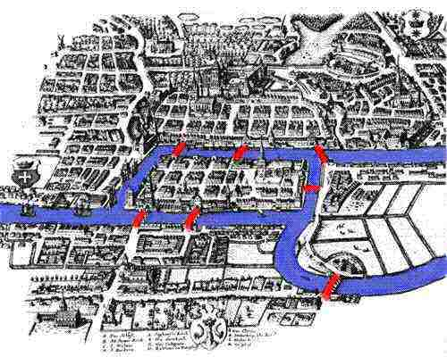
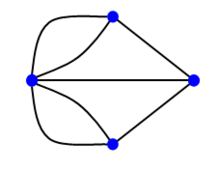
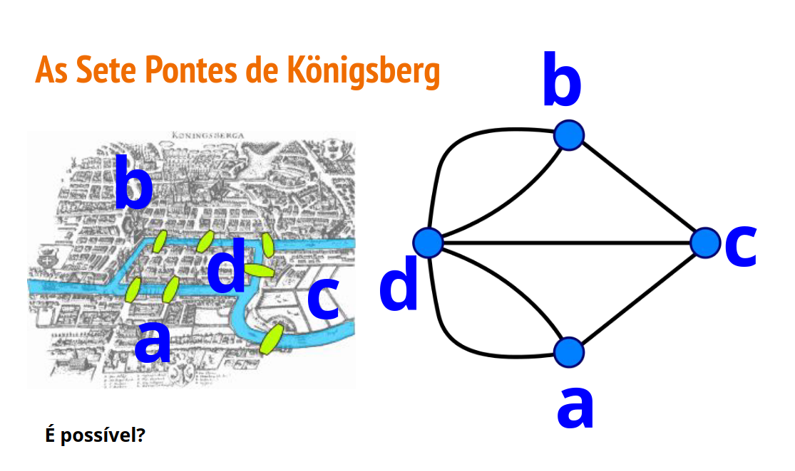
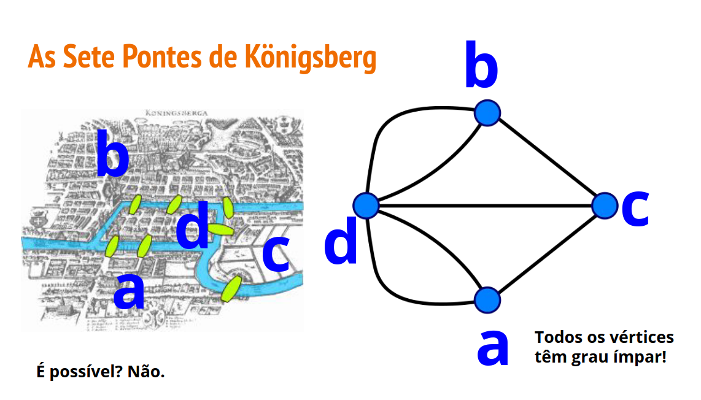
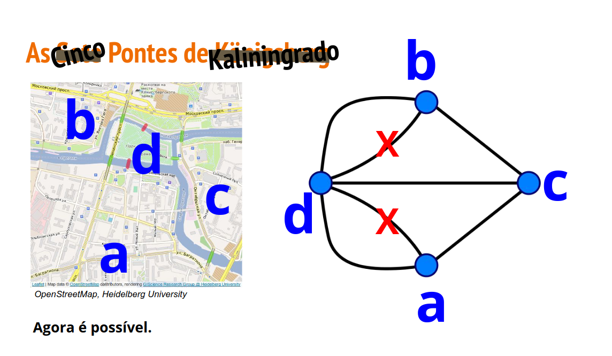
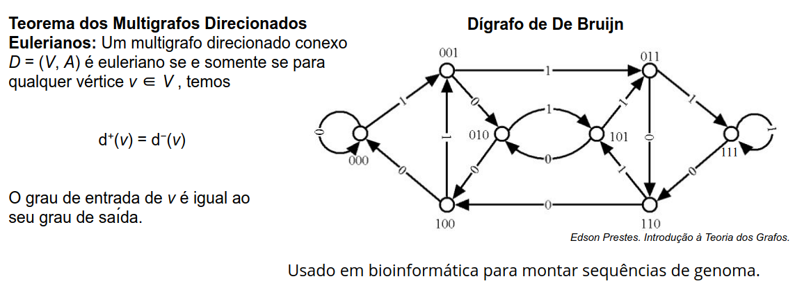
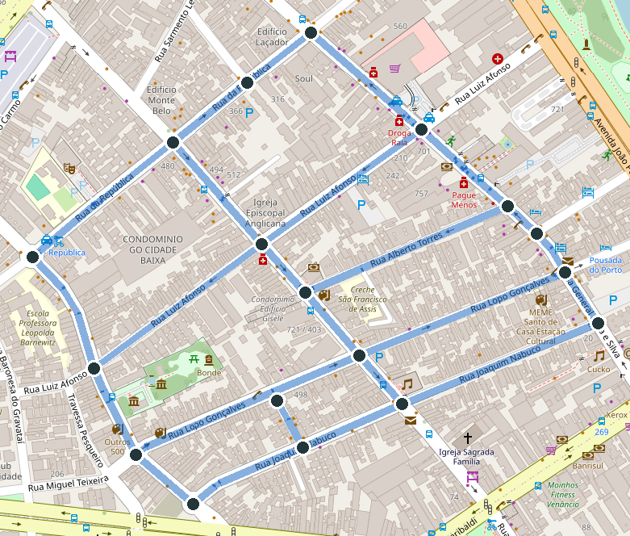
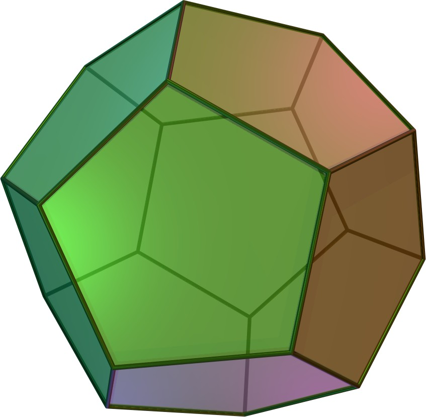
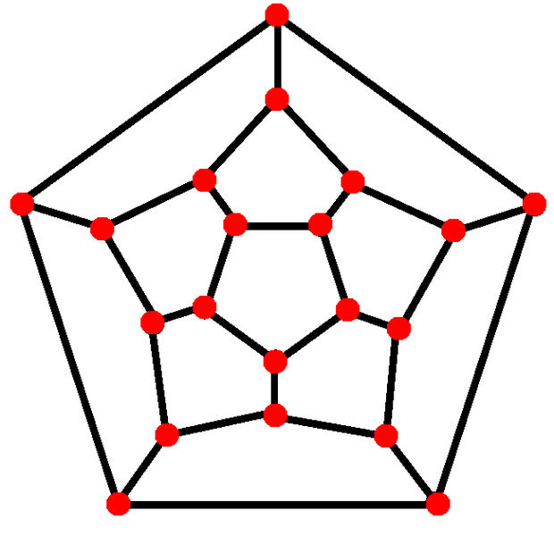
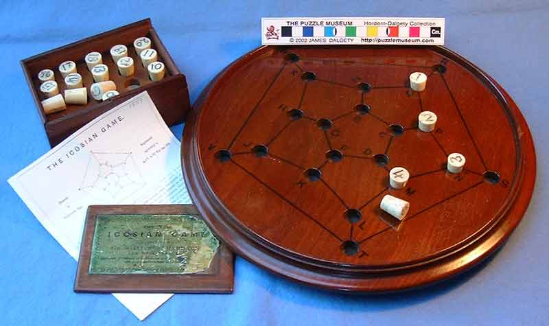

# Grafos Eulerianos

## Problema das Pontes de Königsberg

- Considerado o **primeiro problema** de teoria dos grafos.
- Resolvido em **1736** por Leonhard Euler.

**Problema:** Dada a disposição das pontes da cidade, há algum caminho que passe por cada uma delas uma única vez?

:::: {.columns style="align-items: flex-end;"}
::: {.column width="47.5%"}
{width=80%}
:::
::: {.column width="47.5%"}
{width=70%}
:::
::::

## Problema das Pontes de Königsberg

{width=30% fig-align="center"}

## Tipos de Passeio

:::: columns
::: {.column width="60%"}
> [**Definição:**]{.label-def} Um passeio $p(x,y)$ é **fechado** quando $x = y$.

::: {.fragment}
> [**Definição:**]{.label-def} Uma **trilha** (trail) é um **passeio** sem arestas repetidas.
:::

::: {.fragment}
> [**Definição:**]{.label-def} Um **caminho** (path) é uma **trilha** $p(x,y)$ sem nodos repetidos (com exceção de $x$ e $y$, que podem ser iguais).
:::

::: {.fragment}
> [**Definição:**]{.label-def} Nomes especiais para alguns passeios:
>
> - **circuito** (circuit): trilha fechada
> - **ciclo** (cycle): caminho fechado
> - **laço** (loop): caminho fechado de tamanho 1
:::
:::
::: {.column width="40%"}
```{mermaid}
%%| fig-width: 3.2
%%{init: {'themeVariables': { 'fontSize': '26px' }}}%%
graph TD
  A([Passeio])
  B([Trilha])
  C(["Passeio<br>Fechado"])
  D([Caminho])
  E([Circuito])
  F([Ciclo])
  G([Laço])

  A --> B
  A --> C
  B --> D
  B --> E
  C --> E
  D --> F
  E --> F
  F --> G

  classDef default fill:#23373b,color:#fafafa,stroke:none,font-size:26px;
```
:::
::::

## Circuitos e Grafos Eulerianos

> [**Definição:**]{.label-def} Uma trilha/circuito é **euleriana(o)** sss passa por **todas as arestas** do grafo.

::: {.fragment fragment-index=0}
> [**Definição:**]{.label-def} Um **grafo** é **semi-euleriano** sss possui uma trilha euleriana ou é nulo (sem arestas).
:::

::: {.fragment fragment-index=1}
> [**Definição:**]{.label-def} Um **grafo** é **euleriano** sss possui um circuito euleriano ou é nulo (sem arestas).
:::

:::: {.columns style="align-items: flex-end;"}
::: {.column .fragment fragment-index=0 width="45%"}
```{=html}
<div style="display: flex; justify-content: center;"><div id="def-semi-euleriano"></div></div>
<script>
drawGraph("def-semi-euleriano",
  [["a", 0, 0, "labeled", "a"], ["b", 100, 0, "labeled", "b"],
   ["c", 50, 70, "red labeled", "c"], ["d", 50, 150, "green labeled", "d"]],
  [["c", "d", "blue", "1"], ["c", "a", "blue", "2"], ["a", "b", "blue", "3"], ["b", "c", "blue", "4"]],
  { scale: 1.1 });
</script>
```

[Trilha euleriana:]{.label-exmp} $d \to c \to a \to b \to c$
:::
::: {.column .fragment fragment-index=1 width="45%"}
```{=html}
<div style="display: flex; justify-content: center;"><div id="def-euleriano"></div></div>
<script>
drawGraph("def-euleriano",
  [["A", 0, 0, "green labeled", "A"], ["B", 0, 110, "labeled", "B"], ["C", 85, 55, "labeled", "C"],
   ["D", 170, 0, "labeled", "D"], ["E", 170, 110, "labeled", "E"]],
  [["A", "B", "blue", "1"], ["B", "C", "blue", "2"], ["C", "D", "blue", "3"],
   ["D", "E", "blue", "4"], ["E", "C", "blue", "5"], ["C", "A", "blue", "6"]],
  { scale: 1.1 });
</script>
```

[Circuito euleriano:]{.label-exmp} $A \to B \to C \to D \to E \to C \to A$
:::
::::

## Circuitos e Grafos Eulerianos: Exercício

> [**Exercício:**]{.label-excs} Classifique os seguintes grafos de acordo com a existência ou não de trilhas/circuitos eulerianos:

```{=html}
<div style="display: flex; justify-content: center; align-items: center; gap: 60px; margin: 10px 0;">
  <div id="eul-ex-1"></div>
  <div id="eul-ex-2"></div>
  <div id="eul-ex-3"></div>
</div>
<div style="display: flex; justify-content: center; align-items: center; gap: 80px; margin: 10px 0;">
  <div id="eul-ex-4"></div>
  <div id="eul-ex-5"></div>
</div>

<script>
drawGraph("eul-ex-1",
  [["t", 60, 0], ["l", 0, 35], ["r", 120, 35], ["bl", 0, 110], ["bm", 60, 110], ["br", 120, 110]],
  [["l", "r"], ["l", "bl"], ["l", "t"], ["r", "t"], ["r", "br"], ["bm", "br"], ["bm", "bl"]],
  { edgeColorable: true });

drawGraph("eul-ex-2",
  [["a", 0, 0], ["b", 120, 0], ["c", 60, 55], ["d", 0, 110], ["e", 60, 110], ["f", 120, 110]],
  [["a", "b"], ["a", "d"], ["a", "c"], ["b", "c"], ["b", "f"], ["c", "e"], ["e", "f"], ["e", "d"]],
  { edgeColorable: true });

drawGraph("eul-ex-3",
  [["a", 30, 0], ["b", 120, 0], ["c", 0, 30], ["d", 90, 30],
   ["e", 30, 90], ["f", 120, 90], ["g", 0, 120], ["h", 90, 120]],
  [["a", "b"], ["a", "e"], ["b", "f"], ["c", "a"], ["c", "d"], ["c", "g"],
   ["d", "b"], ["d", "h"], ["e", "f"], ["g", "e"], ["g", "h"], ["h", "f"]],
  { edgeColorable: true });

drawGraph("eul-ex-4",
  [["n00", 0, 0], ["n04", 160, 0], ["n11", 40, 28], ["n13", 120, 28],
   ["n20", 0, 56], ["n22", 80, 56], ["n24", 160, 56],
   ["n31", 40, 84], ["n33", 120, 84], ["n40", 0, 112], ["n44", 160, 112]],
  [["n11", "n13"], ["n11", "n22"], ["n11", "n00"], ["n13", "n22"], ["n13", "n04"],
   ["n20", "n31"], ["n20", "n11"], ["n20", "n00"], ["n20", "n40"],
   ["n22", "n31"], ["n22", "n33"], ["n24", "n33"], ["n24", "n13"], ["n24", "n04"], ["n24", "n44"],
   ["n31", "n40"], ["n31", "n33"], ["n33", "n44"]],
  { edgeColorable: true });

drawGraph("eul-ex-5",
  [["v0", 60, 10], ["v1", 12, 45], ["v2", 31, 100], ["v3", 89, 100], ["v4", 108, 45]],
  [["v0", "v1"], ["v0", "v2"], ["v0", "v3"], ["v0", "v4"], ["v1", "v2"],
   ["v1", "v3"], ["v1", "v4"], ["v2", "v3"], ["v2", "v4"], ["v3", "v4"]],
  { edgeColorable: true });
</script>
```

## Caracterização de Grafos Eulerianos

> [**Lema:**]{.label-lem} Dado um **grafo simples** finito $G$, se $deg(v) \geq 2$ para todo $v \in V$, então $G$ é cíclico.

. . .

[**Demonstração:**]{.label-prf} Considere um caminho $c$ em $G$ que seja:

- **aberto:** os pontos extremos $a$ e $b$ são distintos;
- **maximal:** não está contido em nenhum outro caminho aberto.

::: {style="display: flex; justify-content: center; align-items: center; gap: 12px;"}
$c(a,b) =$

```{=html}
<div id="eul-lema"></div>
<script>
drawGraph("eul-lema",
  [["xo", -80, 0, "labeled red hidden", "x"], ["a", 0, 0, "labeled", "a"], ["v1", 70, 0], ["v2", 140, 0],
   ["x", 210, 0, "", "x"], ["d", 280, 0, "dots", "⋯"], ["b", 350, 0, "labeled", "b"]],
  [["a", "v1", "blue"], ["v1", "v2", "blue"], ["v2", "x", "blue"], ["x", "d", "blue"], ["d", "b", "blue"],
   ["xo", "a", "red dashed hidden"], ["a", "x", "green thick up3 hidden"]],
  {
    steps: [
      {},
      {},
      { "a": "orange" },
      { "xo": "-hidden", "xo-a": "-hidden" },
      { "xo": "hidden", "xo-a": "hidden", "a": "-orange", "a-x": "-hidden", "x": "below green",
        "a-v1": "-blue green thick", "v1-v2": "-blue green thick", "v2-x": "-blue green thick" }
    ]
  });
</script>
```
:::

::: {.incremental}
- Como $G$ é finito, caminhos maximais existem em cada componente conexo.
- Como $deg(a) \geq 2$, $\textcolor{#eb811b}{a}$ deve estar conectado a no mínimo mais um nó $x$ (além do seu vizinho em $c$).
- Se $\textcolor{#c62828}{x \notin c}$: teríamos um caminho maior $c'(x,b)$ $\Rightarrow$ contradição com o fato de $c$ ser maximal!
- Portanto, $a$ deve estar conectado a algum $\textcolor{#2e7d32}{x \in c}$, formando um ciclo. $\blacksquare$
:::

## Caracterização de Grafos Eulerianos (Cont.)

> [**Definição:**]{.label-def} Um componente conexo é [não-trivial]{.alert} **sss** possui ao menos uma aresta.

> [**Teorema:**]{.label-thm} Um **grafo simples** finito $G=(V,E)$ é **euleriano** **sss**
>
> - possui no máximo um componente conexo **não-trivial**, e
> - os graus de todos os nós são **pares**.

:::: {.columns style="align-items: flex-end;"}
::: {.column .fragment width="47%"}
```{=html}
<div style="display: flex; justify-content: center;"><div id="thm-euler-sim"></div></div>
<script>
drawGraph("thm-euler-sim",
  [["t1", 0, 0], ["t2", 90, 0], ["t3", 45, 75], ["i", 160, 40, "orange"]],
  [["t1", "t2", "green"], ["t2", "t3", "green"], ["t3", "t1", "green"]]);
</script>
```

Graus pares e um único componente não-trivial (o vértice [isolado]{style="color:#eb811b"} é trivial) $\Rightarrow$ [**euleriano**]{style="color:#2e7d32"}
:::
::: {.column .fragment width="47%"}
```{=html}
<div style="display: flex; justify-content: center;"><div id="thm-euler-nao"></div></div>
<script>
drawGraph("thm-euler-nao",
  [["t1", 0, 0], ["t2", 90, 0], ["t3", 45, 75], ["u1", 150, 0], ["u2", 240, 0], ["u3", 195, 75]],
  [["t1", "t2", "red"], ["t2", "t3", "red"], ["t3", "t1", "red"],
   ["u1", "u2", "red"], ["u2", "u3", "red"], ["u3", "u1", "red"]]);
</script>
```

Graus pares, mas **dois** componentes não-triviais $\Rightarrow$ [**não** é euleriano]{style="color:#c62828"}
:::
::::

## Caracterização de Grafos Eulerianos: $(\Rightarrow)$

[**Demonstração:**]{.label-prf} $(\Rightarrow)$ $G$ possui um circuito euleriano, que chamaremos $c$.

:::: {.columns style="align-items: center;"}
::: {.column width="57%"}
::: {.incremental}
- Um dado nodo $n$ pode ocorrer ou não em $c$.
- $\textcolor{#eb811b}{n \notin c}$: não há arestas incidentes $\Rightarrow$ grau $0$ (par).
- $n \in c$: cada ocorrência do nodo soma $2$ ao grau (uma aresta de chegada e uma de saída, distintas, pois $c$ é euleriano).
- Como o circuito contém **todas** as arestas, não há outras contribuições para o grau.
- Logo, o grau de $n$ é **par**: $2$ vezes o número de ocorrências de $n$ em $c$.
:::
:::
::: {.column width="40%"}
```{=html}
<div style="display: flex; justify-content: center;"><div id="thm-euler-ida"></div></div>
<script>
drawGraph("thm-euler-ida",
  [["A", 0, 0], ["B", 0, 110], ["C", 85, 55], ["D", 170, 0], ["E", 170, 110], ["F", 250, 55]],
  [["A", "B", "blue", "1"], ["B", "C", "blue", "2"], ["C", "D", "blue", "3"],
   ["D", "E", "blue", "4"], ["E", "C", "blue", "5"], ["C", "A", "blue", "6"]],
  {
    labels: true,
    scale: 1.1,
    steps: [
      {},
      { "F": "orange" },
      { "F": "-orange", "C": "red", "B-C": "-blue green thick", "C-D": "-blue green thick",
        "E-C": "-blue orange thick", "C-A": "-blue orange thick" }
    ]
  });
</script>
```

$c = A \to B \to \textcolor{#c62828}{C} \to D \to E \to \textcolor{#c62828}{C} \to A$

::: {.fragment}
$C$ ocorre **2 vezes**: arestas $\textcolor{#2e7d32}{2, 3}$ e $\textcolor{#eb811b}{5, 6}$ $\Rightarrow deg(C) = 2 \cdot 2 = 4$
:::
:::
::::

. . .

> [**Obs:**]{.label-rmk} Assumir que há mais de um componente conexo não-trivial gera contradição com o fato de haver um circuito euleriano: não seria possível haver caminho entre dois componentes conexos distintos.

## Caracterização de Grafos Eulerianos: $(\Leftarrow)$

[**Demonstração:**]{.label-prf} $(\Leftarrow)$ Por indução no número de arestas $|E|$.

:::: {.columns style="align-items: center;"}
::: {.column width="60%"}
::: {.incremental}
- **Caso base:** $|E| = 0$. O grafo é euleriano por definição.
- **Passo indutivo:** como há nodos de grau maior que zero, existe ao menos um componente conexo não-trivial.
- Nele, todos os graus são pares e $> 0$ (logo $\geq 2$). Pelo lema anterior, existe um subgrafo ciclo $\textcolor{#1565c0}{C=(V_C,E_C)}$.
- O grafo $\textcolor{#c62828}{G'} = G - \textcolor{#1565c0}{E_C}$ possui menos arestas e todos os graus continuam pares (cada nodo de $\textcolor{#1565c0}{C}$ perde exatamente $2$).
- Cada componente conexo não-trivial de $\textcolor{#c62828}{G'}$ possui um [vértice em comum]{style="color:#eb811b"} com $\textcolor{#1565c0}{C}$.
- **Hipótese indutiva:** cada componente conexo de $\textcolor{#c62828}{G'}$ ou é nulo, ou possui circuito euleriano.
- **Resultado:** percorre-se $\textcolor{#1565c0}{C}$ e, ao passar por um nodo comum, entra-se no circuito euleriano daquele componente de $\textcolor{#c62828}{G'}$.
:::
:::
::: {.column width="38%"}
```{=html}
<div style="display: flex; justify-content: center;"><div id="thm-euler-volta"></div></div>
<script>
drawGraph("thm-euler-volta",
  [["n00", 0, 0], ["n01", 60, 0], ["n02", 120, 0], ["n03", 180, 0],
   ["n10", 0, 60], ["n11", 60, 60], ["n12", 120, 60], ["n13", 180, 60],
   ["n21", 60, 120], ["n22", 120, 120]],
  [["n00", "n10", "nolabel", "4"], ["n00", "n01", "nolabel", "5"], ["n03", "n13", "nolabel", "10"], ["n03", "n02", "nolabel", "9"],
   ["n11", "n21", "nolabel", "2"], ["n11", "n12", "nolabel", "7"], ["n11", "n01", "nolabel", "6"], ["n11", "n10", "nolabel", "3"],
   ["n12", "n22", "nolabel", "12"], ["n12", "n13", "nolabel", "11"], ["n12", "n02", "nolabel", "8"], ["n21", "n22", "nolabel", "1"]],
  {
    scale: 1.4,
    steps: [
      {},
      {},
      { "n11-n21": "blue thick", "n21-n22": "blue thick", "n12-n22": "blue thick", "n11-n12": "blue thick" },
      { "n11-n21": "used", "n21-n22": "used", "n12-n22": "used", "n11-n12": "used",
        "n00-n10": "red", "n00-n01": "red", "n11-n01": "red", "n11-n10": "red",
        "n03-n13": "red", "n03-n02": "red", "n12-n13": "red", "n12-n02": "red" },
      { "n11": "orange", "n12": "orange" },
      {},
      { "edges": "-used -nolabel" }
    ]
  });
</script>
```

::: {.fragment}
> [**Corolário:**]{.label-cor} Todo grafo euleriano pode ser decomposto em ciclos disjuntos nas arestas (podem compartilhar nodos).
:::
:::
::::

## Algoritmo de Hierholzer (1873)

Encontrando o circuito euleriano de um grafo euleriano:

```pseudocode
#| html-line-number: true
#| html-no-end: true

\begin{algorithmic}
\Procedure{Hierholzer}{$G,\ v_0$}
  \State \textbf{stack} $St$
  \State coloque o vértice inicial $v_0$ em $St$
  \While{$St \neq \emptyset$}
    \State seja $V$ o valor no topo de $St$
    \If{$degree(V) = 0$}
      \State adicione $V$ à resposta
      \State remova $V$ do topo de $St$
    \Else
      \State encontre uma aresta que sai de $V$
      \State remova essa aresta do grafo
      \State coloque o segundo extremo dessa aresta em $St$
    \EndIf
  \EndWhile
\EndProcedure
\end{algorithmic}
```

Qual a complexidade? [$O(|E|)$]{.fragment}

## Algoritmo de Hierholzer (1873) - Exemplo {.smaller}

:::: columns
::: {.column width="37%"}
**Grafo** (todos os graus pares):

```{=html}
<div style="display: flex; justify-content: center;"><div id="hierholzer-exemplo"></div></div>
<div id="hierholzer-saida" style="text-align: center; font-weight: bold; color: #c40000; margin: 4px 0 8px;"></div>
<script>
(() => {
  const saidas = ["", "", "", "", "A", "A", "A", "A", "A, C", "A, C, E", "A, C, E, D",
                  "A, C, E, D, C", "A, C, E, D, C, B", "A, C, E, D, C, B, A"];
  drawGraph("hierholzer-exemplo",
    [["A", 0, 0, "labeled orange", "A"], ["B", 160, 0], ["C", 80, 70], ["D", 0, 140], ["E", 160, 140]],
    [["A", "B", "", "e₁"], ["B", "C", "", "e₂"], ["A", "C", "", "e₃"],
     ["C", "D", "", "e₄"], ["D", "E", "", "e₅"], ["C", "E", "", "e₆"]],
    {
      labels: true,
      steps: [
        { "A-B": "used", "A": "-orange", "B": "orange" },
        { "B-C": "used", "B": "-orange", "C": "orange" },
        { "A-C": "used", "C": "-orange", "A": "orange" },
        { "A": "-orange", "C": "orange" },
        { "C-D": "used", "C": "-orange", "D": "orange" },
        { "D-E": "used", "D": "-orange", "E": "orange" },
        { "C-E": "used", "E": "-orange", "C": "orange" },
        { "C": "-orange", "E": "orange" },
        { "E": "-orange", "D": "orange" },
        { "D": "-orange", "C": "orange" },
        { "C": "-orange", "B": "orange" },
        { "B": "-orange", "A": "orange" },
        { "A": "-orange" },
        {},
        { "edges": "-used green" }
      ],
      onStep: k => {
        document.getElementById("hierholzer-saida").textContent =
          `Saída: [${saidas[Math.min(k, saidas.length - 1)]}]`;
      }
    });
})();
</script>
```

[■]{style="color:#eb811b"} topo da pilha $\quad$ [- - -]{style="color:#999"} aresta removida

$\deg(C)=4$; $\deg(A)=\deg(B)=\deg(D)=\deg(E)=2$

::: {.fragment fragment-index=13}
[**Saída obtida:**]{style="color:#c40000"}
$$[A,\,C,\,E,\,D,\,C,\,B,\,A]$$
:::

::: {.fragment fragment-index=14}
[**Circuito**]{style="color:#3a7a10"} (saída ao contrário):
$$A\!\to\!B\!\to\!C\!\to\!D\!\to\!E\!\to\!C\!\to\!A$$
:::
:::
::: {.column width="60%"}
::: {#hierholzer-tabela}
| \#  | Pilha $St$ (base$\to$topo) | Operação |
|---:|:---|:---|
| 0  | $[A]$           | início em $A$ |
| 1  | $[A,B]$         | remove $e_1$, empilha $B$ |
| 2  | $[A,B,C]$       | remove $e_2$, empilha $C$ |
| 3  | $[A,B,C,A]$     | remove $e_3$, empilha $A$ |
| 4  | $[A,B,C]$       | $\deg(A){=}0$: adiciona $A$ à saída |
| 5  | $[A,B,C,D]$     | remove $e_4$, empilha $D$ |
| 6  | $[A,B,C,D,E]$   | remove $e_5$, empilha $E$ |
| 7  | $[A,B,C,D,E,C]$ | remove $e_6$, empilha $C$ |
| 8  | $[A,B,C,D,E]$   | $\deg(C){=}0$: adiciona $C$ à saída |
| 9  | $[A,B,C,D]$     | $\deg(E){=}0$: adiciona $E$ à saída |
| 10 | $[A,B,C]$       | $\deg(D){=}0$: adiciona $D$ à saída |
| 11 | $[A,B]$         | $\deg(C){=}0$: adiciona $C$ à saída |
| 12 | $[A]$           | $\deg(B){=}0$: adiciona $B$ à saída |
| 13 | $[\,]$          | $\deg(A){=}0$: adiciona $A$ à saída |
:::

```{=html}
<script>fragmentRows("hierholzer-tabela", 1, 0);</script>
```
:::
::::

## As Pontes de Königsberg

{width=100%}

## As Pontes de Königsberg

{width=100%}

## As Pontes de Königsberg

{width=100%}

[<https://www.google.com/maps/place/Kaliningrad,+Kaliningrad+Oblast,+Russia/@54.7057454,20.5102359,16z>]{style="font-size: 0.6em; word-break: break-all;"}

## Dígrafos Eulerianos

{width=100%}

## O Problema do Carteiro Chinês {.smaller}

:::: {.columns style="align-items: center;"}
::: {.column width="60%"}
Um carteiro precisa percorrer **todas as ruas** do seu bairro e voltar ao ponto de partida, andando o mínimo possível (Kwan Mei-Ko, 1960).

> [**Problema:**]{.label-def} Dado um grafo conexo $G=(V,E)$ com pesos positivos nas arestas, encontrar um **passeio fechado** de custo mínimo que passe por **todas as arestas** de $G$ pelo menos uma vez.

- Se $G$ é euleriano, basta um circuito euleriano; senão, algumas ruas precisam ser **repetidas**.
- Pode ser resolvido em **tempo polinomial** (Edmonds e Johnson, 1973).
:::
::: {.column width="40%"}
{width=100%}

[Cidade Baixa, Porto Alegre: cruzamentos são vértices e trechos de rua são arestas. Mapa: © colaboradores do OpenStreetMap.]{style="font-size: 0.6em; color: #757575;"}

[Wikipedia: Problema do carteiro chinês](https://pt.wikipedia.org/wiki/Problema_do_carteiro_chinês){style="font-size: 0.7em;"}
:::
::::

# Grafos Hamiltonianos

## Problema do Ciclo Hamiltoniano

- **Problema:** Achar um caminho fechado nos vértices de um dodecaedro (poliedro regular de 12 faces) passando por cada vértice (ponta) uma única vez.

::: {.incremental}
- Proposto por Sir William Rowan Hamilton em 1857 (mais conhecido pelo desenvolvimento dos quatérnios e contribuições para a mecânica analítica).
- Foi produzido um jogo de tabuleiro baseado neste problema (*Icosian game*).
:::

:::: {.columns style="align-items: flex-end;"}
::: {.column width="25%"}
{width=100%}
:::
::: {.column width="30%"}
{width=100%}
:::
::: {.column width="30%"}
{width=100%}
:::
::::

[Imagens: `http://puzzlemuseum.com/month/picm02/200207icosian.htm`, `http://en.wikipedia.org/wiki/Dodecahedron`]{style="font-size: 0.8em;"}

## Problema do Ciclo Hamiltoniano: Solução

No grafo do dodecaedro (visão planar), queremos um ciclo que passe **uma única vez** por cada um dos $20$ vértices.

```{=html}
<div style="display: flex; justify-content: center; margin-top: 10px;"><div id="dodecaedro"></div></div>
<script>
drawGraph("dodecaedro",
  [["m0", 110, 42], ["m1", 70, 55], ["m2", 45, 89], ["m3", 45, 131], ["m4", 70, 165], ["m5", 110, 178],
   ["m6", 150, 165], ["m7", 175, 131], ["m8", 175, 89], ["m9", 150, 55],
   ["o0", 110, 10], ["o1", 15, 79], ["o2", 51, 191], ["o3", 169, 191], ["o4", 205, 79],
   ["p0", 89, 82], ["p1", 77, 121], ["p2", 110, 145], ["p3", 143, 121], ["p4", 131, 82]],
  [["o0", "o1"], ["o0", "m0"], ["p0", "p1"], ["p0", "m1"], ["o1", "o2"], ["o1", "m2"], ["p1", "p2"], ["p1", "m3"],
   ["o2", "o3"], ["o2", "m4"], ["p2", "p3"], ["p2", "m5"], ["o3", "o4"], ["o3", "m6"], ["p3", "p4"], ["p3", "m7"],
   ["o4", "o0"], ["o4", "m8"], ["p4", "p0"], ["p4", "m9"], ["m0", "m1"], ["m1", "m2"], ["m2", "m3"], ["m3", "m4"],
   ["m4", "m5"], ["m5", "m6"], ["m6", "m7"], ["m7", "m8"], ["m8", "m9"], ["m9", "m0"]],
  {
    scale: 2.2,
    steps: [
      { "o0": "orange",
        "o0-m0": "green thick", "m0-m1": "green thick", "m1-m2": "green thick", "m2-m3": "green thick",
        "m3-m4": "green thick", "m4-m5": "green thick", "m5-m6": "green thick", "m6-m7": "green thick",
        "p3-m7": "green thick", "p2-p3": "green thick", "p1-p2": "green thick", "p0-p1": "green thick",
        "p4-p0": "green thick", "p4-m9": "green thick", "m8-m9": "green thick", "o4-m8": "green thick",
        "o3-o4": "green thick", "o2-o3": "green thick", "o1-o2": "green thick", "o0-o1": "green thick" }
    ]
  });
</script>
```

::: {.fragment}
Um ciclo hamiltoniano (em [verde]{style="color:#2e7d32"}), começando e terminando no vértice [laranja]{style="color:#eb811b"}.
:::

## Ciclos e Grafos Hamiltonianos


> [**Definição:**]{.label-def} Um caminho/ciclo é **hamiltoniano** sss passa por **todos os vértices** do grafo.

::: {.fragment fragment-index=0}
> [**Definição:**]{.label-def} Um **grafo** é **semi-hamiltoniano** sss possui um caminho hamiltoniano ou possui 1 vértice.
:::

::: {.fragment fragment-index=1}
> [**Definição:**]{.label-def} Um **grafo** é **hamiltoniano** sss possui um ciclo hamiltoniano ou possui 1 vértice.
:::

:::: {.columns style="align-items: flex-end;"}
::: {.column .fragment fragment-index=0 width="45%"}
```{=html}
<div style="display: flex; justify-content: center;"><div id="def-semi-hamiltoniano"></div></div>
<script>
drawGraph("def-semi-hamiltoniano",
  [["a", 0, 0, "labeled", "3"], ["b", 100, 0, "labeled", "4"],
   ["c", 50, 70, "labeled", "2"], ["d", 50, 150, "green labeled", "1"]],
  [["d", "c", "green thick"], ["c", "a", "green thick"], ["a", "b", "green thick"], ["b", "c"]],
  { scale: 1.1 });
</script>
```

[Caminho hamiltoniano]{.label-exmp} (ordem de visita nos vértices), mas nenhum ciclo.
:::
::: {.column .fragment fragment-index=1 width="45%"}
```{=html}
<div style="display: flex; justify-content: center;"><div id="def-hamiltoniano"></div></div>
<script>
drawGraph("def-hamiltoniano",
  [["t", 70, 0, "green labeled", "1"], ["l", 0, 55, "labeled", "2"], ["r", 140, 55, "labeled", "5"],
   ["bl", 0, 150, "labeled", "3"], ["br", 140, 150, "labeled", "4"]],
  [["t", "l", "green thick"], ["l", "bl", "green thick"], ["bl", "br", "green thick"],
   ["br", "r", "green thick"], ["r", "t", "green thick"], ["l", "r"]],
  { scale: 1.1 });
</script>
```

[Ciclo hamiltoniano]{.label-exmp} (ordem de visita nos vértices).
:::
::::

## Ciclos e Grafos Hamiltonianos: Exercício

> [**Exercício:**]{.label-excs} Determine a classificação dos seguintes grafos de acordo com a existência ou não de ciclos/caminhos hamiltonianos.

```{=html}
<div style="display: flex; justify-content: center; align-items: center; gap: 80px; margin: 10px 0;">
  <div id="ham-ex-1"></div>
  <div id="ham-ex-2"></div>
</div>
<div style="display: flex; justify-content: center; align-items: center; gap: 50px; margin: 10px 0;">
  <div id="ham-ex-3"></div>
  <div id="ham-ex-4"></div>
  <div id="ham-ex-5"></div>
</div>

<script>
drawGraph("ham-ex-1",
  [["a", 0, 0], ["b", 120, 0], ["c", 60, 55], ["d", 0, 110], ["e", 60, 110], ["f", 120, 110]],
  [["a", "b"], ["a", "d"], ["a", "c"], ["b", "f"], ["c", "e"], ["e", "f"], ["e", "d"]]);

drawGraph("ham-ex-2",
  [["a", 30, 0], ["b", 120, 0], ["c", 0, 30], ["d", 90, 30],
   ["e", 30, 90], ["f", 120, 90], ["g", 0, 120], ["h", 90, 120]],
  [["a", "b"], ["a", "e"], ["b", "f"], ["c", "a"], ["c", "d"], ["c", "g"],
   ["d", "b"], ["d", "h"], ["e", "f"], ["g", "e"], ["g", "h"], ["h", "f"]]);

drawGraph("ham-ex-3",
  [["n00", 0, 0], ["n04", 140, 0], ["n11", 35, 28], ["n13", 105, 28],
   ["n20", 0, 56], ["n22", 70, 56], ["n24", 140, 56],
   ["n31", 35, 84], ["n33", 105, 84], ["n40", 0, 112], ["n44", 140, 112]],
  [["n11", "n22"], ["n11", "n00"], ["n13", "n22"], ["n13", "n04"],
   ["n20", "n31"], ["n20", "n11"], ["n20", "n00"], ["n20", "n40"],
   ["n22", "n31"], ["n22", "n33"], ["n24", "n33"], ["n24", "n13"], ["n24", "n04"], ["n24", "n44"],
   ["n31", "n40"], ["n33", "n44"]]);

drawGraph("ham-ex-4",
  [["v0", 60, 10], ["v1", 12, 45], ["v2", 31, 100], ["v3", 89, 100], ["v4", 108, 45]],
  [["v0", "v1"], ["v0", "v2"], ["v0", "v3"], ["v0", "v4"], ["v1", "v2"],
   ["v1", "v3"], ["v1", "v4"], ["v2", "v3"], ["v2", "v4"], ["v3", "v4"]]);

drawGraph("ham-ex-5",
  [["a0", 80, 10], ["a1", 13, 58], ["a2", 39, 137], ["a3", 121, 137], ["a4", 147, 58],
   ["b0", 80, 45], ["b1", 47, 69], ["b2", 59, 108], ["b3", 101, 108], ["b4", 113, 69]],
  [["a0", "a1"], ["a1", "a2"], ["a2", "a3"], ["a3", "a4"], ["a4", "a0"],
   ["a0", "b0"], ["a1", "b1"], ["a2", "b2"], ["a3", "b3"], ["a4", "b4"],
   ["b0", "b2"], ["b2", "b4"], ["b4", "b1"], ["b1", "b3"], ["b3", "b0"]]);
</script>
```

## Caracterização de Grafos Hamiltonianos

::: {.incremental}
- Grafos eulerianos possuem uma **caracterização precisa** em termos de propriedades de grau dos vértices.
- Podemos dizer se um grafo é euleriano **sem precisar construir** o circuito euleriano correspondente.
- No caso de grafos **hamiltonianos**, [não se sabe até o momento um conjunto de condições simultaneamente suficientes e necessárias que os caracterizem completamente]{.alert}.
:::

. . .

:::: {.columns style="align-items: center;"}
::: {.column width="58%"}
> [**Exemplo:**]{.label-exmp} Condições necessárias para um grafo simples $G$ ser hamiltoniano:
>
> 1. $\delta(G) \geq 2$, onde $\delta(G)$ é o grau mínimo de $G$
> 2. $G$ é conexo

::: {.fragment}
Notem que elas [não são suficientes]{.alert}, como mostra o grafo ao lado (do exercício anterior): todo ciclo hamiltoniano teria que passar **duas vezes** pelo vértice em [vermelho]{style="color:#c62828"}.
:::
:::
::: {.column width="38%"}
```{=html}
<div style="display: flex; justify-content: center;"><div id="ham-nao-suficiente"></div></div>
<script>
drawGraph("ham-nao-suficiente",
  [["n00", 0, 0], ["n04", 140, 0], ["n11", 35, 28], ["n13", 105, 28],
   ["n20", 0, 56], ["n22", 70, 56], ["n24", 140, 56],
   ["n31", 35, 84], ["n33", 105, 84], ["n40", 0, 112], ["n44", 140, 112]],
  [["n11", "n22"], ["n11", "n00"], ["n13", "n22"], ["n13", "n04"],
   ["n20", "n31"], ["n20", "n11"], ["n20", "n00"], ["n20", "n40"],
   ["n22", "n31"], ["n22", "n33"], ["n24", "n33"], ["n24", "n13"], ["n24", "n04"], ["n24", "n44"],
   ["n31", "n40"], ["n33", "n44"]],
  { scale: 1.4, steps: [{}, {}, {}, {}, { "n22": "red" }] });
</script>
```
:::
::::

## Condição Suficiente para Grafos Hamiltonianos

**Ideia:** se o grafo contém arestas suficientes, ele certamente é hamiltoniano.

> [**Exemplo:**]{.label-exmp} Grafos completos $K_3, K_4, K_5, \ldots$ (ciclo hamiltoniano em [verde]{style="color:#2e7d32"})

```{=html}
<div style="display: flex; justify-content: center; align-items: center; gap: 70px; margin: 10px 0;">
  <div id="completo-k3"></div>
  <div id="completo-k4"></div>
  <div id="completo-k5"></div>
</div>
<script>
drawGraph("completo-k3",
  [["v0", 40, 0], ["v1", 0, 70], ["v2", 80, 70]],
  [["v0", "v1", "green thick"], ["v1", "v2", "green thick"], ["v2", "v0", "green thick"]]);

drawGraph("completo-k4",
  [["v0", 0, 0], ["v1", 75, 0], ["v2", 75, 75], ["v3", 0, 75]],
  [["v0", "v1", "green thick"], ["v1", "v2", "green thick"], ["v2", "v3", "green thick"], ["v3", "v0", "green thick"],
   ["v0", "v2"], ["v1", "v3"]]);

drawGraph("completo-k5",
  [["v0", 60, 10], ["v1", 12, 45], ["v2", 31, 100], ["v3", 89, 100], ["v4", 108, 45]],
  [["v0", "v1", "green thick"], ["v1", "v2", "green thick"], ["v2", "v3", "green thick"],
   ["v3", "v4", "green thick"], ["v4", "v0", "green thick"],
   ["v0", "v2"], ["v0", "v3"], ["v1", "v3"], ["v1", "v4"], ["v2", "v4"]]);
</script>
```

. . .

- À medida que aumenta o valor $\delta(G)$ (grau mínimo do grafo), existem mais interconexões entre nodos arbitrários.

> [**Pergunta:**]{.label-qstn} Qual o menor $\delta(G)$ de um grafo para que tenhamos certeza que ele é hamiltoniano?

## Teorema de Dirac

> [**Teorema:**]{.label-thm} (Dirac, 1952) se $G=(V,E)$ é um grafo simples finito onde $|V| \geq 3$ e $\delta(G) \geq |V|/2$, então $G$ é hamiltoniano.

. . .

[**Demonstração:**]{.label-prf} Baseada em grafos não-hamiltonianos maximais e contradição.

. . .

> [**Definição:**]{.label-def} um grafo $G=(V,E)$ é **não-hamiltoniano maximal** sss
>
> - $G$ não é hamiltoniano, e
> - para qualquer $e \notin E$, temos que $(V,E \cup \{e\})$ é hamiltoniano.

## Teorema de Dirac: Grafos Não-Hamiltonianos Maximais

**Intuição:**

::: {.incremental}
- Um grafo não-hamiltoniano maximal possui o **maior número possível de arestas** sem ser hamiltoniano.
- Se colocarmos **qualquer** aresta a mais, então ele se torna hamiltoniano.
- Note que ele deve ser certamente **semi-hamiltoniano** (para poder fechar o ciclo com a aresta extra).
:::

. . .

> [**Exemplo:**]{.label-exmp} Com quatro vértices, temos o seguinte grafo não-hamiltoniano maximal (a menos de isomorfismo):

```{=html}
<div style="display: flex; justify-content: center; align-items: flex-end; gap: 60px; margin: 10px 0;">
  <div style="text-align: center;"><div id="maximal-g"></div><div>G</div></div>
  <div class="fragment" style="text-align: center;"><div id="maximal-bd"></div><div>G + {b, d}: hamiltoniano</div></div>
  <div class="fragment" style="text-align: center;"><div id="maximal-ad"></div><div>G + {a, d}: hamiltoniano</div></div>
</div>
<script>
drawGraph("maximal-g",
  [["a", 0, 0], ["b", 80, 0], ["c", 0, 80], ["d", 80, 80]],
  [["a", "b"], ["a", "c"], ["c", "b"], ["c", "d"]],
  { labels: true, scale: 1.1 });

drawGraph("maximal-bd",
  [["a", 0, 0], ["b", 80, 0], ["c", 0, 80], ["d", 80, 80]],
  [["a", "b", "green thick"], ["a", "c", "green thick"], ["c", "b"], ["c", "d", "green thick"], ["b", "d", "orange thick"]],
  { labels: true, scale: 1.1 });

drawGraph("maximal-ad",
  [["a", 0, 0], ["b", 80, 0], ["c", 0, 80], ["d", 80, 80]],
  [["a", "b", "green thick"], ["a", "c"], ["c", "b", "green thick"], ["c", "d", "green thick"], ["a", "d", "orange thick"]],
  { labels: true, scale: 1.1 });
</script>
```

## Teorema de Dirac (2)

::: {.incremental}
- Vamos mostrar que não existe grafo não-hamiltoniano maximal $G=(V,E)$ com $\delta(G) = n/2$, onde $n = |V|$.
- Para isso, assumimos que existe, e vamos obter uma contradição.
- Do grafo não-hamiltoniano maximal $G$, tomamos um [caminho hamiltoniano aberto]{style="color:#1565c0"} $\textcolor{#1565c0}{c}$ (e portanto, possuindo $n$ vértices).
:::

::: {style="display: flex; justify-content: center; align-items: center; gap: 12px;"}
$c =$

```{=html}
<div id="dirac-c"></div>
<script>
drawGraph("dirac-c",
  [["a", 0, 0, "labeled", "a"], ["d1", 80, 0, "dots", "⋯"], ["vi", 160, 0, "", "vᵢ"], ["vj", 240, 0, "", "vᵢ₊₁"],
   ["d2", 320, 0, "dots", "⋯"], ["b", 400, 0, "labeled", "b"]],
  [["a", "d1"], ["d1", "vi"], ["vi", "vj"], ["vj", "d2"], ["d2", "b"],
   ["a", "vj", "orange thick up3 hidden"], ["vi", "b", "orange thick up3 hidden"]],
  {
    steps: [
      {},
      {},
      { "a-d1": "blue", "d1-vi": "blue", "vi-vj": "blue", "vj-d2": "blue", "d2-b": "blue" },
      { "a-vj": "-hidden", "vi-b": "-hidden", "vi": "below", "vj": "below" },
      { "a-vj": "-orange green", "vi-b": "-orange green", "a-d1": "-blue green thick", "d1-vi": "-blue green thick",
        "vj-d2": "-blue green thick", "d2-b": "-blue green thick", "vi-vj": "-blue used" }
    ]
  });
</script>
```
:::

::: {.incremental}
- Se algum [vizinho de]{style="color:#eb811b"} $\textcolor{#eb811b}{a}$ sucede um [vizinho de]{style="color:#eb811b"} $\textcolor{#eb811b}{b}$ no caminho $c$...
- ... certamente há um [ciclo hamiltoniano]{style="color:#2e7d32"} (desviando da aresta central $\{v_i, v_{i+1}\}$) $\Rightarrow$ contradição com o fato de $G$ ser não-hamiltoniano!
- Basta mostrar que com $\delta(G) = n/2$ a situação acima **sempre** ocorrerá.
:::

## Teorema de Dirac (3)

::: {.incremental}
- $V_a$: conjunto de posições dos **antecessores** dos vizinhos de $a$ (de $1$ a $n-1$).
- $V_b$: conjunto de posições dos **vizinhos** de $b$ (de $1$ a $n-1$).
- Suponha $\delta(G) = n/2$: tanto $a$ quanto $b$ possuem $n/2$ vizinhos, todos no caminho $c$ (pois $c$ é hamiltoniano). Consequentemente, $|V_a| = |V_b| = n/2$.
- Somando a cardinalidade dos dois conjuntos:
  $$ n = |V_a| + |V_b| = |V_a \cup V_b| + |V_a \cap V_b| $$
- Como o índice $n$ não ocorre nem em $V_a$ nem em $V_b$, certamente $|V_a \cup V_b| < n$. Portanto, $|V_a \cap V_b| \geq 1$.
- Há no mínimo um índice comum entre antecessores de vizinhos de $a$ e vizinhos de $b$ $\Rightarrow$ a situação do slide anterior ocorre $\Rightarrow$ ciclo hamiltoniano em $G$: contradição!
- Portanto, não é possível haver um grafo maximal não-hamiltoniano com $\delta(G) = |V|/2$. O argumento vale para qualquer $\delta(G)$ maior que $n/2$. $\blacksquare$
:::

## Teorema de Dirac (3): Visualização

> [**Exemplo:**]{.label-exmp} $n = 8$ e $\delta(G) = 4$, com o caminho hamiltoniano $a = v_1, v_2, \ldots, v_8 = b$ (só as arestas de $a$ e $b$ são mostradas).

```{=html}
<div style="display: flex; justify-content: center; margin: 10px 0;"><div id="dirac-contagem"></div></div>
<script>
drawGraph("dirac-contagem",
  [["v1", 0, 0, "labeled", "a"], ["v2", 65, 0, "below", "2"], ["v3", 130, 0, "below", "3"], ["v4", 195, 0, "below", "4"],
   ["v5", 260, 0, "below", "5"], ["v6", 325, 0, "below", "6"], ["v7", 390, 0, "below", "7"], ["v8", 455, 0, "labeled", "b"]],
  [["v1", "v2"], ["v2", "v3"], ["v3", "v4"], ["v4", "v5"], ["v5", "v6"], ["v6", "v7"], ["v7", "v8"],
   ["v1", "v4", "blue up2 hidden"], ["v1", "v5", "blue up3 hidden"], ["v1", "v7", "blue up4 hidden"],
   ["v2", "v8", "red down4 hidden"], ["v5", "v8", "red down2 hidden"], ["v6", "v8", "red down hidden"]],
  {
    steps: [
      { "v1-v4": "-hidden", "v1-v5": "-hidden", "v1-v7": "-hidden", "v1-v2": "blue",
        "v1": "blue", "v3": "blue", "v4": "blue", "v6": "blue" },
      { "v2-v8": "-hidden", "v5-v8": "-hidden", "v6-v8": "-hidden", "v7-v8": "red",
        "v2": "red", "v5": "red", "v7": "red", "v6": "-blue green" },
      { "v1-v4": "used", "v1-v5": "used", "v2-v8": "used", "v5-v8": "used" },
      { "v1-v4": "hidden", "v1-v5": "hidden", "v2-v8": "hidden", "v5-v8": "hidden",
        "edges": "-blue -red", "v6-v7": "used",
        "v1-v2": "green thick", "v2-v3": "green thick", "v3-v4": "green thick", "v4-v5": "green thick",
        "v5-v6": "green thick", "v6-v8": "green thick", "v7-v8": "green thick", "v1-v7": "green thick" }
    ]
  });
</script>
```

::: {.incremental}
- Vizinhos de $a$: $v_2, v_4, v_5, v_7$ $\Rightarrow$ $\textcolor{#1565c0}{V_a = \{1, 3, 4, 6\}}$ (antecessores).
- Vizinhos de $b$: $v_2, v_5, v_6, v_7$ $\Rightarrow$ $\textcolor{#c62828}{V_b = \{2, 5, 6, 7\}}$.
- $|V_a| + |V_b| = 8$, mas só há $7$ posições possíveis $\Rightarrow$ $\textcolor{#2e7d32}{V_a \cap V_b = \{6\}}$: $a$ é vizinho de $v_7$, que sucede $v_6$, vizinho de $b$.
- Ciclo hamiltoniano: $a \to v_2 \to \cdots \to v_6 \to b \to v_7 \to a$.
:::

## Teorema de Dirac (4)

> [**Exemplo:**]{.label-exmp} o grafo abaixo tem $6$ nodos e grau mínimo $3$.

```{=html}
<div style="display: flex; justify-content: center;"><div id="dirac-exemplo"></div></div>
<script>
drawGraph("dirac-exemplo",
  [["n01", 80, 0, "", "4"], ["n10", 0, 60, "", "3"], ["n12", 160, 60, "", "4"], ["n13", 240, 60, "", "3"],
   ["n20", 0, 120, "", "3"], ["n22", 160, 120, "", "3"]],
  [["n01", "n10"], ["n01", "n12"], ["n01", "n20"], ["n10", "n12"], ["n10", "n22"],
   ["n12", "n20"], ["n13", "n12"], ["n13", "n22"], ["n13", "n01"], ["n20", "n22"]],
  {
    scale: 1.4,
    padding: 30,
    steps: [
      { "nodes": "above" },
      { "n01-n13": "green thick", "n13-n22": "green thick", "n22-n10": "green thick",
        "n10-n12": "green thick", "n12-n20": "green thick", "n20-n01": "green thick" }
    ]
  });
</script>
```

::: {.incremental}
- Graus: $\delta(G) = 3 \geq 6/2$. Portanto, pelo teorema de Dirac, é hamiltoniano.
- De fato: um [ciclo hamiltoniano]{style="color:#2e7d32"}.
- Existem outros teoremas que garantem que certos tipos de grafos são hamiltonianos.
- Contudo, nenhum deles engloba todos os possíveis grafos hamiltonianos.
:::

# Problema do Caixeiro Viajante

## Problema do Caixeiro Viajante

**Intuição:**

::: {.incremental}
- Um caixeiro viajante parte de uma cidade e quer vender seus produtos em **todas** as demais cidades de um determinado estado, **voltando para a cidade de origem**.
- Ele [não quer passar mais de uma vez por cada cidade]{.alert}.
- Além disso, ele gostaria de andar o [mínimo]{.alert} possível.
- A resposta do problema é a **rota** que o caixeiro viajante deve utilizar para alcançar seus objetivos.
:::

. . .

**Problema:** Dado um grafo com pesos nas arestas (não-negativos), determinar um **ciclo hamiltoniano de peso mínimo**.

. . .

:::: {.columns style="align-items: center;"}
::: {.column width="50%"}
> [**Exercício:**]{.label-excs} Apresente um ciclo hamiltoniano de menor peso para o grafo ao lado.
:::
::: {.column width="45%"}
```{=html}
<div style="display: flex; justify-content: center;"><div id="pcv-exercicio"></div></div>
<script>
drawGraph("pcv-exercicio",
  [["A", 60, 0], ["B", 200, 0], ["E", 0, 110], ["C", 260, 110], ["D", 130, 190]],
  [["A", "B", "", "2"], ["A", "C", "", "3"], ["A", "D", "", "8"], ["A", "E", "", "3"], ["B", "C", "", "6"],
   ["B", "D", "", "1"], ["B", "E", "", "2"], ["C", "D", "", "1"], ["C", "E", "", "4"], ["D", "E", "", "1"]],
  { labels: true, scale: 1.2 });
</script>
```
:::
::::

## Problema do Caixeiro Viajante

::: {.incremental}
- Para um grafo completo $K_n$, há $\frac{n!}{2n}$ [ciclos hamiltonianos distintos]{.alert}.
- No exemplo anterior, temos que averiguar o peso de $\frac{5!}{2 \cdot 5} = 12$ ciclos distintos.
- Para um grafo completo com 50 vértices, número de caminhos distintos:
  [304140932017133780436126081660647688443776415689605120000000000]{style="font-size: 0.75em; color: #d10000; font-weight: 700;"}
:::

. . .

**Complexidade:**

::: {.incremental}
- Problema de decisão (há ciclo hamiltoniano de peso menor que $x$?): [NP-completo]{.alert}
- Problema de otimização (encontre o ciclo hamiltoniano de menor peso): [NP-difícil]{.alert}
- É comum o emprego de **heurísticas** eficientes para se chegar a **resultados aproximados** (sub-ótimos).
:::

## Problema do Caixeiro Viajante

> [**Exemplo:**]{.label-exmp}

:::: {.columns style="align-items: center;"}
::: {.column width="45%"}
```{=html}
<div style="display: flex; justify-content: center;"><div id="pcv-exemplo"></div></div>
<script>
drawGraph("pcv-exemplo",
  [["A", 60, 0], ["B", 200, 0], ["E", 0, 110], ["C", 260, 110], ["D", 130, 190]],
  [["A", "B", "", "2"], ["A", "C", "", "3"], ["A", "D", "", "8"], ["A", "E", "", "3"], ["B", "C", "", "6"],
   ["B", "D", "", "1"], ["B", "E", "", "2"], ["C", "D", "", "1"], ["C", "E", "", "4"], ["D", "E", "", "1"]],
  {
    labels: true,
    scale: 1.3,
    steps: [
      {},
      { "A-B": "green thick", "B-E": "green thick", "D-E": "green thick", "C-D": "green thick", "A-C": "green thick" }
    ]
  });
</script>
```
:::
::: {.column width="50%"}
Ciclos e respectivos pesos (calculados por força bruta):

```
("abedc",9)      ("acdbe",10)
("abdce",11)     ("abdec",11)
("abcde",13)     ("acbde",14)
("abecd",17)     ("acebd",18)
("acbed",20)     ("adcbe",20)
("abced",21)     ("adbce",22)
```

::: {.incremental}
- São $12$ ciclos distintos para $n = 5$.
- Ótimo: $\textcolor{#2e7d32}{a \to b \to e \to d \to c \to a}$, com peso $\textcolor{#2e7d32}{9}$.
:::
:::
::::

## Problema do Caixeiro Viajante

```{=html}
<iframe width="100%" height="100%" src="https://www.math.uwaterloo.ca/tsp/" title="Traveling Salesman Problem"></iframe>
```

## Algoritmos para o Problema do Caixeiro Viajante {.smaller}

:::: columns
::: {.column width="50%"}
[**Exatos**]{.label-def} (exponenciais no pior caso)

- [Held–Karp](https://en.wikipedia.org/wiki/Held%E2%80%93Karp_algorithm) (1962): programação dinâmica em $O(n^2 2^n)$, ainda o melhor limite conhecido para o caso geral.
- [Dantzig, Fulkerson e Johnson](https://www.math.uwaterloo.ca/tsp/history/milestone.html) (1954): programação linear com planos de corte; resolveram $49$ cidades.
- [Concorde](https://www.math.uwaterloo.ca/tsp/concorde.html): *branch-and-cut*. Recordes com prova de otimalidade: [85.900 pontos](https://www.math.uwaterloo.ca/tsp/pla85900/index.html) e [81.998 bares na Coreia](https://www.math.uwaterloo.ca/tsp/korea/index.html).

[**Heurísticas**]{.label-def} (sem garantia, excelentes na prática)

- [2-opt](https://en.wikipedia.org/wiki/2-opt) e [Lin–Kernighan](https://en.wikipedia.org/wiki/Lin%E2%80%93Kernighan_heuristic) (1973): busca local trocando arestas; a variante LKH (Helsgaun) está entre as melhores heurísticas conhecidas.
- [Implementações em Python (Peter Norvig)](https://github.com/norvig/pytudes/blob/main/ipynb/TSP.ipynb){preview-link="false"}.
:::
::: {.column width="50%"}
[**Aproximados**]{.label-def} (TSP métrico: vale a desigualdade triangular)

Um algoritmo tem **fator** $\alpha$ se sempre devolve um ciclo de custo ${\leq \alpha \cdot \mathrm{OPT}}$, onde $\mathrm{OPT}$ é o custo do ciclo ótimo.

- Árvore geradora mínima + percurso em pré-ordem: fator $2$ (Cormen et al., Seção 35.2).
- [Christofides](https://en.wikipedia.org/wiki/Christofides_algorithm) (1976) e Serdyukov (1978): fator $3/2$.
- [Karlin, Klein e Oveis Gharan](https://arxiv.org/abs/2007.01409){preview-link="false"} (2021): fator ${3/2 - 10^{-36}}$, a primeira melhora desde 1976.
- [Arora](https://doi.org/10.1145/290179.290180){preview-link="false"} (1998) e Mitchell (1999): fator $1 + \varepsilon$ para qualquer $\varepsilon > 0$ no TSP euclidiano (PTAS).

[**Limites**]{.label-prf}

- Sem desigualdade triangular, não existe aproximação com fator constante, a menos que ${P = NP}$ ([Sahni e Gonzalez, 1976](https://doi.org/10.1145/321958.321975){preview-link="false"}).
- TSP métrico: a menos que ${P = NP}$, nenhum algoritmo polinomial tem fator menor que ${123/122 \approx 1{,}008}$, ou seja, nenhum garante ciclos menos de $0{,}8\%$ acima do ótimo ([Karpinski, Lampis e Schmied, 2015](https://arxiv.org/abs/1303.6437){preview-link="false"}).
:::
::::

#

::: {style="text-align: center; margin-top: 15vh;"}
[?]{style="font-size: 5em; color: #d10000; font-weight: 700;"}
:::
