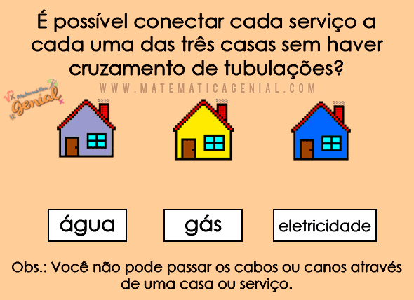
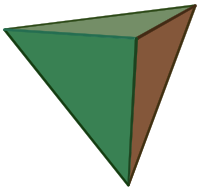
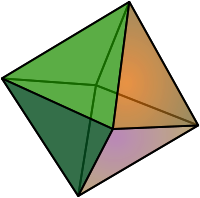
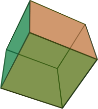
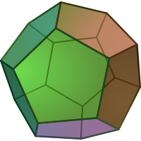
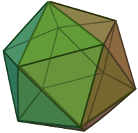
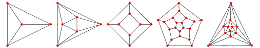
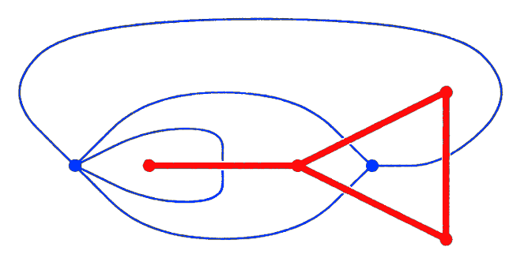
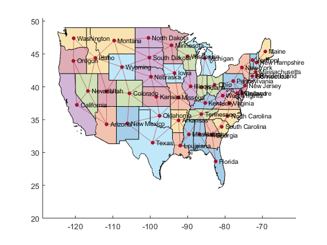

# Planaridade

## Imersões Planares

Como já vimos, um mesmo grafo $G$ tem diversas **representações gráficas**:

```{=html}
<div style="display: flex; justify-content: center; align-items: center; gap: 60px; margin: 10px 0;">
  <div id="imersao-1"></div>
  <div id="imersao-2"></div>
  <div id="imersao-3"></div>
  <div style="font-size: 1.5em;">…</div>
</div>
<script>
drawGraph("imersao-1",
  [["a", 0, 0], ["b", 70, 0], ["c", 0, 70], ["d", 70, 70]],
  [["a", "b"], ["a", "c"], ["b", "c"], ["c", "d"]],
  { labels: true, scale: 1.25 });

drawGraph("imersao-2",
  [["d", 50, 0], ["c", 50, 50], ["a", 0, 100], ["b", 100, 100]],
  [["d", "c"], ["c", "a"], ["c", "b"], ["a", "b"]],
  { labels: true, scale: 1.25 });

drawGraph("imersao-3",
  [["c", 0, 0], ["b", 70, 0], ["a", 0, 70], ["d", 70, 70]],
  [["c", "b"], ["c", "a"], ["c", "d"], ["b", "a"]],
  { labels: true, scale: 1.25 });
</script>
```

> [**Definição:**]{.label-def} Uma associação:
>
> ::: {style="margin-left: 2em;"}
> nodos $\mapsto$ pontos\
> arestas $\mapsto$ curvas simples contínuas entre os pontos associados a vértices
> :::
>
> determina uma **imersão** (*embedding*) do grafo no plano X-Y.

. . .

> [**Definição:**]{.label-def} Uma imersão é **planar** **sss** **duas curvas distintas** se **encontram somente nos pontos dos vértices**.

## O Problema das Três Casas

{width=80% fig-align="center"}

[Em inglês, *three utilities problem*: <https://en.wikipedia.org/wiki/Three_utilities_problem>]{style="font-size: 0.8em;"}

## Grafos Planares

> [**Definição:**]{.label-def} Um grafo $G$ é **planar** sss $G$ possui alguma **imersão planar**.

**Intuitivamente:** Existe uma forma de desenhá-lo no plano sem que tenhamos arestas cortando outras arestas.

. . .

> [**Exercício:**]{.label-excs} Determine quais dos seguintes grafos são planares:

```{=html}
<div style="display: flex; justify-content: center; align-items: center; gap: 70px; margin: 10px 0;">
  <div id="planar-ex-k3"></div>
  <div id="planar-ex-k4"></div>
  <div id="planar-ex-c5"></div>
</div>
<div style="display: flex; justify-content: center; align-items: center; gap: 70px; margin: 10px 0;">
  <div id="planar-ex-k5"></div>
  <div id="planar-ex-k23"></div>
  <div id="planar-ex-k33"></div>
</div>
<script>
drawGraph("planar-ex-k3",
  [["v0", 50, 10], ["v1", 15, 70], ["v2", 85, 70]],
  [["v0", "v1"], ["v1", "v2"], ["v2", "v0"]],
  { scale: 1.3, draggable: true });

drawGraph("planar-ex-k4",
  [["v0", 50, 10], ["v1", 10, 50], ["v2", 50, 90], ["v3", 90, 50]],
  [["v0", "v1"], ["v0", "v2"], ["v0", "v3"], ["v1", "v2"], ["v1", "v3"], ["v2", "v3"]],
  { scale: 1.3, draggable: true });

drawGraph("planar-ex-c5",
  [["v0", 50, 10], ["v1", 12, 38], ["v2", 26, 82], ["v3", 74, 82], ["v4", 88, 38]],
  [["v0", "v2"], ["v2", "v4"], ["v4", "v1"], ["v1", "v3"], ["v3", "v0"]],
  { scale: 1.3, draggable: true });

drawGraph("planar-ex-k5",
  [["v0", 50, 10], ["v1", 12, 38], ["v2", 26, 82], ["v3", 74, 82], ["v4", 88, 38]],
  [["v0", "v1"], ["v0", "v2"], ["v0", "v3"], ["v0", "v4"], ["v1", "v2"],
   ["v1", "v3"], ["v1", "v4"], ["v2", "v3"], ["v2", "v4"], ["v3", "v4"]],
  { scale: 1.3, draggable: true });

drawGraph("planar-ex-k23",
  [["t0", 0, 0], ["t1", 50, 0], ["t2", 100, 0], ["u0", 25, 70], ["u1", 75, 70]],
  [["t0", "u0"], ["t0", "u1"], ["t1", "u0"], ["t1", "u1"], ["t2", "u0"], ["t2", "u1"]],
  { scale: 1.3, draggable: true });

drawGraph("planar-ex-k33",
  [["t0", 0, 0], ["t1", 50, 0], ["t2", 100, 0], ["u0", 0, 70], ["u1", 50, 70], ["u2", 100, 70]],
  [["t0", "u0"], ["t0", "u1"], ["t0", "u2"], ["t1", "u0"], ["t1", "u1"],
   ["t1", "u2"], ["t2", "u0"], ["t2", "u1"], ["t2", "u2"]],
  { scale: 1.3, draggable: true });
</script>
```

## Grafos Planares: Exemplos

Os grafos que representam os cinco poliedros regulares são planares:

**Ideia:** "Expandir" um dos lados do poliedro, achatando a superfície tridimensional. Considera-se a região externa a "face" do lado expandido.

:::: {.columns style="align-items: center;"}
::: {.column width="18%"}
{width=100%}
:::
::: {.column width="18%"}
{width=100%}
:::
::: {.column width="18%"}
{width=100%}
:::
::: {.column width="18%"}
{width=100%}
:::
::: {.column width="18%"}
{width=100%}
:::
::::

{width=85% fig-align="center"}

## Grafos Planares: Definições de Topologia

> [**Definição:**]{.label-def} Um **conjunto aberto** (no plano) é um subconjunto $X \subseteq R^2$ tal que, para qualquer ponto $p \in X$ há uma dada distância $\epsilon$ para a qual todos os pontos no plano a $\epsilon$ de distância de $p$ estão em $X$.

> [**Definição:**]{.label-def} Uma **região** $R$ é um conjunto aberto (no plano) onde, para qualquer par de pontos $p1$ e $p2$, há um caminho simples contínuo entre eles em $R$.

> [**Definição:**]{.label-def} Uma **face** de uma imersão de um grafo $G$ no plano é uma região maximal que não contém nenhum ponto da imersão.

> [**Teorema:**]{.label-thm} (Jordan) Uma curva $c$ em $R^2$ fechada contínua e simples (não repete elementos, com exceção dos pontos iniciais/finais) divide o plano em exatas duas regiões: interna e externa, sendo que toda curva contínua ligando um ponto interno a um ponto externo intersecciona $c$ em no mínimo um ponto.

## Grafos Planares: Visualizando as Definições

:::: {style="display:grid; grid-template-columns:1fr 1fr; gap:10px 30px; margin-top:4px;"}

::: {style="font-size:0.6em; line-height:1.3;"}
```{=html}
<svg viewBox="0 0 440 220" style="display:block; margin:0 auto 4px; width:100%; max-width:430px; height:auto;" xmlns="http://www.w3.org/2000/svg" role="img" aria-label="Conjunto aberto X: o ponto p tem um disco de raio epsilon inteiro dentro de X; o ponto q, na borda, não pertence a X">
<rect x="1" y="1" width="438" height="218" rx="10" fill="#f7f9fb" stroke="#d5dde3" stroke-width="1.5"/>
<path d="M 40,110 C 40,50 110,25 190,30 C 270,35 350,55 345,115 C 340,175 270,195 185,190 C 100,185 40,170 40,110 Z" fill="#2e75b6" fill-opacity="0.14" stroke="#2e75b6" stroke-width="2.5" stroke-dasharray="7 5"/>
<text x="72" y="76" font-size="26" fill="#1d4f7d" font-family="KaTeX_Math, 'Times New Roman', serif" font-style="italic">X</text>
<circle cx="140" cy="110" r="38" fill="#2e75b6" fill-opacity="0.22" stroke="#1d4f7d" stroke-width="1.8" stroke-dasharray="4 3"/>
<line x1="140" y1="110" x2="172.9" y2="91" stroke="#1d4f7d" stroke-width="2"/>
<text x="150" y="90" font-size="20" fill="#1d4f7d" font-family="KaTeX_Math, 'Times New Roman', serif" font-style="italic">ε</text>
<circle cx="140" cy="110" r="4.5" fill="#23373b"/>
<text x="126" y="130" font-size="20" fill="#23373b" font-family="KaTeX_Math, 'Times New Roman', serif" font-style="italic">p</text>
<circle cx="345" cy="115" r="22" fill="none" stroke="#c62828" stroke-width="1.8" stroke-dasharray="4 3"/>
<circle cx="345" cy="115" r="4.5" fill="#ffffff" stroke="#c62828" stroke-width="2"/>
<text x="374" y="122" font-size="20" fill="#c62828" text-anchor="start" font-family="KaTeX_Math, 'Times New Roman', serif" font-style="italic">q <tspan font-style="normal" font-family="KaTeX_Main, 'Times New Roman', serif">∉</tspan> X</text>
</svg>
```
[**Conjunto aberto:**]{style="color:#1d4f7d"} todo $p \in X$ tem um disco de raio $\epsilon$ contido em $X$. A borda (tracejada) não pertence a $X$: nenhum disco em torno de $q$ caberia em $X$.
:::

::: {style="font-size:0.6em; line-height:1.3;"}
```{=html}
<svg viewBox="0 0 440 220" style="display:block; margin:0 auto 4px; width:100%; max-width:430px; height:auto;" xmlns="http://www.w3.org/2000/svg" role="img" aria-label="Região R em forma de haltere: uma curva contínua dentro de R liga p1 a p2. À direita, dois discos separados formam um conjunto aberto que não é região">
<rect x="1" y="1" width="438" height="218" rx="10" fill="#f7f9fb" stroke="#d5dde3" stroke-width="1.5"/>
<path d="M 138,97 C 118,89 115,50 80,50 C 45,50 25,85 25,110 C 25,140 50,170 85,170 C 115,170 120,128 138,123 C 150,120 163,120 175,123 C 195,128 200,170 235,170 C 265,170 290,140 290,110 C 290,75 265,50 235,50 C 200,50 195,92 175,96 C 163,99 150,99 138,97 Z" fill="#2e75b6" fill-opacity="0.14" stroke="#2e75b6" stroke-width="2.5" stroke-dasharray="7 5"/>
<text x="78" y="88" font-size="26" fill="#1d4f7d" font-family="KaTeX_Math, 'Times New Roman', serif" font-style="italic">R</text>
<path d="M 65,125 C 95,100 115,110 150,110 C 185,110 205,125 245,95" fill="none" stroke="#d96c00" stroke-width="3"/>
<circle cx="65" cy="125" r="4.5" fill="#23373b"/>
<circle cx="245" cy="95" r="4.5" fill="#23373b"/>
<text x="52" y="152" font-size="20" fill="#23373b" font-family="KaTeX_Math, 'Times New Roman', serif" font-style="italic">p<tspan font-size="14" dy="5" font-style="normal" font-family="KaTeX_Main, 'Times New Roman', serif">1</tspan></text>
<text x="250" y="86" font-size="20" fill="#23373b" font-family="KaTeX_Math, 'Times New Roman', serif" font-style="italic">p<tspan font-size="14" dy="5" font-style="normal" font-family="KaTeX_Main, 'Times New Roman', serif">2</tspan></text>
<circle cx="345" cy="78" r="24" fill="#2e75b6" fill-opacity="0.14" stroke="#2e75b6" stroke-width="2" stroke-dasharray="6 4"/>
<circle cx="403" cy="140" r="24" fill="#2e75b6" fill-opacity="0.14" stroke="#2e75b6" stroke-width="2" stroke-dasharray="6 4"/>
<line x1="345" y1="78" x2="403" y2="140" stroke="#c62828" stroke-width="2" stroke-dasharray="5 4"/>
<circle cx="345" cy="78" r="4" fill="#23373b"/>
<circle cx="403" cy="140" r="4" fill="#23373b"/>
<path d="M 366,101 L 382,117 M 382,101 L 366,117" stroke="#c62828" stroke-width="3" stroke-linecap="round"/>
<text x="374" y="198" font-size="15" fill="#c62828" text-anchor="middle" font-family="Lexend, sans-serif">não é região</text>
</svg>
```
[**Região:**]{style="color:#1d4f7d"} conjunto aberto e conexo: quaisquer $p_1, p_2 \in R$ são ligados por uma curva contínua dentro de $R$. À direita, um aberto que **não** é região.
:::

::: {style="font-size:0.6em; line-height:1.3;"}
```{=html}
<svg viewBox="0 0 440 220" style="display:block; margin:0 auto 4px; width:100%; max-width:430px; height:auto;" xmlns="http://www.w3.org/2000/svg" role="img" aria-label="Imersão planar de um grafo com 5 vértices e 7 arestas: três faces internas f1, f2, f3 e a face externa f4">
<rect x="1" y="1" width="438" height="218" rx="10" fill="#f1e8f3" stroke="#d5dde3" stroke-width="1.5"/>
<polygon points="115,40 250,188 90,150" fill="#d6e6f5"/>
<polygon points="115,40 260,32 250,188" fill="#fde7cc"/>
<polygon points="260,32 350,112 250,188" fill="#d8eed8"/>
<g stroke="#23373b" stroke-width="2.5">
<line x1="115" y1="40" x2="260" y2="32"/>
<line x1="260" y1="32" x2="350" y2="112"/>
<line x1="350" y1="112" x2="250" y2="188"/>
<line x1="250" y1="188" x2="90" y2="150"/>
<line x1="90" y1="150" x2="115" y2="40"/>
<line x1="115" y1="40" x2="250" y2="188"/>
<line x1="260" y1="32" x2="250" y2="188"/>
</g>
<g fill="#23373b">
<circle cx="115" cy="40" r="7"/>
<circle cx="260" cy="32" r="7"/>
<circle cx="350" cy="112" r="7"/>
<circle cx="250" cy="188" r="7"/>
<circle cx="90" cy="150" r="7"/>
</g>
<g font-size="22" fill="#23373b" text-anchor="middle" font-family="KaTeX_Math, 'Times New Roman', serif" font-style="italic">
<text x="146" y="134">f<tspan font-size="15" dy="5" font-style="normal" font-family="KaTeX_Main, 'Times New Roman', serif">1</tspan></text>
<text x="206" y="94">f<tspan font-size="15" dy="5" font-style="normal" font-family="KaTeX_Main, 'Times New Roman', serif">2</tspan></text>
<text x="285" y="118">f<tspan font-size="15" dy="5" font-style="normal" font-family="KaTeX_Main, 'Times New Roman', serif">3</tspan></text>
<text x="392" y="176">f<tspan font-size="15" dy="5" font-style="normal" font-family="KaTeX_Main, 'Times New Roman', serif">4</tspan></text>
</g>
<text x="392" y="204" font-size="13" fill="#6c006c" text-anchor="middle" font-family="Lexend, sans-serif">(externa)</text>
</svg>
```
[**Face:**]{style="color:#1d4f7d"} cada região maximal que sobra ao retirar do plano os pontos da imersão. Aqui há 4 faces; $f_4$ é a face externa (ilimitada).
:::

::: {style="font-size:0.6em; line-height:1.3;"}
```{=html}
<svg viewBox="0 0 440 220" style="display:block; margin:0 auto 4px; width:100%; max-width:430px; height:auto;" xmlns="http://www.w3.org/2000/svg" role="img" aria-label="Teorema de Jordan: a curva fechada c separa interior e exterior; a curva de a (interior) até b (exterior) cruza c">
<rect x="1" y="1" width="438" height="218" rx="10" fill="#f7f9fb" stroke="#d5dde3" stroke-width="1.5"/>
<path d="M 120,50 C 190,20 260,60 250,100 C 240,130 300,150 280,180 C 255,210 150,200 110,180 C 60,155 60,75 120,50 Z" fill="#c62828" fill-opacity="0.10" stroke="#c62828" stroke-width="3"/>
<text x="96" y="46" font-size="24" fill="#c62828" font-family="KaTeX_Math, 'Times New Roman', serif" font-style="italic">c</text>
<text x="180" y="168" font-size="15" fill="#8e1b1b" text-anchor="middle" font-family="Lexend, sans-serif">interior</text>
<text x="370" y="170" font-size="15" fill="#555555" text-anchor="middle" font-family="Lexend, sans-serif">exterior</text>
<path d="M 150,115 C 190,112 225,107 250,100 C 290,88 340,62 380,60" fill="none" stroke="#1565c0" stroke-width="2.5"/>
<circle cx="250" cy="100" r="6" fill="#f9a825" stroke="#c17900" stroke-width="2"/>
<circle cx="150" cy="115" r="4.5" fill="#23373b"/>
<circle cx="380" cy="60" r="4.5" fill="#23373b"/>
<text x="130" y="121" font-size="20" fill="#23373b" font-family="KaTeX_Math, 'Times New Roman', serif" font-style="italic">a</text>
<text x="390" y="55" font-size="20" fill="#23373b" font-family="KaTeX_Math, 'Times New Roman', serif" font-style="italic">b</text>
</svg>
```
[**Jordan:**]{style="color:#1d4f7d"} a curva fechada simples $c$ divide o plano em interior e exterior; toda curva contínua de $a$ (interior) até $b$ (exterior) cruza $c$.
:::

::::

## Grafos Planares: Grafo Dual Planar

> [**Definição:**]{.label-def} Seja $G$ um pseudografo planar. O [**pseudografo dual planar**]{style="color:#c40000"} de uma [imersão planar de $G$]{style="color:#1565c0"}, também chamado dual geométrico, é o pseudografo $G'=(V',E')$ onde
>
> - $V'$ é o conjunto de faces da imersão planar de $G$.
> - existe uma aresta $\{f_1,f_2\} \in E'$ para cada aresta $e \in E$ dividindo as faces $f_1$ e $f_2$ em $G$.

> [**Exemplo:**]{.label-exmp} [Pseudografo G]{style="color:#1565c0"} e o [dual de G]{style="color:#c40000"}.

{width=40% fig-align="center" .nostretch}

> [**Nota:**]{.label-rmk} Duas imersões planares distintas de um mesmo pseudografo $G$ podem ter duais não-isomorfos.

## Mapas

{width=90% fig-align="center"}

# Fórmula de Euler

## Grafos Planares: Fórmula de Euler (Lema)

> [**Lema:**]{.label-lem} Para um grafo planar $G$,
>
> $$ \textcolor{#d96c00}{v} + \textcolor{#006666}{f} = \textcolor{#bf0000}{e} + \textcolor{#6c006c}{c} + 1 $$
>
> onde
>
> - $\textcolor{#d96c00}{v}$: número de vértices $= |V|$
> - $\textcolor{#006666}{f}$: número de faces de uma imersão planar de $G$
> - $\textcolor{#bf0000}{e}$: número de arestas $= |E|$
> - $\textcolor{#6c006c}{c}$: número de componentes conexos

## Grafos Planares: Fórmula de Euler (Prova do Lema)

[**Demonstração:**]{.label-prf} Por indução no número de arestas ($\textcolor{#bf0000}{e}$):

::: {.incremental}
- **Caso base:** $\textcolor{#bf0000}{e}=0$: $\textcolor{#d96c00}{v} + 1 = 0 + \textcolor{#d96c00}{v} + 1$ (prova válida)
- **Passo indutivo:** 
- Suponha que $\textcolor{#d96c00}{v} + \textcolor{#006666}{f} = \textcolor{#bf0000}{e} + \textcolor{#6c006c}{c} + 1$ valha para grafo planar $G$ (hipótese indutiva). 
- Tome uma imersão planar de $G$, como base, e considere a adição de uma aresta $i$ entre dois nodos **não-adjacentes** de $G$ de tal forma que [não haja cruzamento de arestas]{.alert}. Duas possibilidades:

  ::: {.incremental}
  - $i$ conecta dois nodos de um **mesmo componente conexo**. Nesse caso, aumenta-se em um o número de faces (planaridade) e o número de arestas, onde temos $\textcolor{#d96c00}{v} + (\textcolor{#006666}{f}+1) = (\textcolor{#bf0000}{e}+1) + \textcolor{#6c006c}{c} + 1$.
  - $i$ conecta dois nodos em **componentes conexos distintos**. Neste caso, não se adicionam faces porém reduz-se (em uma unidade) o número de componentes conexos do grafo, e temos $\textcolor{#d96c00}{v} + \textcolor{#006666}{f} = (\textcolor{#bf0000}{e}+1) + (\textcolor{#6c006c}{c}-1) + 1$. $\blacksquare$
  :::
:::

## Grafos Planares: Fórmula de Euler

> [**Teorema:**]{.label-thm} Para um grafo planar e conexo $G$,
>
> $$ \textcolor{#d96c00}{v} + \textcolor{#006666}{f} = \textcolor{#bf0000}{e} + 2 $$
>
> onde
>
> - $\textcolor{#d96c00}{v}$: número de vértices
> - $\textcolor{#006666}{f}$: número de faces de uma imersão planar de $G$
> - $\textcolor{#bf0000}{e}$: número de arestas

[**Demonstração:**]{.label-prf} Usando a prova do lema anterior, contando $\textcolor{#d96c00}{v}-1$ vezes o caso 2 (conexão de nodos em componentes conexos distintos).

## Grafos Planares: Quantidade Máxima de Arestas

Os grafos planares possuem a propriedade de **serem esparsos** (poucas arestas).

. . .

> [**Definição:**]{.label-def} Um grafo simples planar $G = (V,E)$ é [**maximal**]{style="color:#c40000"} se, para toda aresta $e \notin E$, $G' = (V,E \cup \{e\})$ não é planar.

. . .

> [**Teorema:**]{.label-thm} Um grafo simples planar maximal $G$ possui $\textcolor{#bf0000}{e} = 3\textcolor{#d96c00}{v} - 6$ arestas.

[**Demonstração:**]{.label-prf}

::: {.incremental}
- $G$ é conexo.
- Todas as regiões de um grafo simples planar maximal são triângulos.
- Como cada face é composta por três arestas, podemos inicialmente aproximar $3\textcolor{#006666}{f} \propto \textcolor{#bf0000}{e}$.
- Contudo, isso estaria contando duas vezes cada aresta, portanto a fórmula exata é $3\textcolor{#006666}{f} = 2\textcolor{#bf0000}{e}$.
- Substituindo $\textcolor{#006666}{f}$ na fórmula de Euler pelo resultado anterior, obtemos $\textcolor{#bf0000}{e} = 3\textcolor{#d96c00}{v} -6$. $\blacksquare$
:::

## Grafos Planares: Quantidade Máxima de Arestas

:::: {.columns style="display:flex; align-items:center;"}
::: {.column width="47%"}
```{=html}
<svg viewBox="0 0 400 335" style="display:block; margin:0 auto; width:100%; height:auto;" xmlns="http://www.w3.org/2000/svg" role="img" aria-label="Octaedro: 8 faces triangulares; cada face marca suas 3 arestas (24 marcas) e cada uma das 12 arestas recebe exatamente 2 marcas">
<g class="fragment" data-fragment-index="1">
<rect x="1" y="1" width="398" height="333" rx="10" fill="#006666" fill-opacity="0.11"/>
<polygon points="200.0,15.0 158.9,181.2 241.1,181.2" fill="#ffffff"/><polygon points="200.0,15.0 158.9,181.2 241.1,181.2" fill="#006666" fill-opacity="0.11"/>
<polygon points="35.5,300.0 200.0,252.5 158.9,181.2" fill="#ffffff"/><polygon points="35.5,300.0 200.0,252.5 158.9,181.2" fill="#006666" fill-opacity="0.11"/>
<polygon points="364.5,300.0 200.0,252.5 241.1,181.2" fill="#ffffff"/><polygon points="364.5,300.0 200.0,252.5 241.1,181.2" fill="#006666" fill-opacity="0.11"/>
<polygon points="200.0,15.0 35.5,300.0 158.9,181.2" fill="#ffffff"/><polygon points="200.0,15.0 35.5,300.0 158.9,181.2" fill="#006666" fill-opacity="0.24"/>
<polygon points="35.5,300.0 364.5,300.0 200.0,252.5" fill="#ffffff"/><polygon points="35.5,300.0 364.5,300.0 200.0,252.5" fill="#006666" fill-opacity="0.24"/>
<polygon points="364.5,300.0 200.0,15.0 241.1,181.2" fill="#ffffff"/><polygon points="364.5,300.0 200.0,15.0 241.1,181.2" fill="#006666" fill-opacity="0.24"/>
<polygon points="200.0,252.5 158.9,181.2 241.1,181.2" fill="#ffffff"/><polygon points="200.0,252.5 158.9,181.2 241.1,181.2" fill="#006666" fill-opacity="0.24"/>
</g>
<g stroke="#23373b" stroke-width="2.5">
<line x1="200.0" y1="15.0" x2="35.5" y2="300.0"/>
<line x1="35.5" y1="300.0" x2="364.5" y2="300.0"/>
<line x1="364.5" y1="300.0" x2="200.0" y2="15.0"/>
<line x1="200.0" y1="252.5" x2="158.9" y2="181.2"/>
<line x1="158.9" y1="181.2" x2="241.1" y2="181.2"/>
<line x1="241.1" y1="181.2" x2="200.0" y2="252.5"/>
<line x1="200.0" y1="15.0" x2="158.9" y2="181.2"/>
<line x1="35.5" y1="300.0" x2="158.9" y2="181.2"/>
<line x1="200.0" y1="15.0" x2="241.1" y2="181.2"/>
<line x1="364.5" y1="300.0" x2="241.1" y2="181.2"/>
<line x1="35.5" y1="300.0" x2="200.0" y2="252.5"/>
<line x1="364.5" y1="300.0" x2="200.0" y2="252.5"/>
</g>
<g class="fragment" data-fragment-index="2" stroke="#006666" stroke-width="5" stroke-linecap="round">
<line x1="191.5" y1="90.8" x2="186.7" y2="110.2"/>
<line x1="190.0" y1="171.2" x2="210.0" y2="171.2"/>
<line x1="213.3" y1="110.2" x2="208.5" y2="90.8"/>
<line x1="105.3" y1="269.4" x2="124.6" y2="263.9"/>
<line x1="175.8" y1="230.5" x2="165.8" y2="213.2"/>
<line x1="111.3" y1="240.9" x2="96.9" y2="254.8"/>
<line x1="294.7" y1="269.4" x2="275.4" y2="263.9"/>
<line x1="224.2" y1="230.5" x2="234.2" y2="213.2"/>
<line x1="288.7" y1="240.9" x2="303.1" y2="254.8"/>
<line x1="131.4" y1="153.8" x2="121.4" y2="171.2"/>
<line x1="83.0" y1="240.4" x2="97.4" y2="226.5"/>
<line x1="167.3" y1="105.4" x2="172.1" y2="86.0"/>
<line x1="190.0" y1="290.0" x2="210.0" y2="290.0"/>
<line x1="289.1" y1="288.6" x2="269.9" y2="283.1"/>
<line x1="130.1" y1="283.1" x2="110.9" y2="288.6"/>
<line x1="278.6" y1="171.2" x2="268.6" y2="153.8"/>
<line x1="227.9" y1="86.0" x2="232.7" y2="105.4"/>
<line x1="302.6" y1="226.5" x2="317.0" y2="240.4"/>
<line x1="193.1" y1="220.5" x2="183.1" y2="203.2"/>
<line x1="190.0" y1="191.2" x2="210.0" y2="191.2"/>
<line x1="216.9" y1="203.2" x2="206.9" y2="220.5"/>
<line x1="114.1" y1="143.8" x2="104.1" y2="161.2"/>
<line x1="190.0" y1="310.0" x2="210.0" y2="310.0"/>
<line x1="295.9" y1="161.2" x2="285.9" y2="143.8"/>
</g>
<g class="fragment" data-fragment-index="3" stroke="#bf0000" stroke-linecap="round">
<line x1="35.5" y1="300.0" x2="364.5" y2="300.0" stroke-width="4.5"/>
<line x1="158.9" y1="181.2" x2="241.1" y2="181.2" stroke-width="4.5"/>
<line x1="190.0" y1="171.2" x2="210.0" y2="171.2" stroke-width="5"/>
<line x1="190.0" y1="290.0" x2="210.0" y2="290.0" stroke-width="5"/>
<line x1="190.0" y1="191.2" x2="210.0" y2="191.2" stroke-width="5"/>
<line x1="190.0" y1="310.0" x2="210.0" y2="310.0" stroke-width="5"/>
</g>
<g fill="#23373b" stroke="#152224" stroke-width="2">
<circle cx="200.0" cy="15.0" r="7.5"/>
<circle cx="35.5" cy="300.0" r="7.5"/>
<circle cx="364.5" cy="300.0" r="7.5"/>
<circle cx="200.0" cy="252.5" r="7.5"/>
<circle cx="158.9" cy="181.2" r="7.5"/>
<circle cx="241.1" cy="181.2" r="7.5"/>
</g>
</svg>
```
:::

::: {.column width="53%"}
::: {style="font-size:0.78em; line-height:1.35;"}
[**Exemplo:**]{.label-exmp} octaedro, planar maximal com $\textcolor{#d96c00}{v} = 6$.

::: {.fragment fragment-index=1}
**1. Faces:** $\textcolor{#006666}{f} = 8$, todas triângulos (inclusive a externa).
:::

::: {.fragment fragment-index=2}
**2. Contando por face:** cada face marca suas 3 arestas, totalizando $3\textcolor{#006666}{f} = 24$ marcas. Mas só há $\textcolor{#bf0000}{e} = 12$ arestas: $3\textcolor{#006666}{f} \propto \textcolor{#bf0000}{e}$ conta arestas repetidas.
:::

::: {.fragment fragment-index=3}
**3. Contando por aresta:** cada aresta separa exatamente 2 faces, então recebe 2 marcas (uma de cada lado). Logo $3\textcolor{#006666}{f} = 2\textcolor{#bf0000}{e}$, ou seja, $24 = 2 \cdot 12$.
:::

::: {.fragment fragment-index=4}
**4. Euler:** substituindo $\textcolor{#006666}{f} = \tfrac{2}{3}\textcolor{#bf0000}{e}$ em $\textcolor{#d96c00}{v} + \textcolor{#006666}{f} = \textcolor{#bf0000}{e} + 2$:

$$
\begin{aligned}
\textcolor{#d96c00}{v} + \tfrac{2}{3}\textcolor{#bf0000}{e} &= \textcolor{#bf0000}{e} + 2 \\
\textcolor{#d96c00}{v} - 2 &= \tfrac{1}{3}\textcolor{#bf0000}{e} \\
\textcolor{#bf0000}{e} &= 3\textcolor{#d96c00}{v} - 6 \quad \blacksquare
\end{aligned}
$$

Conferindo: $3 \cdot 6 - 6 = 12 = \textcolor{#bf0000}{e}$ ✓
:::
:::
:::
::::

## Grafos Planares: Quantidade Máxima de Arestas

> [**Teorema:**]{.label-thm} Um grafo simples planar maximal $G$ possui $\textcolor{#bf0000}{e} = 3\textcolor{#d96c00}{v} - 6$ arestas.

> [**Corolário:**]{.label-cor} Se $G$ é **planar**, então $\textcolor{#bf0000}{e} \leq 3\textcolor{#d96c00}{v} - 6$.

> [**Obs:**]{.label-rmk} Note que isto não é uma equivalência:
>
> - Nem todo grafo com $\textcolor{#bf0000}{e} \leq 3\textcolor{#d96c00}{v} - 6$ é planar.
> - Exemplo: $K_{3,3}$ tem $\textcolor{#d96c00}{v} = 6$ e $\textcolor{#bf0000}{e} = 9$, e portanto $\textcolor{#bf0000}{e} \leq 3\textcolor{#d96c00}{v} - 6$, mas $K_{3,3}$ é não-planar.

## Grafos Planares: Exemplos do Limite

:::: {style="display:grid; grid-template-columns:repeat(3, 1fr); gap:0 26px; margin-top:4px;"}

::: {style="font-size:0.6em; line-height:1.3; text-align:center;"}
[**Planar maximal** (octaedro)]{style="font-size:1.15em;"}\
[$\textcolor{white}{e = 3v-6}$ · planar]{style="display:inline-block; margin-top:4px; padding:1px 10px; border-radius:6px; color:#ffffff; font-weight:600; font-size:0.95em; background:#2e7d32;"}

```{=html}
<svg viewBox="0 0 300 296" style="display:block; margin:6px auto; width:100%; max-width:290px; height:auto;" xmlns="http://www.w3.org/2000/svg" role="img" aria-label="Octaedro desenhado sem cruzamentos: 6 vértices, 12 arestas, 8 faces triangulares; a barra de arestas chega exatamente ao limite 3v-6 = 12">
<polygon points="150,18 35,205 265,205" fill="#006666" fill-opacity="0.12"/>
<g stroke="#23373b" stroke-width="2.5">
<line x1="150" y1="18" x2="35" y2="205"/>
<line x1="35" y1="205" x2="265" y2="205"/>
<line x1="265" y1="205" x2="150" y2="18"/>
<line x1="115" y1="100" x2="185" y2="100"/>
<line x1="185" y1="100" x2="150" y2="160"/>
<line x1="150" y1="160" x2="115" y2="100"/>
<line x1="150" y1="18" x2="115" y2="100"/>
<line x1="150" y1="18" x2="185" y2="100"/>
<line x1="35" y1="205" x2="115" y2="100"/>
<line x1="35" y1="205" x2="150" y2="160"/>
<line x1="265" y1="205" x2="185" y2="100"/>
<line x1="265" y1="205" x2="150" y2="160"/>
</g>
<g fill="#23373b" stroke="#152224" stroke-width="2">
<circle cx="150" cy="18" r="8"/><circle cx="35" cy="205" r="8"/><circle cx="265" cy="205" r="8"/>
<circle cx="115" cy="100" r="8"/><circle cx="185" cy="100" r="8"/><circle cx="150" cy="160" r="8"/>
</g>
<rect x="30" y="250" width="240" height="24" rx="3" fill="#e6ebef"/>
<rect x="30" y="250" width="192" height="24" rx="3" fill="#4a6572"/>
<text x="37" y="268" font-size="19" fill="#ffffff" font-family="KaTeX_Math, 'Times New Roman', serif" font-style="italic">e<tspan font-style="normal" font-family="KaTeX_Main, 'Times New Roman', serif"> = 12</tspan></text>
<line x1="222" y1="243" x2="222" y2="281" stroke="#23373b" stroke-width="2.5"/>
<text x="222" y="235" font-size="19" fill="#23373b" text-anchor="middle" font-family="KaTeX_Main, 'Times New Roman', serif">3<tspan fill="#d96c00" font-style="italic" font-family="KaTeX_Math, 'Times New Roman', serif">v</tspan> − 6 = 12</text>
</svg>
```

$\textcolor{#d96c00}{v} = 6$, $\textcolor{#bf0000}{e} = 12$, $\textcolor{#006666}{f} = 8$. Todas as faces são triângulos e o limite é atingido **exatamente**.
:::

::: {style="font-size:0.6em; line-height:1.3; text-align:center;"}
[**Grafo completo $K_5$**]{style="font-size:1.15em;"}\
[$\textcolor{white}{e > 3v-6}$ ⇒ não planar]{style="display:inline-block; margin-top:4px; padding:1px 10px; border-radius:6px; color:#ffffff; font-weight:600; font-size:0.95em; background:#c62828;"}

```{=html}
<svg viewBox="0 0 300 296" style="display:block; margin:6px auto; width:100%; max-width:290px; height:auto;" xmlns="http://www.w3.org/2000/svg" role="img" aria-label="K5: 5 vértices e 10 arestas; a barra de arestas ultrapassa o limite 3v-6 = 9 em uma aresta">
<g stroke="#23373b" stroke-width="2.5">
<line x1="150" y1="20" x2="237.5" y2="83.6"/>
<line x1="150" y1="20" x2="204.1" y2="186.4"/>
<line x1="150" y1="20" x2="95.9" y2="186.4"/>
<line x1="150" y1="20" x2="62.5" y2="83.6"/>
<line x1="237.5" y1="83.6" x2="204.1" y2="186.4"/>
<line x1="237.5" y1="83.6" x2="95.9" y2="186.4"/>
<line x1="237.5" y1="83.6" x2="62.5" y2="83.6"/>
<line x1="204.1" y1="186.4" x2="95.9" y2="186.4"/>
<line x1="204.1" y1="186.4" x2="62.5" y2="83.6"/>
<line x1="95.9" y1="186.4" x2="62.5" y2="83.6"/>
</g>
<g fill="#23373b" stroke="#152224" stroke-width="2">
<circle cx="150" cy="20" r="8"/><circle cx="237.5" cy="83.6" r="8"/><circle cx="204.1" cy="186.4" r="8"/>
<circle cx="95.9" cy="186.4" r="8"/><circle cx="62.5" cy="83.6" r="8"/>
</g>
<rect x="30" y="250" width="240" height="24" rx="3" fill="#e6ebef"/>
<rect x="30" y="250" width="160" height="24" rx="3" fill="#c62828"/>
<rect x="30" y="250" width="144" height="24" rx="3" fill="#4a6572"/>
<text x="37" y="268" font-size="19" fill="#ffffff" font-family="KaTeX_Math, 'Times New Roman', serif" font-style="italic">e<tspan font-style="normal" font-family="KaTeX_Main, 'Times New Roman', serif"> = 10</tspan></text>
<line x1="174" y1="243" x2="174" y2="281" stroke="#23373b" stroke-width="2.5"/>
<text x="174" y="235" font-size="19" fill="#23373b" text-anchor="middle" font-family="KaTeX_Main, 'Times New Roman', serif">3<tspan fill="#d96c00" font-style="italic" font-family="KaTeX_Math, 'Times New Roman', serif">v</tspan> − 6 = 9</text>
<text x="196" y="269" font-size="18" fill="#c62828" font-weight="600" font-family="Lexend, sans-serif">+1</text>
</svg>
```

$\textcolor{#bf0000}{e} = 10 > 9$: pelo corolário, $K_5$ **não é planar**. O teste funciona!
:::

::: {style="font-size:0.6em; line-height:1.3; text-align:center;"}
[**Bipartido $K_{3,3}$**]{style="font-size:1.15em;"}\
[$\textcolor{white}{e \leq 3v-6}$ ⇒ inconclusivo]{style="display:inline-block; margin-top:4px; padding:1px 10px; border-radius:6px; color:#ffffff; font-weight:600; font-size:0.95em; background:#c17900;"}

```{=html}
<svg viewBox="0 0 300 296" style="display:block; margin:6px auto; width:100%; max-width:290px; height:auto;" xmlns="http://www.w3.org/2000/svg" role="img" aria-label="K3,3: 6 vértices e 9 arestas; a barra de arestas fica abaixo do limite 3v-6 = 12, mas o grafo não é planar">
<g stroke="#23373b" stroke-width="2.5">
<line x1="55" y1="30" x2="55" y2="195"/><line x1="55" y1="30" x2="150" y2="195"/><line x1="55" y1="30" x2="245" y2="195"/>
<line x1="150" y1="30" x2="55" y2="195"/><line x1="150" y1="30" x2="150" y2="195"/><line x1="150" y1="30" x2="245" y2="195"/>
<line x1="245" y1="30" x2="55" y2="195"/><line x1="245" y1="30" x2="150" y2="195"/><line x1="245" y1="30" x2="245" y2="195"/>
</g>
<g fill="#1565c0" stroke="#0d47a1" stroke-width="2">
<circle cx="55" cy="30" r="8"/><circle cx="150" cy="30" r="8"/><circle cx="245" cy="30" r="8"/>
</g>
<g fill="#f9a825" stroke="#c17900" stroke-width="2">
<circle cx="55" cy="195" r="8"/><circle cx="150" cy="195" r="8"/><circle cx="245" cy="195" r="8"/>
</g>
<rect x="30" y="250" width="240" height="24" rx="3" fill="#e6ebef"/>
<rect x="30" y="250" width="144" height="24" rx="3" fill="#4a6572"/>
<text x="37" y="268" font-size="19" fill="#ffffff" font-family="KaTeX_Math, 'Times New Roman', serif" font-style="italic">e<tspan font-style="normal" font-family="KaTeX_Main, 'Times New Roman', serif"> = 9</tspan></text>
<line x1="222" y1="243" x2="222" y2="281" stroke="#23373b" stroke-width="2.5"/>
<text x="222" y="235" font-size="19" fill="#23373b" text-anchor="middle" font-family="KaTeX_Main, 'Times New Roman', serif">3<tspan fill="#d96c00" font-style="italic" font-family="KaTeX_Math, 'Times New Roman', serif">v</tspan> − 6 = 12</text>
<text x="198" y="270" font-size="22" fill="#c17900" text-anchor="middle" font-family="Lexend, sans-serif" font-weight="600">?</text>
</svg>
```

$\textcolor{#bf0000}{e} = 9 \leq 12$: o corolário **não conclui nada**, e mesmo assim $K_{3,3}$ não é planar.
:::

::::

> [**Resumo:**]{.label-rmk} $\textcolor{#bf0000}{e} \leq 3\textcolor{#d96c00}{v} - 6$ é condição **necessária**, mas não suficiente: serve para provar que um grafo **não** é planar, nunca que ele **é** planar.

# Caracterização de Planaridade

## Não-Planaridade de $K_{3,3}$ e $K_5$

Os seguintes **grafos não-planares** são especiais:

::: {style="display: flex; justify-content: center; align-items: center; gap: 30px;"}
$K_5 =$

```{=html}
<div id="nao-planar-k5"></div>
<script>
drawGraph("nao-planar-k5",
  [["v0", 80, 10], ["v1", 13, 58], ["v2", 39, 137], ["v3", 121, 137], ["v4", 147, 58]],
  [["v0", "v1"], ["v0", "v2"], ["v0", "v3"], ["v0", "v4"], ["v1", "v2"],
   ["v1", "v3"], ["v1", "v4"], ["v2", "v3"], ["v2", "v4"], ["v3", "v4"]],
  { scale: 1.1 });
</script>
```

$\textcolor{#d96c00}{v} = 5 \qquad \textcolor{#bf0000}{e} = 10$
:::

::: {style="display: flex; justify-content: center; align-items: center; gap: 30px;"}
$K_{3,3} =$

```{=html}
<div id="nao-planar-k33"></div>
<script>
drawGraph("nao-planar-k33",
  [["t0", 0, 0], ["t1", 80, 0], ["t2", 160, 0], ["u0", 0, 90], ["u1", 80, 90], ["u2", 160, 90]],
  [["t0", "u0"], ["t0", "u1"], ["t0", "u2"], ["t1", "u0"], ["t1", "u1"],
   ["t1", "u2"], ["t2", "u0"], ["t2", "u1"], ["t2", "u2"]],
  { scale: 1.1 });
</script>
```

$\textcolor{#d96c00}{v} = 6 \qquad \textcolor{#bf0000}{e} = 9$
:::

## Caracterização de Planaridade

> [**Definição:**]{.label-def} Dado um grafo simples $G$, uma **extensão direta** de $G$ é um grafo $G'$ obtido pela eliminação de uma aresta em $G$ e a **introdução de um caminho de tamanho 2 no lugar da aresta removida** (com um nodo novo).

[**Exemplo:**]{.label-exmp}

::: {style="display: flex; justify-content: center; align-items: center; gap: 20px;"}
$G =$

```{=html}
<div id="extensao-direta-g"></div>
<script>
drawGraph("extensao-direta-g",
  [["g00", 0, 0], ["g02", 60, 0], ["g20", 0, 60], ["g22", 60, 60]],
  [["g00", "g20"], ["g00", "g02"], ["g00", "g22"], ["g20", "g22"]],
  { scale: 1.1 });
</script>
```

$\quad \Rightarrow \quad G' =$

```{=html}
<div id="extensao-direta-g1"></div>
<script>
drawGraph("extensao-direta-g1",
  [["g00", 0, 0], ["g02", 60, 0], ["g11", 30, 30], ["g20", 0, 60], ["g22", 60, 60]],
  [["g00", "g20"], ["g00", "g02"], ["g00", "g11"], ["g11", "g22"], ["g20", "g22"]],
  { scale: 1.1 });
</script>
```
:::

. . .

> [**Definição:**]{.label-def} Dado um grafo simples $G$, uma **extensão** de $G$ é um grafo $G'$ obtido através de um número finito (possivelmente zero) de **sucessivas extensões diretas** de $G$.

::: {style="display: flex; justify-content: center; align-items: center; gap: 20px;"}
$G =$

```{=html}
<div id="extensao-g"></div>
<script>
drawGraph("extensao-g",
  [["g00", 0, 0], ["g02", 60, 0], ["g20", 0, 60], ["g22", 60, 60]],
  [["g00", "g20"], ["g00", "g02"], ["g00", "g22"], ["g20", "g22"]],
  { scale: 1.1 });
</script>
```

$\quad \Rightarrow \quad G' =$

```{=html}
<div id="extensao-g1"></div>
<script>
drawGraph("extensao-g1",
  [["n00", 0, 0], ["n01", 30, 0], ["n02", 60, 0], ["n03", 90, 0],
   ["n11", 30, 30], ["n20", 0, 60], ["n21", 30, 60], ["n22", 60, 60]],
  [["n00", "n01"], ["n01", "n02"], ["n02", "n03"], ["n00", "n20"],
   ["n00", "n11"], ["n11", "n22"], ["n20", "n21"], ["n21", "n22"]],
  { scale: 1.1 });
</script>
```
:::

## Caracterização de Grafos Planares

> [**Teorema:**]{.label-thm} (Kuratowski) Um grafo simples é não-planar sss possui como subgrafo uma extensão de $K_5$ ou de $K_{3,3}$.

[**Demonstração:**]{.label-prf} Não será vista nessa disciplina.

. . .

> [**Exemplo:**]{.label-exmp} Mostre que o grafo de Petersen não é planar utilizando o teorema de Kuratowski.

::::: {.columns style="display:flex; align-items:center;"}
:::: {.column width="44%"}
```{=html}
<div id="kuratowski-petersen" style="margin: 0 auto;"></div>
<script>
drawGraph("kuratowski-petersen",
  [["a0", 220, 110, "out", "a0"], ["a1", 151, 15, "out", "a1"], ["a2", 39, 51, "out", "a2"],
   ["a3", 39, 169, "out", "a3"], ["a4", 151, 205, "out", "a4"],
   ["b0", 170, 110, "out", "b0"], ["b1", 135, 62, "out", "b1"], ["b2", 80, 81, "out", "b2"],
   ["b3", 80, 139, "out", "b3"], ["b4", 135, 158, "out", "b4"]],
  [["a0", "a1"], ["a1", "a2"], ["a2", "a3"], ["a3", "a4"], ["a4", "a0"],
   ["a0", "b0"], ["a1", "b1"], ["a2", "b2"], ["a3", "b3"], ["a4", "b4"],
   ["b0", "b2"], ["b2", "b4"], ["b4", "b1"], ["b1", "b3"], ["b3", "b0"]],
  { scale: 1.3, steps: [
    {},
    // 1. arestas a remover
    { "a2-a3": "red dashed thick", "b4-b1": "red dashed thick" },
    // 2. removidas: a2, a3, b1, b4 ficam com grau 2
    { "a2-a3": "hidden", "b4-b1": "hidden",
      "a2": "gray small", "a3": "gray small", "b1": "gray small", "b4": "gray small" },
    // 3. vértices de grau 3: V1 (azul) e V2 (vermelho)
    { "a1": "blue", "b0": "blue", "a4": "blue", "a0": "red", "b2": "red", "b3": "red" },
    // 4. redesenha como K3,3: V1 em cima, V2 embaixo, subdivisões sobre as arestas
    { pos: { a1: [45, 25], a4: [130, 25], b0: [215, 25],
             b2: [45, 195], b3: [130, 195], a0: [215, 195],
             a2: [45, 110], b1: [70.5, 76], a3: [130, 76], b4: [70.5, 144] } },
    // 5. suaviza os vértices de grau 2
    { "a2": "point hidden", "a3": "point hidden", "b1": "point hidden", "b4": "point hidden" }
  ] });
</script>
```
::::

:::: {.column width="56%"}
::: {style="font-size:0.72em; line-height:1.35;"}
::: {.fragment}
**1.** Escolhemos as arestas $\textcolor{#c62828}{\{a2, a3\}}$ e $\textcolor{#c62828}{\{b1, b4\}}$ para remover.
:::

::: {.fragment}
**2.** Sem elas, $a2, a3, b1, b4$ ficam com **grau 2**: são só pontos no meio de caminhos (subdivisões de arestas).
:::

::: {.fragment}
**3.** Os demais vértices têm grau 3: $\textcolor{#1565c0}{V_1 = \{a1, b0, a4\}}$ e $\textcolor{#c62828}{V_2 = \{a0, b2, b3\}}$.
:::

::: {.fragment}
**4.** Redesenhando: cada vértice de $\textcolor{#1565c0}{V_1}$ se liga a cada vértice de $\textcolor{#c62828}{V_2}$ por um caminho, o que dá uma **extensão de $K_{3,3}$**.
:::

::: {.fragment}
**5.** Suavizando os vértices de grau 2, obtemos exatamente $K_{3,3}$. Pelo teorema de Kuratowski, o grafo de Petersen **não é planar**. $\blacksquare$
:::
:::
::::
:::::


## Caracterização de Grafos Planares (2)

> [**Definição:**]{.label-def} **Contração de aresta (grafos simples)**.\
> Seja $G=(V,E)$ um grafo simples e uma aresta $e=\{v,w\} \in E$. Definimos a contração de $e$ em $G$, denotada $G/e$, como o grafo $G' = (V',E')$ onde
>
> $V' = V - \{v,w\} \uplus \{\bullet\}$
>
> $E' = \{ e \mid e \in E,\ \ v \notin e,\ \ w \notin e \} \cup \{ \{\bullet, x\} \mid x \in V \land (v \ \text{adj}\ x \lor w\ \text{adj}\ x) \}$

[**Exemplo:**]{.label-exmp}

::: {style="display: flex; justify-content: center; align-items: center; gap: 20px;"}
$G =$

```{=html}
<div id="contracao-g"></div>
<script>
drawGraph("contracao-g",
  [["a", 0, 0], ["b", 80, 0], ["c", 0, 80], ["d", 80, 80]],
  [["a", "c"], ["a", "b"], ["a", "d"], ["c", "d"]],
  { labels: true, scale: 1.0 });
</script>
```

$\quad \Rightarrow \quad G/\{a,d\} =$

```{=html}
<div id="contracao-g1"></div>
<script>
drawGraph("contracao-g1",
  [["ad", 0, 0, "bullet"], ["b", 80, 0], ["c", 0, 80]],
  [["ad", "c"], ["ad", "b"]],
  { labels: true, scale: 1.0 });
</script>
```
:::

. . .

> [**Teorema:**]{.label-thm} (Wagner) Um grafo simples $G$ é não-planar sss possui um subgrafo que pode ser transformado em $K_5$ ou $K_{3,3}$ através de um número finito (possivelmente zero) de contrações de aresta.

[**Demonstração:**]{.label-prf} Não será vista nessa disciplina.

## Caracterização de Grafos Planares (2)

> [**Exemplo:**]{.label-exmp} mostre que o grafo de Petersen não é planar utilizando o teorema de Wagner.

::::: {.columns style="display:flex; align-items:center; margin-top:10px;"}
:::: {.column width="50%"}
```{=html}
<div id="wagner-petersen" style="margin: 0 auto;"></div>
<script>
drawGraph("wagner-petersen",
  [["a0", 220, 110, "out", "a0"], ["a1", 151, 15, "out", "a1"], ["a2", 39, 51, "out", "a2"],
   ["a3", 39, 169, "out", "a3"], ["a4", 151, 205, "out", "a4"],
   ["b0", 170, 110, "out", "b0"], ["b1", 135, 62, "out", "b1"], ["b2", 80, 81, "out", "b2"],
   ["b3", 80, 139, "out", "b3"], ["b4", 135, 158, "out", "b4"]],
  [["a0", "a1"], ["a1", "a2"], ["a2", "a3"], ["a3", "a4"], ["a4", "a0"],
   ["a0", "b0"], ["a1", "b1"], ["a2", "b2"], ["a3", "b3"], ["a4", "b4"],
   ["b0", "b2"], ["b2", "b4"], ["b4", "b1"], ["b1", "b3"], ["b3", "b0"]],
  { scale: 1.4, steps: [
    // 1. as 5 arestas {ai, bi}, cada par com uma cor
    { "a0": "blue", "b0": "blue", "a0-b0": "blue thick",
      "a1": "red", "b1": "red", "a1-b1": "red thick",
      "a2": "green", "b2": "green", "a2-b2": "green thick",
      "a3": "orange", "b3": "orange", "a3-b3": "orange thick",
      "a4": "purple", "b4": "purple", "a4-b4": "purple thick" },
    // 2. contrai {a0, b0}: b0 desliza até a0
    { "b0": "-out", "a0-b0": "hidden", pos: { b0: [220, 110] } },
    // 3. contrai as demais
    { "b1": "-out", "b2": "-out", "b3": "-out", "b4": "-out",
      "a1-b1": "hidden", "a2-b2": "hidden", "a3-b3": "hidden", "a4-b4": "hidden",
      pos: { b1: [151, 15], b2: [39, 51], b3: [39, 169], b4: [151, 205] } },
    // 4. resultado: K5
    { "edges": "thick" }
  ] });
</script>
```
::::

:::: {.column width="50%"}
::: {style="font-size:0.75em; line-height:1.35;"}
::: {.fragment}
**1.** Escolhemos as 5 arestas $\{a_i, b_i\}$, que ligam o pentágono externo à estrela interna (cada par com uma cor).
:::

::: {.fragment}
**2.** Contraindo $\{a0, b0\}$: os dois viram um só vértice, que herda os vizinhos de ambos: $a1, a4, b2, b3$.
:::

::: {.fragment}
**3.** Contraindo as demais, $/\{a1,b1\}/\{a2,b2\}/\{a3,b3\}/\{a4,b4\}$, as arestas da estrela $\{b_i, b_{i+2}\}$ viram as diagonais do pentágono.
:::

::: {.fragment}
**4.** Restam 5 vértices, todos adjacentes entre si: é o $K_5$! Pelo teorema de Wagner, o grafo de Petersen **não é planar**. $\blacksquare$
:::
:::
::::
:::::

# Algoritmos e Aplicações

## Algoritmo de Hopcroft-Tarjan

- O **algoritmo de Hopcroft-Tarjan** determina a planaridade de um grafo de forma linear usando DFS: $O(n)$.

<br>

[Artigo: https://www.cse.iitk.ac.in/users/dsrkg/cs245/html/Planarity.pdf](https://www.cse.iitk.ac.in/users/dsrkg/cs245/html/Planarity.pdf)

## Circuitos Planares e Não Planares

- **Circuitos planares**\
  - Usados em placas de **circuitos impressos** (finas camadas de material isolante com traços condutores impressos).
  - São usadas para conectar componentes eletrônicos em computadores, celulares, etc.

. . .

- **Circuitos não planares**\
  - Usados em **circuitos integrados 3D**, compostos por múltiplas camadas de componentes eletrônicos conectados por fios ou trilhas verticais. 
  - Circuitos integrados 3D normalmente oferecem maior densidade e menor consumo de energia.

## Printed Circuit Board

{width=75% fig-align="center"}

#

::: {style="text-align: center; margin-top: 15vh;"}
[?]{style="font-size: 5em; color: #d10000; font-weight: 700;"}
:::
