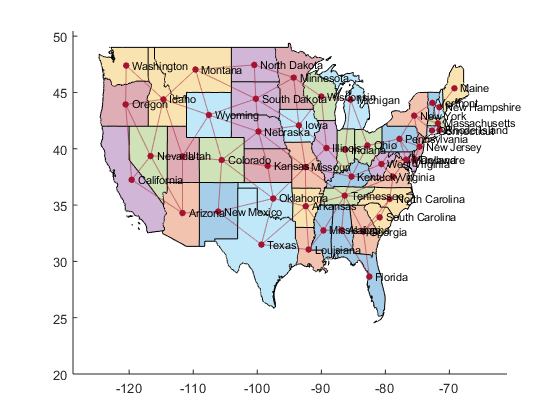
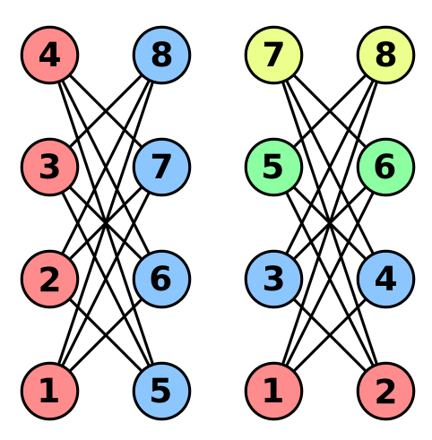

# Coloração de Grafos

## Mapas

{width=90% fig-align="center"}

## Coloração de Grafos

> [**Definição:**]{.label-def} Uma **coloração** (de vértices) de um grafo simples $G=(V,E)$ é uma função $f: V \to C$, onde, para todo $x,y \in V$,
>
> $$ \{x,y\} \in E  \Rightarrow f(x) \neq f(y) $$

Cada elemento do conjunto $C$ é denominado uma cor.

> [**Definição:**]{.label-def} $|img(f)|$ é o **número de cores** de $f$.

. . .

> [**Definição:**]{.label-def} Um grafo $G$ é **$k$-colorível** sss existe uma coloração de $G$ com no máximo $k$ cores.

> [**Nota:**]{.label-rmk} Um grafo é $k$-colorível sss for $k$-partido.

## Coloração de Grafos: Número Cromático

> [**Definição:**]{.label-def} O **número cromático** de $G$ é o **menor número de cores** $k$ tal que $G$ seja $k$-colorível.

> [**Notação:**]{.label-notn} Denotamos o número cromático de $G$ por $\chi(G)$. Dizemos que $G$ é $k$-cromático sss seu número cromático é $k$.

. . .

> [**Exercício:**]{.label-excs} Determine o número cromático dos grafos abaixo:

```{=html}
<div style="display: flex; justify-content: center; align-items: center; gap: 60px; margin: 6px 0;">
  <div id="cromatico-1"></div>
  <div id="cromatico-2"></div>
</div>
<div style="display: flex; justify-content: center; align-items: center; gap: 40px; margin: 6px 0;">
  <div id="cromatico-3"></div>
  <div id="cromatico-4"></div>
  <div id="cromatico-5"></div>
</div>
<script>
drawGraph("cromatico-1",
  [["a", 0, 0], ["b", 120, 0], ["c", 60, 55], ["d", 0, 110], ["e", 60, 110], ["f", 120, 110]],
  [["a", "b"], ["a", "d"], ["a", "c"], ["b", "f"], ["c", "e"], ["e", "f"], ["e", "d"]],
  { colorable: true, scale: 1.0 });

drawGraph("cromatico-2",
  [["a", 30, 0], ["b", 120, 0], ["c", 0, 30], ["d", 90, 30],
   ["e", 30, 90], ["f", 120, 90], ["g", 0, 120], ["h", 90, 120]],
  [["a", "b"], ["a", "e"], ["b", "f"], ["c", "a"], ["c", "d"], ["c", "g"],
   ["d", "b"], ["d", "h"], ["e", "f"], ["g", "e"], ["g", "h"], ["h", "f"]],
  { colorable: true, scale: 1.0 });

drawGraph("cromatico-3",
  [["n00", 0, 0], ["n04", 140, 0], ["n11", 35, 28], ["n13", 105, 28],
   ["n20", 0, 56], ["n22", 70, 56], ["n24", 140, 56],
   ["n31", 35, 84], ["n33", 105, 84], ["n40", 0, 112], ["n44", 140, 112]],
  [["n11", "n22"], ["n11", "n00"], ["n13", "n22"], ["n13", "n04"],
   ["n20", "n31"], ["n20", "n11"], ["n20", "n00"], ["n20", "n40"],
   ["n22", "n31"], ["n22", "n33"], ["n24", "n33"], ["n24", "n13"], ["n24", "n04"], ["n24", "n44"],
   ["n31", "n40"], ["n33", "n44"]],
  { colorable: true, scale: 1.0 });

drawGraph("cromatico-4",
  [["v0", 60, 10], ["v1", 12, 45], ["v2", 31, 100], ["v3", 89, 100], ["v4", 108, 45]],
  [["v0", "v1"], ["v0", "v2"], ["v0", "v3"], ["v0", "v4"], ["v1", "v2"],
   ["v1", "v3"], ["v1", "v4"], ["v2", "v3"], ["v2", "v4"], ["v3", "v4"]],
  { colorable: true, scale: 1.0 });

drawGraph("cromatico-5",
  [["a0", 80, 10], ["a1", 13, 58], ["a2", 39, 137], ["a3", 121, 137], ["a4", 147, 58],
   ["b0", 80, 45], ["b1", 47, 69], ["b2", 59, 108], ["b3", 101, 108], ["b4", 113, 69]],
  [["a0", "a1"], ["a1", "a2"], ["a2", "a3"], ["a3", "a4"], ["a4", "a0"],
   ["a0", "b0"], ["a1", "b1"], ["a2", "b2"], ["a3", "b3"], ["a4", "b4"],
   ["b0", "b2"], ["b2", "b4"], ["b4", "b1"], ["b1", "b3"], ["b3", "b0"]],
  { colorable: true, scale: 1.0 });
</script>
```

## Coloração de Grafos: Exercício (2)

Determine os números cromáticos das seguintes famílias de grafos:

:::: columns
::: {.column width="47.5%"}
- nulo
- completo
- caminho
- círculo
:::
::: {.column width="47.5%"}
- grade
- estrela
- roda
- k-cubo
:::
::::

## Coloração de Grafos: Alguns Resultados

Alguns resultados sobre o número cromático $\chi(G)$ de um grafo simples $G=(V,E)$

- $\chi(G) \leq |V|$ [(trivial)]{style="color:#1565c0"}
- $\omega(G) \leq \chi(G)$, onde $\omega(G)$ é o número de nodos do maior clique de $G$. [(trivial)]{style="color:#1565c0"}
- se $|E|=0$, então $\chi(G) \leq 1$. [(trivial)]{style="color:#1565c0"}
- se $G$ bipartido, então $\chi(G) \leq 2$. [(trivial)]{style="color:#1565c0"}

. . .

- $\chi(G) \leq \Delta(G) + 1$. [teorema, a ser visto]{style="color:#1565c0"}
- se $G$ planar, então $\chi(G) \leq 5$ [teorema, a ser visto]{style="color:#1565c0"}
- se $G$ planar, então $\chi(G) \leq 4$ [teorema, a ser visto (sem prova)]{style="color:#1565c0"}

## Coloração de Grafos: Algoritmos

- Decidir se um grafo é 2-colorível $\Leftrightarrow$ testar bipartição.
- Pode ser feito em **tempo linear** usando BFS ou DFS.

<br>

- Para **grafos perfeitos**, o número cromático pode ser obtido em tempo polinomial via *programação semidefinida*.

<br>

- Fórmulas fechadas para o **polinômio cromático** existem para:
  - Florestas, grafos cordais, ciclos, rodas, escadas.
- Grafos planares (ou com baixa *branch-width*):
  - Resolvíveis em tempo polinomial via **programação dinâmica**;
  - Mas exponencial na largura da decomposição.

## Coloração de Grafos: Algoritmos Exatos (1)

- Busca exaustiva para $k$ cores:
  $$
  k^n \text{ atribuições}
  $$
- Verifica cada atribuição → impraticável para $n$ moderado.

<br>

- Para obter:
  - Número cromático,
  - Polinômio cromático,

  É necessário repetir para $k = 1, \ldots, n-1$.

## Coloração de Grafos: Algoritmos Exatos (2)

- Usando **programação dinâmica** e limites no nº de conjuntos independentes máximos:
  $$
  k\text{-coloribilidade em } O(2.4423^n)
  $$
- Usando inclusão–exclusão + transformada zeta (Yates):
  $$
  k\text{-coloribilidade em } O(2^n \, n) \quad \text{para qualquer } k
  $$
- Algoritmos mais rápidos para casos específicos:
  - 3-colorabilidade: $\quad O(1.3289^n)$
  - 4-colorabilidade: $\quad O(1.7272^n)$
  - 5 e 6 cores: Algoritmos ainda mais rápidos.
- Melhorias também para famílias restritas (ex.: grafos esparsos).

## Coloração Gulosa (Greedy)

- Considere uma ordem de vértices: $v_1, v_2, \ldots, v_n$.
- Para cada $v_i$:
  - Olhe apenas para $v_1, \ldots, v_{i-1}$;
  - Pegue a **menor cor disponível** que não aparece nos vizinhos já coloridos;
  - Se necessário, crie uma nova cor.

<br>

- Simples, linear no número de arestas (dada a ordem).
- A **qualidade** da coloração depende fortemente da **ordem dos vértices**.

## Coloração Gulosa: Qualidade

:::: {.columns style="align-items: center;"}
::: {.column width="62%"}
- Sempre existe uma ordem de vértices que produz uma coloração ótima (com $\chi(G)$ cores) usando o método guloso.

<br>

- Por outro lado, o método pode ser **arbitrariamente ruim**:
  - Exemplo: **crown graph** com $n$ vértices:
    - É 2-colorível,
    - Mas existe uma ordem que faz o guloso usar $n/2$ cores.

<br>

- Moral: A **ordem dos vértices** é crucial.
:::
::: {.column width="35%"}
{width=100%}
:::
::::

## Heurística de Welsh–Powell

- Ideia: Ordenar vértices por **grau decrescente**.
- Aplicar coloração gulosa nessa ordem.
- Garante usar no máximo:
  $$
  \max_i \min\{deg(x_i)+1,\, i\}
  $$
  cores.
- Em particular: usa no máximo
  $$
  \Delta(G)+1
  $$
  cores (no máximo um a mais que o grau máximo).
- Simples, rápido, muito usado na prática.

## Coloração de Grafos: Limites para $\chi(G)$

> [**Teorema:**]{.label-thm} Em um grafo simples $G=(V,E)$ temos $\chi(G) \leq \Delta(G) + 1$

**Intuição:** O número cromático é sempre menor ou igual ao maior grau do grafo mais um.

[**Demonstração:**]{.label-prf} Seja $v_1, v_2, \ldots, v_n$ uma enumeração qualquer dos vértices de $V$. Seja $C=c_1,\ldots, c_k$ uma coleção de $k=\Delta(G)+1$ cores. Para cada $v_i$ atribua a primeira cor da enumeração $C$ que não ocorre em nenhum dos $v_1,\ldots,v_{i-1}$ anteriores que são adjacentes a $v_i$. No pior caso, o número máximo de vizinhos adjacentes que ocorrem antes de $v_i$ é $\Delta(G)$, e portanto precisamos de uma cor adicional para tal nodo $c_k$.

## Coloração de Grafos: Limites para $\chi(G)$ (2)

> [**Lema:**]{.label-lem} Se o grafo simples $G=(V,E)$ é planar, então existe um vértice $v$ tal que $deg(v) \leq 5$

[**Demonstração:**]{.label-prf} Por contradição, assuma que $deg(x) \geq 6$ para todo $x \in V$. Como $G$ é planar, a fórmula de Euler ($|V|+|F|=|E|+2$) vale, e temos

$$ |E| \leq 3 |V| - 6 $$

Contudo, como temos que todo $x \in V$ tem grau 6 ou mais, temos que $\sum_{x \in V}deg(v) \geq 6|V|$ e a soma de todos os graus de todos os vértices é $2|E|$ (*handshake-lema*):

$$ 2|E| \geq 6|V| \rightarrow |E| \geq 3|V| $$

O que gera, obviamente, uma contradição.

Logo, existe no mínimo um vértice $x \in V$ tal que $deg(x) \leq 5$.

## Coloração de Grafos: Limites para $\chi(G)$ (3)

> [**Teorema:**]{.label-thm} Se $G$ é simples e planar, então $\chi(G) \leq 5$.

[**Demonstração:**]{.label-prf} Por indução no número de vértices de $G$.

## Coloração de Grafos: Limites para $\chi(G)$ (4)

> [**Teorema:**]{.label-thm} Se $G$ é simples e planar, então $\chi(G) \leq 4$.

[**Demonstração:**]{.label-prf} (Appel & Haken, 1976) Não será vista nessa disciplina.

Problema famoso de teoria dos grafos, foi durante antes uma conjectura confirmada por exemplos, porém sem prova.

Primeiro teorema importante cuja prova recebeu ajuda de computadores na verificação (por força bruta) de um grande número de subcasos.

#

::: {style="text-align: center; margin-top: 15vh;"}
[?]{style="font-size: 5em; color: #d10000; font-weight: 700;"}
:::
