# Motivação e Aplicações

## Colorindo um Mapa

:::: {.columns style="display:flex; align-items:center;"}
::: {.column width="50%"}
::: {.r-stack}
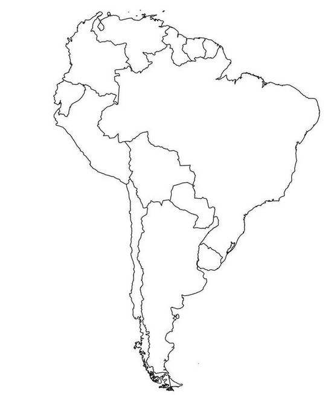{height="560"}

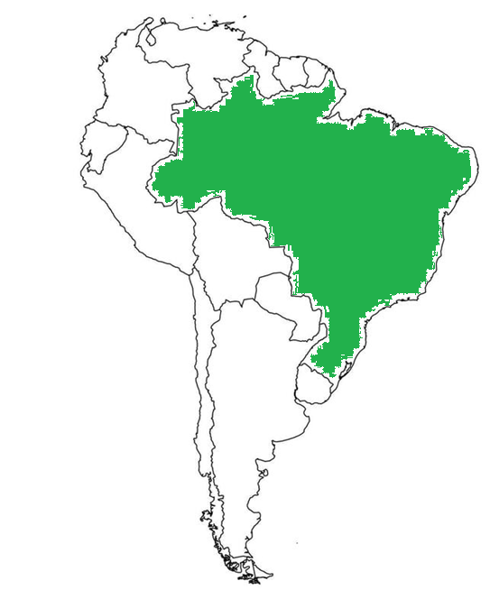{.fragment fragment-index=1 height="560"}

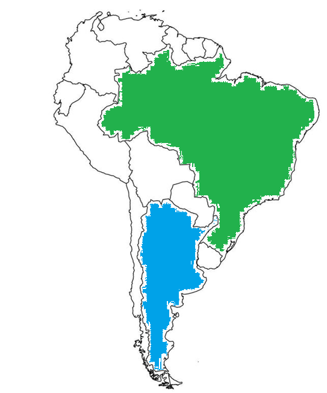{.fragment fragment-index=2 height="560"}

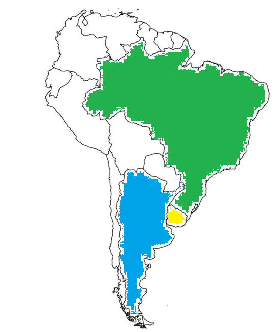{.fragment fragment-index=3 height="560"}

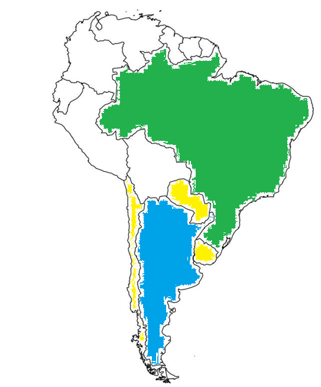{.fragment fragment-index=4 height="560"}

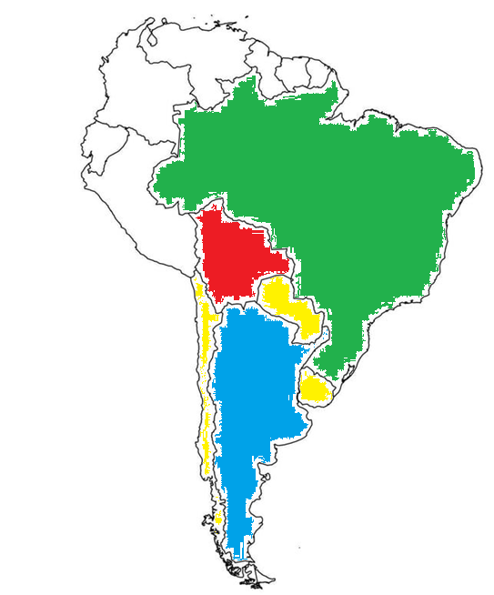{.fragment fragment-index=5 height="560"}

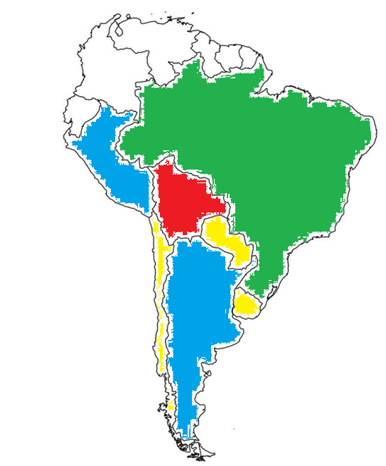{.fragment fragment-index=6 height="560"}

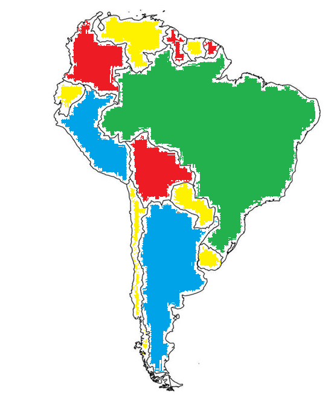{.fragment fragment-index=7 height="560"}
:::
:::

::: {.column width="50%"}
::: {style="font-size:0.8em;"}
> Vamos **colorir os países da América do Sul** de modo que [**países vizinhos tenham cores diferentes**]{.alert}.

::: {.fragment fragment-index=1}
- Começamos pelo **Brasil**: [verde]{style="color:#1f9e45; font-weight:700;"}.
:::

::: {.fragment fragment-index=2}
- **Argentina**: [azul]{style="color:#0a8fd6; font-weight:700;"}. O **Uruguai** é vizinho dos dois: [precisamos de uma terceira cor]{.alert}.
:::

::: {.fragment fragment-index=3}
- **Uruguai**: [amarelo]{style="color:#d4a900; font-weight:700;"}.
:::

::: {.fragment fragment-index=4}
- **Chile** e **Paraguai**: [amarelo]{style="color:#d4a900; font-weight:700;"}. A **Bolívia** é vizinha de Brasil, Argentina, Chile e Paraguai: [não pode ser verde, amarelo nem azul]{.alert}!
:::

::: {.fragment fragment-index=5}
- **Bolívia**: [vermelho]{style="color:#e0202a; font-weight:700;"}, a **quarta cor**.
:::

::: {.fragment fragment-index=6}
- **Peru**: [azul]{style="color:#0a8fd6; font-weight:700;"}.
:::

::: {.fragment fragment-index=7}
- E assim por diante, até o último país.
:::
:::
:::
::::

## Do Mapa ao Grafo

:::: {.columns style="display:flex; align-items:center;"}
::: {.column width="50%"}
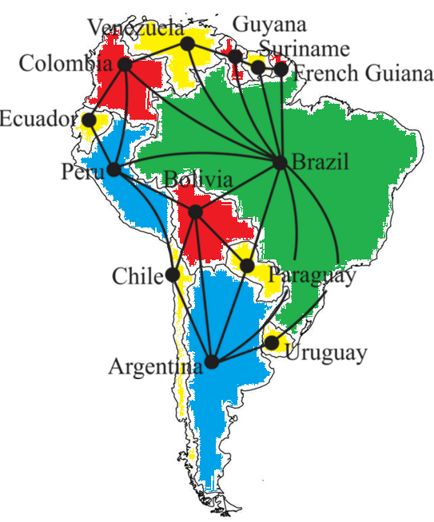{height="560"}
:::

::: {.column width="50%"}
- **Nodos:** países.
- **Arestas:** países que fazem fronteira.
- **Cores:** cores do mapa.

::: {.fragment}
Como no **dual planar** (aula passada), o grafo de um mapa é **planar**.
:::

::: {.fragment}
> Foram necessárias **4 cores** para colorir a América do Sul.
:::

::: {.fragment}
> [**Nesta aula:**]{.label-rmk} todo **grafo planar** (e.g., mapas) pode ser colorido com **4 cores**!
:::
:::
::::

## Agendamento de Provas

::: {style="font-size:0.85em;"}
- **Disciplinas:** Teoria dos Grafos, Estruturas de Dados, ARQ I, Lógica e Cálculo II.
- Professores querem agendar as datas das provas.
- **Restrição:** [nenhum aluno com mais de uma prova no mesmo dia]{.alert}.
- Qual o **menor número de dias** de provas necessário?
:::

:::: {.columns style="display:flex; align-items:center;"}
::: {.column width="42%"}
::: {style="font-size:0.75em;"}
|            | Bob | Alice | João | Maria |
|------------|:---:|:-----:|:----:|:-----:|
| Grafos     |  x  |       |  x   |       |
| E.D.       |  x  |   x   |      |   x   |
| Cálculo\ II |     |       |      |   x   |
| ARQ I      |     |       |  x   |       |
| Lógica     |     |   x   |      |       |

[Provas que cada aluno precisa realizar.]{style="display:block; text-align:center; color:#555555;"}
:::
:::

::: {.column width="58%"}
```{=html}
<div style="display: flex; justify-content: center;"><div id="provas-grafo"></div></div>
<script>
drawGraph("provas-grafo",
  [["G", 0, 0, "box white", "Grafos"], ["ED", 190, 0, "box white", "E.D."],
   ["ARQ", -40, 90, "box white", "ARQ I"], ["LOG", 240, 90, "box white", "Lógica"],
   ["CAL", 100, 150, "box white", "Cálculo II"]],
  [["G", "ED", "hidden", "Bob"], ["ED", "LOG", "hidden", "Alice"],
   ["G", "ARQ", "hidden", "João"], ["ED", "CAL", "hidden", "Maria"]],
  { scale: 1.3, steps: [
    { "G-ED": "-hidden" },
    { "ED-LOG": "-hidden", "G-ARQ": "-hidden", "ED-CAL": "-hidden" },
    { "G": "-white yellow", "CAL": "-white yellow", "LOG": "-white yellow" },
    { "ARQ": "-white blue", "ED": "-white blue" }
  ] });
</script>
```

::: {style="font-size:0.8em; line-height:1.35;"}
::: {.fragment fragment-index=0}
**Nodos:** disciplinas. **Arestas:** disciplinas com algum aluno em comum (Bob faz Grafos e E.D.).
:::

::: {.fragment fragment-index=1}
Alice, João e Maria geram as demais arestas.
:::

::: {.fragment fragment-index=2}
[Dia 1:]{style="color:#c17900; font-weight:700;"} Grafos, Cálculo II e Lógica.
:::

::: {.fragment fragment-index=3}
[Dia 2:]{style="color:#1565c0; font-weight:700;"} ARQ I e E.D. **Cores:** dias. Bastam **2 dias**!
:::
:::
:::
::::

## Sudoku

:::: {.columns style="display:flex; align-items:center;"}
::: {.column width="45%"}
- **Sudoku** $4 \times 4$: cada linha, coluna e bloco $2 \times 2$ deve conter os valores de 1 a 4.

<br>

- **Nodos:** células do jogo.
- **Arestas:** células na mesma linha, coluna ou bloco (restrições).
- **Cores:** valores de 1 a 4.

::: {.fragment}
<br>

Resolver o Sudoku é **completar uma 4-coloração** parcial do grafo! (No Sudoku $9 \times 9$: 81 nodos e 9 cores.)
:::
:::

::: {.column width="55%"}
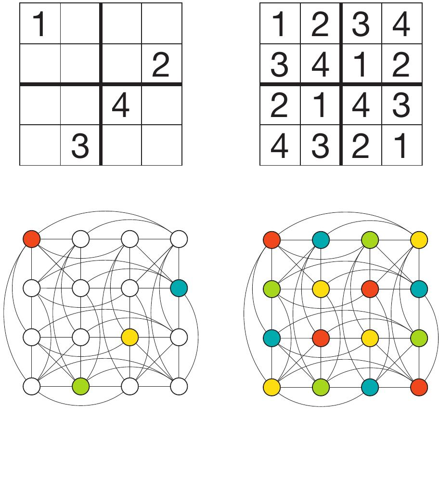{width="100%"}
:::
::::

## Alocação de Registradores

::: {style="font-size:0.85em;"}
- Considere o programa abaixo, com variáveis $a, \ldots, e$ e 3 registradores: $R_1, R_2, R_3$.
- Como **alocar as variáveis em registradores** de modo a [evitar conflitos temporais]{.alert}?
- **Nodos:** variáveis. **Arestas:** variáveis em uso ao mesmo tempo. **Cores:** registradores.
:::

```{=html}
<div style="display:flex; justify-content:center; align-items:center; gap:40px; margin-top:10px;">
<svg viewBox="0 0 330 230" style="display:block; width:380px; height:auto;" xmlns="http://www.w3.org/2000/svg" role="img" aria-label="Programa com 6 linhas e o intervalo em que cada variável está em uso: a nas linhas 1 a 3, b de 2 a 5, c de 3 a 4, d de 4 a 5 e e na linha 6">
<g font-size="21" fill="#23373b" font-family="'Fira Code', 'DejaVu Sans Mono', monospace" dominant-baseline="central">
<text x="160" y="32">a := 10</text>
<text x="160" y="66">b := a * 2</text>
<text x="160" y="100">c := b + a</text>
<text x="160" y="134">d := b + c</text>
<text x="160" y="168">b := d − 1</text>
<text x="160" y="202">e := 7</text>
</g>
<g fill="#ffffff" stroke="#23373b" stroke-width="2">
<rect x="114" y="18" width="16" height="96" rx="3"/>
<rect x="88" y="52" width="16" height="130" rx="3"/>
<rect x="62" y="86" width="16" height="62" rx="3"/>
<rect x="36" y="120" width="16" height="62" rx="3"/>
<rect x="10" y="188" width="16" height="28" rx="3"/>
</g>
<g class="fragment" data-fragment-index="0" fill="#f9a825" stroke="#c17900" stroke-width="2">
<rect x="114" y="18" width="16" height="96" rx="3"/>
<rect x="36" y="120" width="16" height="62" rx="3"/>
<rect x="10" y="188" width="16" height="28" rx="3"/>
</g>
<g class="fragment" data-fragment-index="1" fill="#2e7d32" stroke="#1b5e20" stroke-width="2">
<rect x="88" y="52" width="16" height="130" rx="3"/>
</g>
<g class="fragment" data-fragment-index="2" fill="#7b1fa2" stroke="#4a148c" stroke-width="2">
<rect x="62" y="86" width="16" height="62" rx="3"/>
</g>
<g font-size="17" fill="#23373b" text-anchor="middle" font-family="KaTeX_Math, 'Times New Roman', serif" font-style="italic">
<text x="122" y="12">a</text>
<text x="96" y="46">b</text>
<text x="70" y="80">c</text>
<text x="44" y="114">d</text>
<text x="18" y="182">e</text>
</g>
</svg>
<div id="registradores-grafo"></div>
<div style="border:2px solid #c62828; border-radius:6px; padding:8px 16px; font-size:0.9em; line-height:1.7; min-width:7.5em;">
<span style="color:#c17900; font-weight:700;">R1</span>: <span class="fragment" data-fragment-index="0">a, d, e</span><br>
<span style="color:#2e7d32; font-weight:700;">R2</span>: <span class="fragment" data-fragment-index="1">b</span><br>
<span style="color:#7b1fa2; font-weight:700;">R3</span>: <span class="fragment" data-fragment-index="2">c</span>
</div>
</div>
<script>
drawGraph("registradores-grafo",
  [["a", 80, 0, "white labeled", "a"], ["b", 140, 65, "white labeled", "b"],
   ["c", 20, 65, "white labeled", "c"], ["d", 80, 130, "white labeled", "d"],
   ["e", -40, 10, "white labeled", "e"]],
  [["a", "b"], ["a", "c"], ["b", "c"], ["b", "d"], ["c", "d"]],
  { scale: 1.3, steps: [
    { "a": "-white yellow", "d": "-white yellow", "e": "-white yellow" },
    { "b": "-white green" },
    { "c": "-white purple" }
  ] });
</script>
```

## Frequências de Torres de Rádio

- **Problema:** alocar frequências para torres de rádio.
- **Restrição:** [evitar interferência de sinal entre torres próximas]{.alert}.
- **Nodos:** torres. **Arestas:** torres próximas o suficiente para interferir. **Cores:** frequências.

:::: {.columns style="display:flex; align-items:center;"}
::: {.column width="50%"}
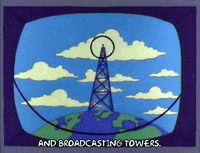{width="85%" fig-align="center"}
:::

::: {.column width="50%"}
{width="70%" fig-align="center"}
:::
::::

# Coloração de Grafos

## Coloração de Grafos

> [**Definição:**]{.label-def} Seja $G=(V,E)$ um grafo simples. Uma **coloração** (de vértices) de $G$ é uma função $f: V \to C$ tal que, para todo $u, v \in V$,
>
> $$ \{u,v\} \in E \Rightarrow f(u) \neq f(v) $$
>
> onde $C \subseteq \mathbb{N}$ é o conjunto de **cores**.

. . .

[**Exemplo:**]{.label-exmp}

```{=html}
<div style="display:flex; justify-content:center; align-items:center; gap:40px; margin-top:6px;">
<div id="def-coloracao"></div>
<svg viewBox="0 0 300 250" style="display:block; width:280px; height:auto;" xmlns="http://www.w3.org/2000/svg" role="img" aria-label="Função f de V em C: A e B vão para 0, C e E vão para 1, D vai para 2">
<defs><marker id="colmap-arrow" viewBox="0 0 10 10" refX="10" refY="5" markerWidth="10" markerHeight="10" markerUnits="userSpaceOnUse" orient="auto"><path d="M0,0 L10,5 L0,10 z" fill="#1d4f7d"/></marker></defs>
<text x="20" y="136" font-size="26" fill="#23373b" font-family="KaTeX_Math, 'Times New Roman', serif" font-style="italic" dominant-baseline="central">f<tspan font-style="normal" font-family="KaTeX_Main, 'Times New Roman', serif">:</tspan></text>
<ellipse cx="95" cy="136" rx="34" ry="102" fill="#2e7d32" fill-opacity="0.12" stroke="#2e7d32" stroke-width="2"/>
<ellipse cx="228" cy="136" rx="34" ry="102" fill="#1565c0" fill-opacity="0.10" stroke="#1565c0" stroke-width="2"/>
<text x="95" y="18" font-size="24" fill="#23373b" text-anchor="middle" font-family="KaTeX_Math, 'Times New Roman', serif" font-style="italic" dominant-baseline="central">V</text>
<text x="228" y="18" font-size="24" fill="#23373b" text-anchor="middle" font-family="KaTeX_Math, 'Times New Roman', serif" font-style="italic" dominant-baseline="central">C</text>
<g font-size="18" fill="#23373b" text-anchor="middle" font-family="KaTeX_Math, 'Times New Roman', serif" font-style="italic" dominant-baseline="central">
<text x="92" y="62">A</text><text x="92" y="99">B</text><text x="92" y="136">C</text><text x="92" y="173">D</text><text x="92" y="210">E</text>
</g>
<g font-size="20" font-weight="700" text-anchor="middle" font-family="KaTeX_Main, 'Times New Roman', serif" dominant-baseline="central">
<text x="232" y="72" fill="#c62828">0</text><text x="232" y="136" fill="#2e7d32">1</text><text x="232" y="200" fill="#1565c0">2</text>
</g>
<g stroke="#1d4f7d" stroke-width="2.2" fill="none" marker-end="url(#colmap-arrow)">
<line x1="106" y1="62" x2="218" y2="71"/>
<line x1="106" y1="99" x2="218" y2="74"/>
<line x1="106" y1="136" x2="218" y2="136"/>
<line x1="106" y1="173" x2="218" y2="198"/>
<line x1="106" y1="210" x2="218" y2="139"/>
</g>
</svg>
<div style="font-size:0.85em; text-align:center; max-width:9em;">
<span class="math inline">|img(f)| = 3</span>
</div>
</div>
<script>
drawGraph("def-coloracao",
  [["A", 0, 0, "red labeled", "A"], ["E", 120, 0, "green labeled", "E"],
   ["B", 60, 55, "red labeled", "B"], ["C", 0, 120, "green labeled", "C"],
   ["D", 120, 120, "blue labeled", "D"]],
  [["A", "E"], ["A", "C"], ["E", "B"], ["E", "D"], ["B", "C"], ["B", "D"], ["C", "D"]],
  { scale: 1.3 });
</script>
```

> [**Definição:**]{.label-def} $|img(f)|$ é o **número de cores** da coloração $f$.

## Grafos $k$-Coloríveis

> [**Definição:**]{.label-def} Um grafo $G$ é **$k$-colorível** sss existe uma coloração de $G$ com [**no máximo**]{.alert} $k$ cores.

:::: {.columns style="display:flex; align-items:center;"}
::: {.column width="35%"}
```{=html}
<div style="display:flex; justify-content:center;"><div id="k-colorivel"></div></div>
<script>
drawGraph("k-colorivel",
  [["A", 0, 0, "red labeled", "A"], ["E", 120, 0, "green labeled", "E"],
   ["B", 60, 55, "red labeled", "B"], ["C", 0, 120, "green labeled", "C"],
   ["D", 120, 120, "blue labeled", "D"]],
  [["A", "E"], ["A", "C"], ["E", "B"], ["E", "D"],
   ["B", "C", "orange thick"], ["B", "D", "orange thick"], ["C", "D", "orange thick"]],
  { scale: 1.2 });
</script>
```
:::

::: {.column width="65%"}
[**Exemplo:**]{.label-exmp} o grafo do slide anterior é **3-colorível** (e também 4-colorível, 5-colorível, ...).

::: {.fragment}
Mas ele **não** é 2-colorível: $B$, $C$ e $D$ formam um [triângulo]{style="color:#eb811b; font-weight:700;"}, e cada um precisa de uma cor diferente.
:::
:::
::::

. . .

:::: {.columns style="display:flex; align-items:center;"}
::: {.column width="88%"}
> [**Importante:**]{.label-rmk} pseudografos com **laços** não são coloríveis: um laço $\{v, v\}$ exigiria $f(v) \neq f(v)$.
:::

::: {.column width="12%"}
```{=html}
<svg viewBox="0 0 50 60" style="display:block; width:50px; height:auto; margin:0 auto;" xmlns="http://www.w3.org/2000/svg" role="img" aria-label="Vértice com um laço">
<path d="M 18,40 C -2,4 52,4 32,40" fill="none" stroke="#c62828" stroke-width="3"/>
<circle cx="25" cy="46" r="10" fill="#ffffff" stroke="#23373b" stroke-width="2.5"/>
</svg>
```
:::
::::

## Número Cromático

> [**Definição:**]{.label-def} O **número cromático** $\chi(G)$ de um grafo $G$ é o [**menor número de cores**]{.alert} $k$ tal que $G$ é $k$-colorível.
>
> $$ G \text{ é } k\text{-cromático} \iff \chi(G) = k $$

:::: {.columns style="display:flex; align-items:center;"}
::: {.column width="50%"}
```{=html}
<div style="display:flex; justify-content:center;"><div id="cromatico-petersen"></div></div>
<script>
drawGraph("cromatico-petersen",
  [["a0", 80, 10, "white"], ["a1", 13, 58, "white"], ["a2", 39, 137, "white"],
   ["a3", 121, 137, "white"], ["a4", 147, 58, "white"],
   ["b0", 80, 45, "white"], ["b1", 47, 69, "white"], ["b2", 59, 108, "white"],
   ["b3", 101, 108, "white"], ["b4", 113, 69, "white"]],
  [["a0", "a1"], ["a1", "a2"], ["a2", "a3"], ["a3", "a4"], ["a4", "a0"],
   ["a0", "b0"], ["a1", "b1"], ["a2", "b2"], ["a3", "b3"], ["a4", "b4"],
   ["b0", "b2"], ["b2", "b4"], ["b4", "b1"], ["b1", "b3"], ["b3", "b0"]],
  { scale: 1.55, steps: [
    // 1. dez cores, uma por vértice
    { "a0": "-white red", "a1": "-white blue", "a2": "-white green", "a3": "-white orange",
      "a4": "-white purple", "b0": "-white yellow", "b1": "-white cyan", "b2": "-white pink",
      "b3": "-white brown", "b4": "-white" },
    // 2. nove cores: b4 (não adjacente a a0) passa a usar a cor de a0
    { "b4": "red" },
    // 3. ...
    { "nodes": "white -red -blue -green -orange -purple -yellow -cyan -pink -brown" },
    // 4. três cores
    { "a0": "-white red", "a1": "-white blue", "a2": "-white red", "a3": "-white blue",
      "a4": "-white green", "b0": "-white blue", "b1": "-white green", "b2": "-white green",
      "b3": "-white red", "b4": "-white red" },
    // 5. o ciclo externo é ímpar: não há 2-coloração
    { "a0-a1": "red thick", "a1-a2": "red thick", "a2-a3": "red thick",
      "a3-a4": "red thick", "a4-a0": "red thick" }
  ] });
</script>
```
[Grafo de Petersen]{style="display:block; text-align:center; font-size:0.7em; color:#1565c0;"}
:::

::: {.column width="50%"}
[**Exemplo:**]{.label-exmp}

::: {.fragment fragment-index=0}
- 10-colorível
:::

::: {.fragment fragment-index=1}
- 9-colorível
:::

::: {.fragment fragment-index=2}
- $\ldots$
:::

::: {.fragment fragment-index=3}
- **3-colorível**
:::

::: {.fragment fragment-index=4}
- [não é 2-colorível]{.alert}: o [ciclo externo]{style="color:#c62828;"} tem 5 vértices (ciclo ímpar).
:::

::: {.fragment fragment-index=5}
$\Rightarrow$ **3-cromático**: $\chi(G) = 3$.
:::
:::
::::

## Número Cromático: Exercício

> [**Exercício:**]{.label-excs} Determine o número cromático dos grafos abaixo. (Clique nos vértices para colori-los.)

```{=html}
<div style="display:grid; grid-template-columns:1fr 1fr; justify-items:center; align-items:center; gap:30px 60px; margin-top:20px;">
  <div id="cromatico-ex-1"></div>
  <div id="cromatico-ex-2"></div>
  <div id="cromatico-ex-3"></div>
  <div id="cromatico-ex-4"></div>
</div>
<script>
drawGraph("cromatico-ex-1",
  [["b00", 58, 0, "white"], ["b10", 174, 0, "white"], ["b01", 58, 90, "white"], ["b11", 174, 90, "white"],
   ["f00", 0, 48, "white"], ["f10", 115, 48, "white"], ["f01", 0, 140, "white"], ["f11", 115, 140, "white"]],
  [["b00", "b10"], ["b10", "b11"], ["b11", "b01"], ["b01", "b00"],
   ["f00", "f10"], ["f10", "f11"], ["f11", "f01"], ["f01", "f00"],
   ["b00", "f00"], ["b10", "f10"], ["b01", "f01"], ["b11", "f11"]],
  { colorable: true, scale: 1.2 });

drawGraph("cromatico-ex-2",
  [["tl", 0, 0, "white"], ["tr", 248, 0, "white"], ["m", 125, 55, "white"],
   ["bl", 0, 122, "white"], ["bm", 125, 122, "white"], ["br", 248, 122, "white"]],
  [["tl", "tr"], ["tl", "bl"], ["tr", "br"], ["bl", "bm"], ["bm", "br"], ["tl", "m"], ["m", "bm"]],
  { colorable: true, scale: 1.0 });

drawGraph("cromatico-ex-3",
  [["l1", 0, 0, "white"], ["l2", 0, 63, "white"], ["l3", 0, 126, "white"],
   ["la", 70, 31, "white"], ["lb", 70, 98, "white"], ["c", 137, 63, "white"],
   ["ra", 203, 31, "white"], ["rb", 203, 98, "white"],
   ["r1", 270, 0, "white"], ["r2", 270, 63, "white"], ["r3", 270, 126, "white"]],
  [["l1", "l2"], ["l2", "l3"], ["l1", "la"], ["l2", "la"], ["l2", "lb"], ["l3", "lb"],
   ["la", "c"], ["lb", "c"], ["c", "ra"], ["c", "rb"],
   ["ra", "r1"], ["ra", "r2"], ["rb", "r2"], ["rb", "r3"], ["r1", "r2"], ["r2", "r3"]],
  { colorable: true, scale: 1.0 });

drawGraph("cromatico-ex-4",
  [["l1", 0, 0, "white"], ["l2", 0, 62, "white"], ["l3", 0, 124, "white"],
   ["r1", 134, 0, "white"], ["r2", 134, 62, "white"], ["r3", 134, 124, "white"]],
  [["l1", "r1"], ["l1", "r2"], ["l1", "r3"], ["l2", "r1"], ["l2", "r2"],
   ["l2", "r3"], ["l3", "r1"], ["l3", "r2"], ["l3", "r3"]],
  { colorable: true, scale: 1.2 });
</script>
```

# Limites para o Número Cromático

## Limites Triviais

Seja $\chi(G)$ o **número cromático** de um grafo simples $G = (V, E)$.

::: {style="display:flex; align-items:center; gap:40px; min-height:90px;"}
- Se $|V| = 0$, então [$\chi(G) = 0$.]{.fragment fragment-index=0}
:::

::: {.fragment fragment-index=1 style="display:flex; align-items:center; gap:40px; min-height:110px;"}
- Se $|E| = 0$ e $|V| > 0$, então [$\chi(G) = 1$.]{.fragment fragment-index=2}

```{=html}
<div class="fragment" data-fragment-index="2"><div id="limite-nulo"></div></div>
<script>
drawGraph("limite-nulo",
  [["a", 0, 10, "green"], ["b", 45, 0, "green"], ["c", 90, 18, "green"], ["d", 40, 45, "green"]],
  [], { scale: 1.3 });
</script>
```
:::

::: {.fragment fragment-index=3 style="display:flex; align-items:center; gap:40px; min-height:130px;"}
- Para qualquer $G$: $\chi(G) \leq$ [$|V|$ (basta dar uma cor diferente para cada vértice).]{.fragment fragment-index=4}

```{=html}
<div class="fragment" data-fragment-index="4"><div id="limite-k4"></div></div>
<script>
drawGraph("limite-k4",
  [["a", 0, 0, "green"], ["b", 70, 0, "red"], ["c", 0, 70, "blue"], ["d", 70, 70, "yellow"]],
  [["a", "b"], ["a", "c"], ["a", "d"], ["b", "c"], ["b", "d"], ["c", "d"]],
  { scale: 1.3 });
</script>
```
:::

## Limites: Partições e Cliques

::: {style="display:flex; align-items:center; gap:40px; min-height:110px;"}
- Se $G$ é **bipartido**, então [$\chi(G) \leq 2$.]{.fragment fragment-index=0}

```{=html}
<div class="fragment" data-fragment-index="0"><div id="limite-bipartido"></div></div>
<script>
drawGraph("limite-bipartido",
  [["t0", 0, 0, "red"], ["t1", 40, 0, "red"], ["t2", 80, 0, "red"], ["t3", 120, 0, "red"], ["t4", 160, 0, "red"],
   ["u0", 40, 60, "blue"], ["u1", 80, 60, "blue"], ["u2", 120, 60, "blue"]],
  [["t0", "u0"], ["t0", "u1"], ["t0", "u2"], ["t1", "u0"], ["t1", "u1"], ["t1", "u2"],
   ["t2", "u0"], ["t2", "u1"], ["t2", "u2"], ["t3", "u0"], ["t3", "u1"], ["t3", "u2"],
   ["t4", "u0"], ["t4", "u1"], ["t4", "u2"]],
  { scale: 1.2 });
</script>
```
:::

::: {.fragment fragment-index=1}
- Mais geralmente: se $G$ é **$k$-partido**, então [$\chi(G) \leq k$ (uma cor para cada parte).]{.fragment fragment-index=2}
:::

::: {.fragment fragment-index=3}
<br>

::: {style="display:flex; align-items:center; gap:40px;"}
::: {}
- Seja $\omega(G)$ o tamanho do **maior clique** de $G$. Então [$\chi(G) \geq \omega(G)$.]{.fragment fragment-index=4}

  ::: {.fragment fragment-index=4}
  - Em um clique, cada vértice deve [**obrigatoriamente**]{.alert} ter uma cor diferente.
  :::
:::

```{=html}
<div class="fragment" data-fragment-index="4" style="display:flex; align-items:center; gap:20px;">
<div id="limite-k5"></div>
<div style="white-space:nowrap;"><span class="math inline">\chi(K_5) = 5</span></div>
</div>
<script>
drawGraph("limite-k5",
  [["v0", 50, 10, "blue"], ["v1", 12, 38, "red"], ["v2", 26, 82, "green"], ["v3", 74, 82, "yellow"], ["v4", 88, 38, "purple"]],
  [["v0", "v1"], ["v0", "v2"], ["v0", "v3"], ["v0", "v4"], ["v1", "v2"],
   ["v1", "v3"], ["v1", "v4"], ["v2", "v3"], ["v2", "v4"], ["v3", "v4"]],
  { scale: 1.3 });
</script>
```
:::
:::

## Limite Superior: $\chi(G) \leq \Delta(G) + 1$

> [**Teorema:**]{.label-thm} Seja $G = (V, E)$ um grafo simples, onde $\Delta(G)$ é o [**maior grau**]{.alert} de algum vértice em $V$. Então
>
> $$ \chi(G) \leq \Delta(G) + 1. $$

. . .

**Ideia:** Se um vértice $u$ possui $d$ vizinhos, então mesmo que cada vizinho tenha uma cor diferente, basta **uma cor adicional** para $u$ ($d + 1$ cores). Como $d \leq \Delta(G)$ para todo vértice, $\Delta(G) + 1$ cores são suficientes.

. . .

> [**Nota:**]{.label-rmk} O limite é justo: $\chi(K_n) = n = \Delta(K_n) + 1$. (Teorema de Brooks: grafos completos e ciclos ímpares são os únicos grafos conexos que o atingem.)

## Limite Superior: Demonstração

[**Demonstração:**]{.label-prf}

::: {style="font-size:0.9em;"}
- Seja $v_1, v_2, \ldots, v_n$ uma permutação arbitrária dos vértices em $V$.
- Seja $C = \{c_1, \ldots, c_k\}$ um conjunto de $k = \Delta(G) + 1$ cores.

::: {.fragment fragment-index=0}
- **Colorindo $v_i$** (em ordem): atribua a **primeira cor** não usada em nenhum vizinho já colorido.
:::

::: {.fragment fragment-index=1}
- [**Pior caso:**]{.alert} há $\Delta(G)$ vizinhos de $v_i$ já coloridos, todos com cores diferentes.
:::

::: {.fragment fragment-index=2}
- Portanto, precisamos de **uma cor adicional**: no máximo $\Delta(G) + 1$ cores. $\blacksquare$
:::
:::

```{=html}
<div style="display:flex; justify-content:center; align-items:center; gap:60px;">
<div id="delta-mais-um"></div>
<div style="font-size:0.85em; line-height:1.6;">
<span class="math inline">\Delta(G) = 3</span><br>
<span class="math inline">k = \Delta(G) + 1 = 4</span>
</div>
</div>
<script>
drawGraph("delta-mais-um",
  [["dots", -50, 0, "dots", "…"],
   ["v3", 0, 0, "white below lg", "vᵢ₋₃"], ["v2", 80, 0, "white below lg", "vᵢ₋₂"],
   ["v1", 160, 0, "white below lg", "vᵢ₋₁"], ["v0", 240, 0, "white below lg", "vᵢ"]],
  [["v3", "v2"], ["v2", "v1"], ["v1", "v0"],
   ["v3", "v0", "up3"], ["v2", "v0", "up2"], ["v3", "v1", "down2"]],
  { scale: 1.3, steps: [
    { "v3": "-white green", "v2": "-white red", "v1": "-white yellow" },
    { "v1-v0": "red thick", "v2-v0": "red thick", "v3-v0": "red thick" },
    { "v0": "-white blue" }
  ] });
</script>
```

> [**Nota:**]{.label-rmk} este procedimento é exatamente o **algoritmo guloso**, que veremos no final da aula.

# Coloração de Grafos Planares

## Coloração e Grafos Planares

:::: {.columns style="display:flex; align-items:center;"}
::: {.column width="65%"}
- Restringindo nossa atenção a **grafos planares**, obtemos resultados mais precisos.

<br>

- **Conjectura das 4 Cores:** é sempre possível [colorir um mapa]{style="color:#1565c0;"} usando [apenas 4 cores]{.alert}.
  - Postulada em **1852** por Francis Guthrie, ao colorir o mapa dos condados da Inglaterra.

<br>

- Vamos começar por um resultado mais fraco (e com prova bem mais simples): o **Teorema das 5 Cores**.
:::

::: {.column width="35%"}
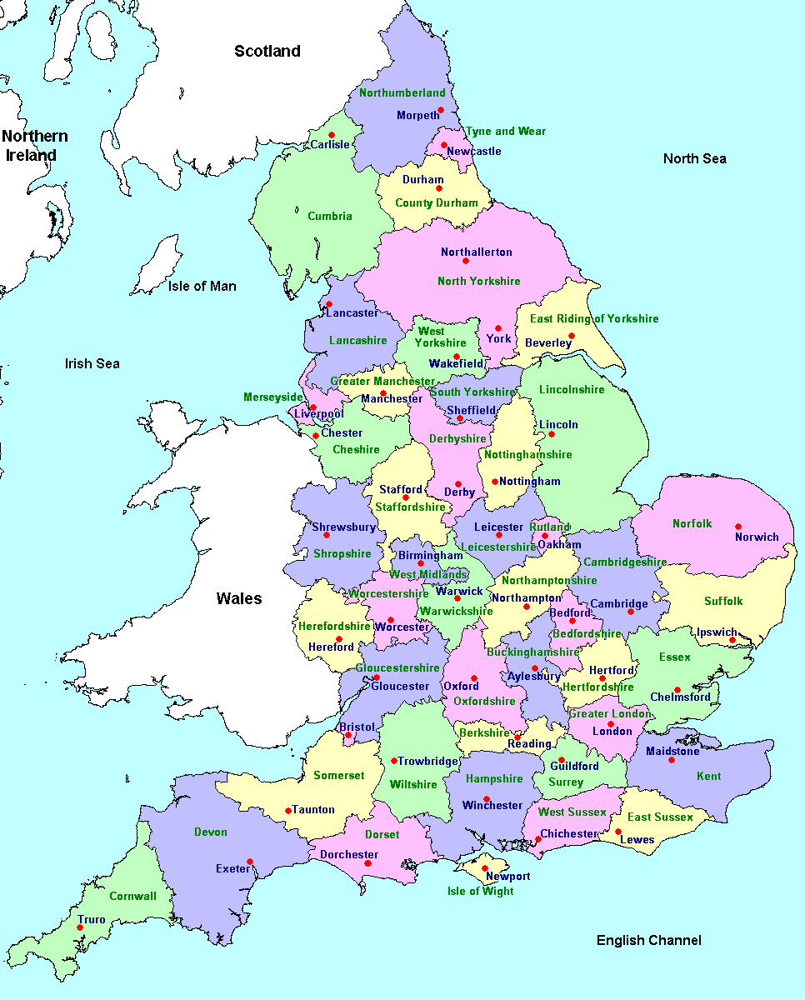{width="100%"}
:::
::::

## Teorema das 5 Cores: Lema

> [**Teorema:**]{.label-thm} (5 Cores) Se $G = (V, E)$ é **simples e planar**, então $\chi(G) \leq 5$.

. . .

> [**Lema:**]{.label-lem} Seja $G = (V, E)$ um grafo simples e planar. Então existe pelo menos um vértice $v$ com [**no máximo 5 vizinhos**]{.alert}.

[**Demonstração:**]{.label-prf} Por contradição. Assuma que todo vértice $v$ tem **pelo menos 6 vizinhos**.

::: {.incremental}
- Pelo corolário da fórmula de Euler (aula passada), temos
  $$ |E| \leq 3|V| - 6 $$
- Porém, se todo vértice tem pelo menos 6 vizinhos, como $\sum_{v} deg(v) = 2|E|$ (*handshake lemma*):
  $$ 2|E| \geq 6|V| \quad \Rightarrow \quad |E| \geq 3|V| $$
- [**Contradição!**]{.alert} Teríamos $3|V| \leq |E| \leq 3|V| - 6$. $\blacksquare$
:::

## Teorema das 5 Cores: Indução

> [**Teorema:**]{.label-thm} (5 Cores) Se $G = (V, E)$ é **simples e planar**, então $\chi(G) \leq 5$.

[**Demonstração:**]{.label-prf} Por indução no número de vértices $n$.

**Proposição** $P(n)$: Se $G$ é simples, planar e possui $n$ vértices, então $\chi(G) \leq 5$.

. . .

:::: {.columns style="display:flex; align-items:center;"}
::: {.column width="75%"}
**Caso base:** $P(n)$ para $n \leq 5$. Trivial: cada vértice pode receber uma cor diferente.
:::

::: {.column width="25%"}
```{=html}
<div style="display:flex; justify-content:center;"><div id="cinco-base"></div></div>
<script>
drawGraph("cinco-base",
  [["h", 50, 50, "purple"], ["n", 50, 0, "blue"], ["e", 100, 50, "red"], ["s", 50, 100, "green"], ["w", 0, 50, "yellow"]],
  [["n", "e"], ["e", "s"], ["s", "w"], ["w", "n"], ["h", "n"], ["h", "e"], ["h", "s"], ["h", "w"]],
  { scale: 0.9 });
</script>
```
:::
::::

. . .

**Hipótese de indução:** $P(k)$ vale para todo $k < n$, isto é, todo grafo simples e planar com $k < n$ vértices tem $\chi \leq 5$.

. . .

**Passo:** vamos demonstrar que $P(k < n) \to P(n)$. Seja $G$ simples e planar com $n$ vértices. Pelo **lema**, existe um vértice $v$ com no máximo 5 vizinhos. Dois casos:

- **Caso 1:** $v$ tem no máximo 4 vizinhos.
- **Caso 2:** $v$ tem exatamente 5 vizinhos.

## Teorema das 5 Cores: Caso 1

**Caso 1:** $v$ tem [no máximo 4 vizinhos]{.alert}.

:::: {.columns style="display:flex; align-items:center;"}
::: {.column width="42%"}
::: {style="font-size:0.95em;"}
::: {.fragment fragment-index=0}
**1.** Ao remover $v$, $G - v$ tem $n - 1$ vértices (e continua simples e planar).
:::

::: {.fragment fragment-index=1}
**2.** Pela H.I., $P(n-1)$: $G - v$ é **5-colorível**.
:::

::: {.fragment fragment-index=2}
**3.** Ao reintroduzir $v$: seus (no máximo) 4 vizinhos usam no máximo 4 cores, então [**sobra uma cor**]{.alert}.
:::

::: {.fragment fragment-index=3}
**4.** Colorimos $v$ com a cor restante! Logo, $P(n-1) \to P(n)$.
:::
:::
:::

::: {.column width="58%"}
```{=html}
<div style="display:flex; justify-content:center;"><div id="cinco-caso1"></div></div>
<script>
drawGraph("cinco-caso1",
  [["Lu", 5, 18, "dots", "⋮"], ["Ld", 3, 102, "dots", "⋮"], ["Ru", 383, 10, "dots", "⋮"], ["n3r", 312, 184, "dots", "…"],
   ["L", 9, 59, "white big"], ["M", 94, 87, "white big"], ["R", 405, 51, "white big"],
   ["n1", 133, 19, "white above lg big", "v₁"], ["n2", 125, 163, "white below lg big", "v₂"],
   ["n3", 254, 165, "white below lg big", "v₃"], ["n4", 351, 130, "white out lg big", "v₄"],
   ["x", 287, 8, "white big"], ["v", 213, 82, "white above lg big", "v"]],
  [["L", "Lu"], ["L", "Ld"], ["R", "Ru"], ["n3", "n3r"],
   ["L", "n1"], ["L", "M"], ["M", "n1"], ["M", "n2"], ["n1", "x"], ["x", "n4"],
   ["n2", "n3"], ["n3", "n4"], ["n4", "R"],
   ["v", "n1"], ["v", "n2"], ["v", "n3"], ["v", "n4"]],
  { scale: 1.2, steps: [
    // 1. remove v
    { "v": "hidden", "v-n1": "hidden", "v-n2": "hidden", "v-n3": "hidden", "v-n4": "hidden" },
    // 2. H.I.: G - v é 5-colorível
    { "L": "-white red", "n1": "-white yellow", "M": "-white blue", "n2": "-white green",
      "n3": "-white purple", "n4": "-white blue", "x": "-white green", "R": "-white red" },
    // 3. reintroduz v
    { "v": "-hidden", "v-n1": "-hidden", "v-n2": "-hidden", "v-n3": "-hidden", "v-n4": "-hidden" },
    // 4. v recebe a cor que sobrou
    { "v": "-white red" }
  ] });
</script>
```
:::
::::

## Teorema das 5 Cores: Caso 2

**Caso 2:** $v$ tem [exatamente 5 vizinhos]{.alert}, e em $G - v$ (colorido pela H.I.) eles usam **5 cores diferentes**. (Se usassem 4 ou menos, sobraria uma cor, como no caso 1.)

:::: {.columns style="display:flex; align-items:center;"}
::: {.column width="42%"}
::: {style="font-size:0.75em;"}
::: {.fragment fragment-index=0}
**1.** Entre os vizinhos $v_1, \ldots, v_5$, deve haver **dois não-adjacentes** (senão teríamos $K_5$, que não é planar). Sejam $v_2$ e $v_5$.
:::

::: {.fragment fragment-index=1}
**2.** **Contraímos** as arestas $\{v, v_2\}$ e $\{v, v_5\}$: o grafo resultante é simples, planar e tem $n - 2$ vértices.
:::

::: {.fragment fragment-index=2}
**3.** Pela H.I., ele é **5-colorível**.
:::

::: {.fragment fragment-index=3}
**4.** Desfazendo a contração (ainda sem $v$), $v_2$ e $v_5$ ficam com a [**mesma cor**]{.alert}.
:::

::: {.fragment fragment-index=4}
**5.** Ao reintroduzir $v$, seus 5 vizinhos usam no máximo 4 cores: **sobra uma cor** para $v$! Logo, $P(k < n) \to P(n)$. $\blacksquare$
:::
:::
:::

::: {.column width="58%"}
```{=html}
<div style="display:flex; justify-content:center;"><div id="cinco-caso2"></div></div>
<script>
drawGraph("cinco-caso2",
  [["Lu", 5, 18, "dots", "⋮"], ["Ld", 3, 102, "dots", "⋮"], ["Ru", 383, 10, "dots", "⋮"], ["n3r", 312, 184, "dots", "…"],
   ["L", 9, 59, "red big"], ["M", 94, 87, "blue big"], ["R", 405, 51, "red big"],
   ["n1", 133, 19, "yellow above lg big", "v₁"], ["n2", 125, 163, "green below lg big", "v₂"],
   ["n3", 254, 165, "purple below lg big", "v₃"], ["n4", 351, 130, "blue out lg big", "v₄"],
   ["n5", 287, 8, "red above lg big", "v₅"], ["v", 213, 82, "white above lg big", "v"]],
  [["L", "Lu"], ["L", "Ld"], ["R", "Ru"], ["n3", "n3r"],
   ["L", "n1"], ["L", "M"], ["M", "n1"], ["M", "n2"], ["n1", "n5"], ["n5", "n4"],
   ["n2", "n3"], ["n3", "n4"], ["n4", "R"],
   ["v", "n1"], ["v", "n2"], ["v", "n3"], ["v", "n4"], ["v", "n5"]],
  { scale: 1.2, steps: [
    // 1. v2 e v5 não são adjacentes
    { "n2": "ring", "n5": "ring" },
    // 2. contrai {v, v2} e {v, v5}: v2 e v5 deslizam até v
    { "n2": "-ring", "n5": "-ring", "v": "hidden", "v-n2": "hidden", "v-n5": "hidden",
      "nodes": "white -red -yellow -blue -green -purple",
      pos: { n2: [213, 82], n5: [213, 82] } },
    // 3. H.I.: o grafo contraído é 5-colorível
    { "L": "-white red", "n1": "-white yellow", "M": "-white blue", "n2": "-white green",
      "n5": "-white green", "n3": "-white purple", "n4": "-white blue", "R": "-white red" },
    // 4. desfaz a contração, sem v: v2 e v5 com a mesma cor
    { "v-n1": "hidden", "v-n3": "hidden", "v-n4": "hidden",
      pos: { n2: [125, 163], n5: [287, 8] } },
    // 5. reintroduz v com a cor que sobrou
    { "v": "-hidden -white red", "v-n1": "-hidden", "v-n2": "-hidden", "v-n3": "-hidden",
      "v-n4": "-hidden", "v-n5": "-hidden" }
  ] });
</script>
```
:::
::::

## Teorema das 4 Cores

> [**Teorema:**]{.label-thm} Se $G = (V, E)$ é **simples e planar**, então $\chi(G) \leq 4$.

:::: {.columns style="display:flex; align-items:center;"}
::: {.column width="75%"}
- Conhecido como *Four Color Theorem* (Teorema das Quatro Cores).

::: {.fragment}
- **1852:** Francis Guthrie formula a conjectura; seu irmão Frederick a leva ao professor [Augustus De Morgan]{style="color:#c62828;"}.
:::

::: {.fragment}
- **1879:** [Alfred B. Kempe]{style="color:#c62828;"} anuncia uma demonstração da conjectura. Ganhou muito prestígio e foi eleito membro da Royal Society.
:::

::: {.fragment}
- **1890:** [Percy Heawood]{style="color:#c62828;"} encontra um [erro]{.alert} na prova de Kempe e, a partir dela, prova o **Teorema das 5 Cores**.
:::
:::

::: {.column width="25%"}
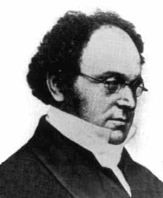{width="90%" fig-align="center"}

[Augustus De Morgan (1806–1871)]{style="display:block; text-align:center; font-size:0.55em; color:#555555;"}
:::
::::

## Teorema das 4 Cores: A Prova

> [**Teorema:**]{.label-thm} Se $G = (V, E)$ é **simples e planar**, então $\chi(G) \leq 4$.

:::: {.columns style="display:flex; align-items:center;"}
::: {.column width="58%"}
- Somente em **1976**, [Appel & Haken]{style="color:#c62828;"} provaram o teorema com **ajuda de computadores**.
- [Primeira vez que um teorema importante é provado dessa forma!]{style="color:#1565c0;"}

::: {.fragment}
- **Ideia:** reduzir o problema a **1936 configurações** e testá-las por computador, usando [**~1200 horas**]{.alert} de computação!
- À mão, estima-se que levariam 100 mil anos, dedicando-se 60h/semana.
:::

::: {.fragment}
- A prova foi simplificada desde então, mas, até hoje, [não existe prova do teorema sem auxílio de computadores]{style="color:#1565c0;"}.
:::
:::

::: {.column width="42%"}
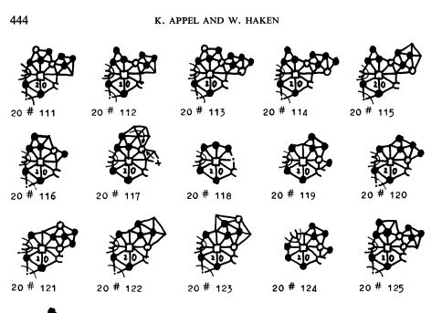{width="100%"}

[Algumas das configurações da prova de Appel & Haken.]{style="display:block; text-align:center; font-size:0.55em; color:#555555;"}
:::
::::

::: notes
1976: O Teorema das Quatro Cores foi finalmente comprovado por Kenneth Appel e Wolfgang Haken na Universidade de Illinois. Usaram mais de 1.200 horas do computador mais rápido que havia para demonstrar a conjectura. Os mais otimistas afirmam que, para que Appel e Haken pudessem provar a conjectura à mão, levariam 100 mil anos, dedicando-se 60 horas por semana.
:::

## Teorema das 4 Cores: Repercussão

:::: {.columns style="display:flex; align-items:center;"}
::: {.column width="62%"}
- Muitos questionaram a **legitimidade** da prova.
  - [O que conta como uma prova válida?]{style="color:#1565c0;"}

<br>

- Computadores se tornaram ubíquos em provas matemáticas: em 2005, a prova foi **verificada formalmente** no assistente de provas Coq.

<br>

- Propulsor do estudo de [Teoria dos Grafos]{style="color:#1565c0;"} ao longo do tempo.
:::

::: {.column width="38%"}
{width="95%" fig-align="center"}

[Kenneth Appel e Wolfgang Haken.]{style="display:block; text-align:center; font-size:0.55em; color:#555555;"}
:::
::::

::: notes
É um dos primeiros casos na história da matemática no qual o computador teve um impacto tão forte: ele permitiu um resultado para um problema que havia sido proposto há mais de um século. O resultado trouxe grande aflição no mundo da matemática, não porque se esperava que o resultado fosse falso, mas porque foi o primeiro caso em que a máquina (em algum sentido) estava batendo o homem.
:::

# Algoritmos de Coloração

## Algoritmos de Coloração: Complexidade

- Como **computar** $\chi(G)$ dado um grafo $G$?
  - Problema [**NP-Difícil**]{.alert}!

. . .

- Como **verificar** se $G$ é $k$-colorível, isto é, se $\chi(G) \leq k$?
  - Problema [**NP-Completo**]{.alert}! (Um dos 21 problemas NP-Completos de Karp.)

::: {style="display:inline-block; border:2px solid #c62828; border-radius:6px; padding:4px 14px; font-size:0.75em; margin-left:2em;"}
[Disciplina de Teoria da Computação II]{style="color:#c62828;"}\
Classes de complexidade computacional
:::

. . .

:::: {.columns style="display:flex; align-items:center;"}
::: {.column width="65%"}
[**Intuitivamente:**]{style="color:#1565c0;"} até onde se sabe, o número de operações para resolver o problema cresce [**exponencialmente**]{.alert} com o tamanho do grafo.
:::

::: {.column width="35%"}
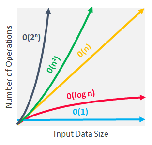{width="85%" fig-align="center"}
:::
::::

## Algoritmos de Coloração: Casos Tratáveis

- Decidir se um grafo é **2-colorível** $\iff$ testar **bipartição**.
  - Pode ser feito em **tempo linear** usando BFS ou DFS.


- Existem fórmulas fechadas para o **polinômio cromático** $P(G, k)$ (o número de colorações de $G$ com até $k$ cores) de:
  - florestas, grafos cordais, ciclos, rodas, escadas.

- Grafos com baixa *branch-width* (dada uma decomposição em ramos):
  - Resolvíveis em tempo polinomial no tamanho do grafo via **programação dinâmica**;
  - Mas exponencial na largura da decomposição.

. . .

> [**Curiosidade:**]{.label-rmk} todo grafo planar tem uma 4-coloração, que pode ser encontrada em tempo $O(n^2)$; mas decidir se um grafo planar é **3-colorível** continua NP-Completo!

## Algoritmos de Coloração Exatos

- **Busca exaustiva** para $k$ cores: testar todas as
  $$ k^n \text{ atribuições} $$
  - Verificar cada atribuição $\to$ impraticável para $n$ moderado. Ex.: $3^{50} \approx 7{,}2 \times 10^{23}$.
  - Para obter o número cromático, é necessário repetir para $k = 1, \ldots, n - 1$.

. . .

- **Programação dinâmica** e limites no número de conjuntos independentes maximais: $k$-colorabilidade em $O(2{,}4423^n)$.
- **Inclusão–exclusão**: $k$-colorabilidade em $O(2^n \, n)$, para qualquer $k$.

. . .

- Algoritmos mais rápidos para casos específicos:
  - 3-colorabilidade: $O(1{,}3289^n)$; 4-colorabilidade: $O(1{,}7272^n)$.
  - 5 e 6 cores: também há algoritmos exponencialmente mais rápidos que o caso geral.
- Melhorias também para famílias restritas (ex.: grafos esparsos).

## Algoritmo Guloso (Não Ótimo)

[**Entrada:**]{.alert} grafo simples $G = (V, E)$ e cores $C = \{c_1, c_2, \ldots, c_k\}$.\
[**Saída:**]{.alert} coloração $f: V \to C$.

::: {.pc-lg}
```pseudocode
#| html-line-number: true
#| html-no-end: true

\begin{algorithmic}
\Procedure{ColoracaoGulosa}{$G=(V,E)$, $C$}
  \State Ordene os vértices $v_1, v_2, \ldots, v_n$ em ordem arbitrária.
  \For{$i = 1$ até $n$}
    \State $j \gets 1$
    \While{algum vizinho de $v_i$ possui cor $c_j$}
      \State $j \gets j + 1$ \Comment{vá para a próxima cor}
    \EndWhile
    \State $f(v_i) \gets c_j$
  \EndFor
  \State \textbf{Retorne} $f$
\EndProcedure
\end{algorithmic}
```
:::

. . .

- Com $k = \Delta(G) + 1$ cores, sempre há uma cor disponível (teorema anterior).
- Fixada a ordem, pode ser implementado em $O(|V| + |E|)$.

## Algoritmo Guloso: Exemplo

Cores, em ordem: $\textcolor{#1565c0}{\mathbf{c_1}}$, $\textcolor{#c62828}{\mathbf{c_2}}$, $\textcolor{#2e7d32}{\mathbf{c_3}}$, $\textcolor{#c17900}{\mathbf{c_4}}$. Ordem dos vértices: $v_1, v_2, \ldots, v_6$.

:::: {.columns style="display:flex; align-items:center;"}
::: {.column width="50%"}
```{=html}
<div style="display:flex; justify-content:center;"><div id="guloso-exemplo"></div></div>
<script>
drawGraph("guloso-exemplo",
  [["v1", 0, 0, "white labeled", "v₁"], ["v2", 110, 0, "white labeled", "v₂"], ["v3", 220, 0, "white labeled", "v₃"],
   ["v4", 0, 100, "white labeled", "v₄"], ["v5", 110, 100, "white labeled", "v₅"], ["v6", 220, 100, "white labeled", "v₆"]],
  [["v1", "v2"], ["v2", "v3"], ["v1", "v4"], ["v2", "v4"], ["v2", "v5"],
   ["v3", "v5"], ["v3", "v6"], ["v4", "v5"], ["v5", "v6"]],
  { scale: 1.7, steps: [
    { "v1": "-white blue" },
    { "v2": "-white red" },
    { "v3": "-white blue" },
    { "v4": "-white green" },
    { "v5": "-white yellow" },
    { "v6": "-white red" },
    // ordem v2, v6, v4, v3, v1, v5: 3 cores
    { "v1": "-blue green", "v2": "-red blue", "v3": "-blue red",
      "v4": "-green red", "v5": "-yellow green", "v6": "-red blue" }
  ] });
</script>
```
:::

::: {.column width="50%"}
::: {style="font-size:0.95em; line-height:1.35;"}
::: {.fragment fragment-index=0}
$v_1$: nenhum vizinho colorido $\to$ $\textcolor{#1565c0}{\mathbf{c_1}}$
:::

::: {.fragment fragment-index=1}
$v_2$: vizinho com $c_1$ $\to$ $\textcolor{#c62828}{\mathbf{c_2}}$
:::

::: {.fragment fragment-index=2}
$v_3$: vizinho com $c_2$ $\to$ $\textcolor{#1565c0}{\mathbf{c_1}}$
:::

::: {.fragment fragment-index=3}
$v_4$: vizinhos com $c_1, c_2$ $\to$ $\textcolor{#2e7d32}{\mathbf{c_3}}$
:::

::: {.fragment fragment-index=4}
$v_5$: vizinhos com $c_1, c_2, c_3$ $\to$ $\textcolor{#c17900}{\mathbf{c_4}}$
:::

::: {.fragment fragment-index=5}
$v_6$: vizinhos com $c_1, c_4$ $\to$ $\textcolor{#c62828}{\mathbf{c_2}}$
:::

::: {.fragment fragment-index=6}
O guloso usou **4 cores**, mas $\chi(G) = 3$! Com a ordem $v_2, v_6, v_4, v_3, v_1, v_5$, ele usa apenas 3.
:::
:::
:::
::::

## Algoritmo Guloso: Qualidade

:::: {.columns style="display:flex; align-items:center;"}
::: {.column width="52%"}
::: {style="font-size:1.05em;"}
- **Sempre existe** uma ordem de vértices que produz uma coloração ótima (com $\chi(G)$ cores) usando o método guloso.

- Por outro lado, o método pode ser **arbitrariamente ruim**:

- [**Exemplo:**]{.label-exmp} *crown graph* com $n$ vértices ($u_i$ adjacente a $w_j$ sss $i \neq j$):
  - É 2-colorível;
  - Mas existe uma ordem que faz o guloso usar $n/2$ cores.

- [**Moral:**]{.alert} a ordem dos vértices é crucial.
:::
:::

::: {.column width="48%"}
```{=html}
<div style="display:flex; justify-content:center; gap:30px;">
<div>
<div id="crown-boa"></div>
<div style="text-align:center; font-size:0.75em;">2 cores</div>
</div>
<div>
<div id="crown-ruim"></div>
<div style="text-align:center; font-size:0.75em;"><span class="math inline">n/2 = 4</span> cores</div>
</div>
</div>
<script>
(function() {
  const crown = (id, left, right, pairs, colors) => {
    const nodes = [];
    left.forEach((k, i) => nodes.push([`n${k}`, 0, 70 * i, `${colors[k]} labeled`, `${k}`]));
    right.forEach((k, i) => nodes.push([`n${k}`, 110, 70 * i, `${colors[k]} labeled`, `${k}`]));
    const edges = [];
    left.forEach(u => right.forEach(w => {
      if (pairs[u] !== w) edges.push([`n${u}`, `n${w}`]);
    }));
    drawGraph(id, nodes, edges, { scale: 1.3 });
  };
  crown("crown-boa", [4, 3, 2, 1], [8, 7, 6, 5], { 1: 5, 2: 6, 3: 7, 4: 8 },
    { 1: "red", 2: "red", 3: "red", 4: "red", 5: "blue", 6: "blue", 7: "blue", 8: "blue" });
  crown("crown-ruim", [7, 5, 3, 1], [8, 6, 4, 2], { 1: 2, 3: 4, 5: 6, 7: 8 },
    { 1: "red", 2: "red", 3: "blue", 4: "blue", 5: "green", 6: "green", 7: "yellow", 8: "yellow" });
})();
</script>
```
[Os rótulos indicam a ordem em que o guloso visita os vértices.]{style="display:block; text-align:center; font-size:0.55em; color:#555555;"}
:::
::::

## Heurística de Welsh–Powell

- [**Ideia:**]{style="color:#1565c0;"} ordenar os vértices por **grau decrescente**: $x_1, x_2, \ldots, x_n$.
- Aplicar a coloração gulosa nessa ordem.
- Garante usar no máximo
  $$ \max_i \, \min\{deg(x_i) + 1,\ i\} \text{ cores.} $$
- Em particular: usa no máximo $\Delta(G) + 1$ cores (no máximo um a mais que o grau máximo).
- Simples, rápido e muito usado na prática.

:::: {.columns style="display:flex; align-items:center;"}
::: {.column width="50%"}
```{=html}
<div style="display:flex; justify-content:center;"><div id="welsh-powell"></div></div>
<script>
drawGraph("welsh-powell",
  [["v1", 0, 0, "white labeled", "v₁"], ["v2", 110, 0, "white labeled", "v₂"], ["v3", 220, 0, "white labeled", "v₃"],
   ["v4", 0, 100, "white labeled", "v₄"], ["v5", 110, 100, "white labeled", "v₅"], ["v6", 220, 100, "white labeled", "v₆"]],
  [["v1", "v2"], ["v2", "v3"], ["v1", "v4"], ["v2", "v4"], ["v2", "v5"],
   ["v3", "v5"], ["v3", "v6"], ["v4", "v5"], ["v5", "v6"]],
  { scale: 1.4, steps: [
    {},
    { "v2": "-white blue", "v5": "-white red", "v3": "-white green",
      "v4": "-white green", "v1": "-white red", "v6": "-white blue" }
  ] });
</script>
```
:::

::: {.column width="50%"}
::: {style="font-size:0.9em;"}
::: {.fragment fragment-index=0}
[**Exemplo:**]{.label-exmp} no grafo anterior, a ordem por grau é $v_2, v_5$ (grau 4), $v_3, v_4$ (grau 3), $v_1, v_6$ (grau 2).
:::

::: {.fragment fragment-index=1}
O guloso nessa ordem usa **3 cores**: ótimo!
:::
:::
:::
::::

#

::: {style="text-align: center; margin-top: 15vh;"}
[?]{style="font-size: 5em; color: #d10000; font-weight: 700;"}
:::
